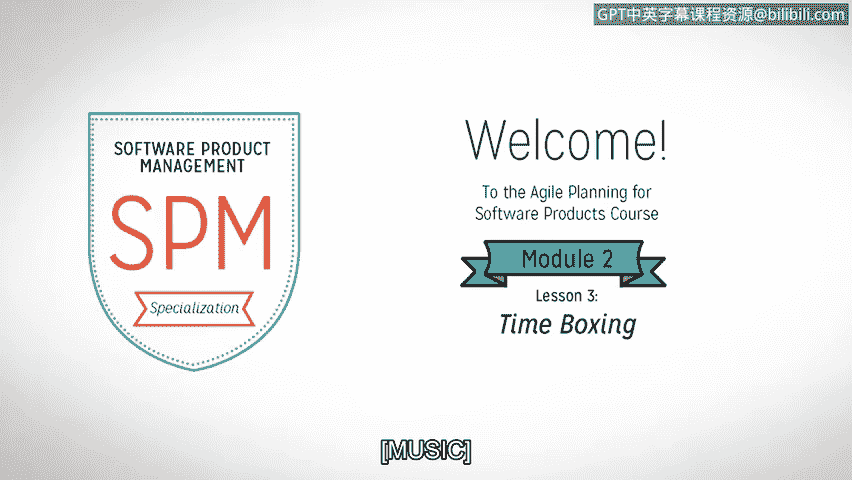
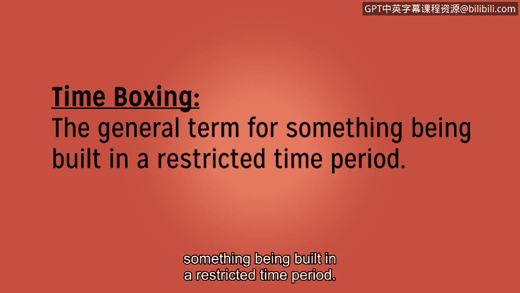
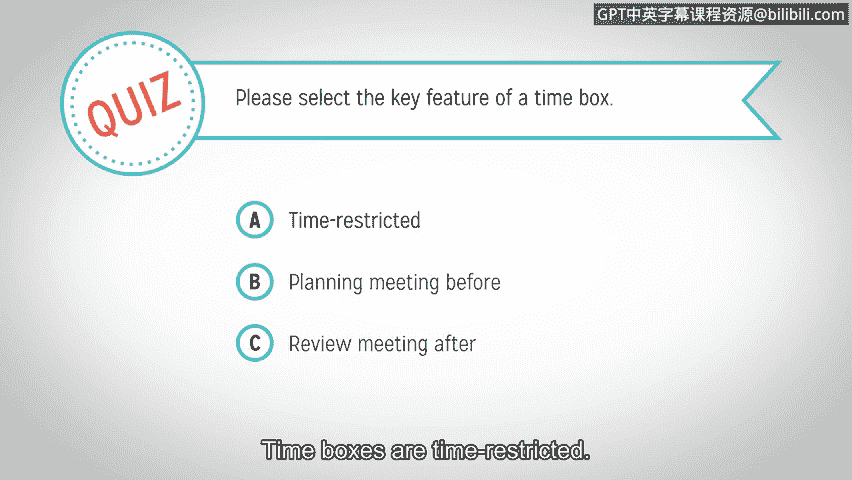

# 艾伯塔大学软件产品管理课程4：《面向软件产品的敏捷规划》：4-2-3：时间盒 📦

在本节课中，我们将要学习一个关键的敏捷规划概念——时间盒。我们将探讨它是什么、为什么重要，以及如何利用它来组织和管理软件开发工作，以确保项目稳步推进。

## 概述

上一节我们介绍了如何利用团队速率来估算项目工作量。本节中，我们来看看为什么在敏捷开发中，我们总是将工作安排在固定的时间段（即“冲刺”）内完成。这个做法的核心理念就是“时间盒”。

## 什么是故事点？ 😡

在深入时间盒之前，我们先简要回顾一下故事点。故事点是用于估算任何给定用户故事所需工作量的相对单位。它们不以时间单位衡量，以避免估算听起来像承诺。你可以通过跟踪团队在一个冲刺内能完成多少工作来确定团队的速率。

## 引入时间盒

你可能会想，如何确保开发过程是有纪律的呢？答案就是时间盒。

时间盒是一个通用术语，指在**受限的时间段内**构建某些东西。你可以为任何活动设置时间盒，从为期四周的Scrum冲刺到半小时的计划会议。

> **时间盒**：将工作安排在**固定长度**的时间段内完成。

以下哪一项是Scrum冲刺所属的广义类别？
A. 时间锁
B. 计划
C. 工作盒
D. 时间盒

**正确答案是 D，时间盒。**

Scrum冲刺被认为是时间盒化的，因为它们被限制在相对较短的开发时间和相对较少的工作量内。

## 如何创建时间盒

要创建一个时间盒，你只需要：
1.  在项目中设定一个**时间段**，工作将在此期间完成。
2.  设定在该时间段内**将完成多少工作**的限制。
3.  在开始时**规划**这些工作。

在Scrum中，冲刺长度通常为两到四周，前后各有计划期和评审期。

## 时间盒的重要性

独自开发产品并跟踪进度，然后根据速率估算项目完成日期是一回事。而为了确保项目按计划进行而规划工作，则是另一回事。

这是因为，如果没有开发目标或里程碑，大多数人往往会比定期规划工作时开发得更慢。想想看，如果你给自己一项任务，却没有明确的完成截止日期，那么很容易分心去做不必要的工作。由于时间看似灵活，工作范围往往会扩大，这是一种风险。

然而，如果你将工作规划在足够小的时间剂量内，就很容易看清下一个目标是什么，以及到那时需要完成什么。当你使用时间盒时，你将一定量的工作放入**特别规划的、固定长度的时间段或“盒子”**中。你取项目结束时需要完成的工作的一个子集，并将其划分为可管理的块，放入这些盒子中。

## 时间盒的延伸价值

时间盒的妙处在于，除了以理性、可持续的方式组织工作外，你现在还可以定期从工作中学习。许多方法允许你规划出评审时间。你可以利用这个评审时间来回顾你的进展，然后利用获得的见解来为下一个时间盒制定计划。这对时间盒原则本身来说并非关键，但却是该原则的一个宝贵延伸。

时间盒让你有机会看到工作将如何在项目中划分。即使你不知道具体在什么时间会完成什么，有一个大致的想法仍然是很有用的信息。

## 实现可发布的产品

你不必等到项目最后才拥有一个可发布的产品。它可以分阶段发布。事实上，在每个时间盒结束时，你都应该拥有一个**可以潜在地作为产品发布的可工作软件**。这能保持开发人员的士气，并确保即使资源耗尽，你在项目结束时仍然拥有一个有形的产品。

请选择时间盒的关键特征。
A. 时间受限
B. 之前有计划会议
C. 之后有评审会议

**正确答案是 A，时间盒是时间受限的。**

> 时间盒化的工作可以在前后安排计划和评审会议，但这并不是该概念本身的关键，因此时间盒只是一种将你的工作计划分解为可管理块的方法。

## 总结

本节课中，我们一起学习了时间盒的概念。时间盒是一种将工作安排在固定时间段内完成的规划方法，它有助于保持开发节奏、控制范围蔓延，并允许团队定期评审和调整。它易于实施，并能显著提高项目成功的几率。

在下一课中，我将讨论一种流行的可视化项目计划的方法——燃尽图。让我们继续学习。