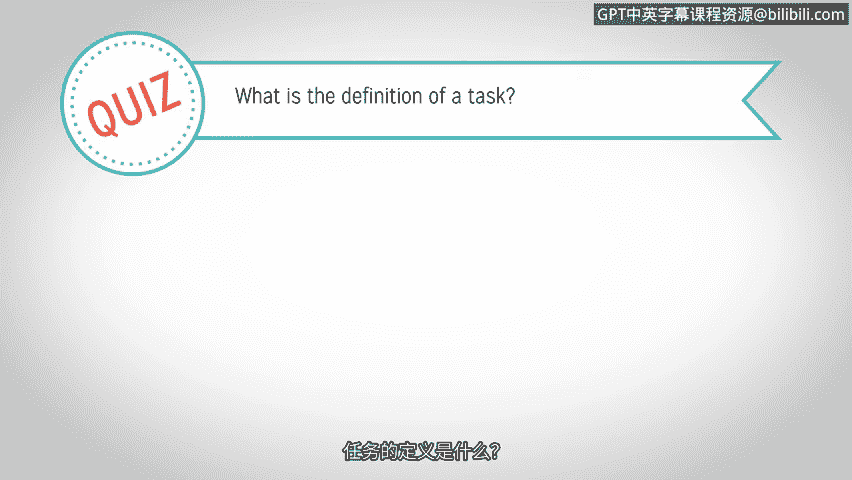
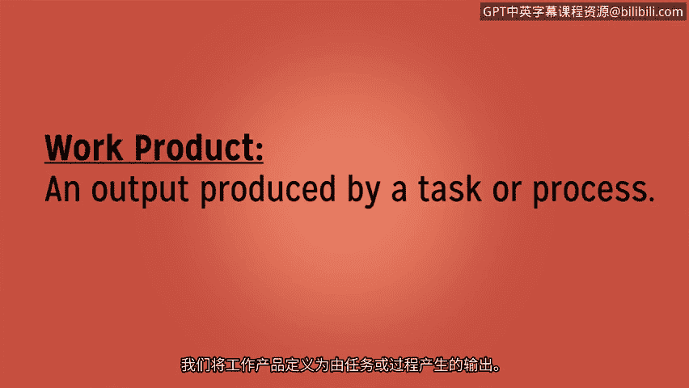
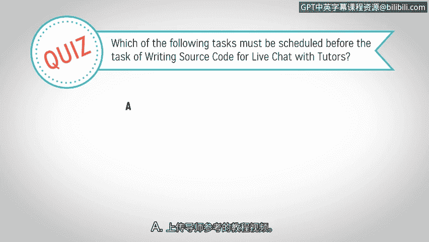

# 艾伯塔大学软件产品管理课程4：《面向软件产品的敏捷规划》｜agile-planning-for-software-products｜ - P3：2_第4.1.1节 计划简介.zh - GPT中英字幕课程资源 - BV14w411a7jH

🎼。😊，Hello and welcome to Agile Planning for softwareftware Products。In this course。

 we will be covering strategies and techniques for planning your software projects。

These techniques will make your project more adaptable to change since they are aligned with the agile manifesto。

The key to planning a software project is to break the workload into smaller， more manageable tasks。

We will begin this course by understanding how to describe and organize tasks at a granular level。

Followed by some time focusing on how to break down larger activities。

You will also cover how to create time and work estimates so that you can accurately schedule the needed work。

There are many ways that you can schedule a software project。

We will cover how to plan your project both at the release level and the iteration level。

A release is where you are delivering your product to be ready for the market。

A release normally consists of iterations。You use a release plan to plan your project as a whole。

This includes deciding which requirements will get completed in each iteration。

You use your iteration planning to plan the tasks that will be completed in a certain iteration。

You are going to learn release planning techniques such as Gantt charts and release plans。

You will also learn iteration planning techniques such as pert charts， CPM charts。

 and iteration plans。We will also be covering all of these techniques in detail throughout this course。

You will also cover risk planning。As mentioned in the introductory course。

 risk planning is an important part of software planning。

There are many risks that can arise with software development。

 so you need to be prepared for these risks to avoid negative impacts on creating and supporting your product。

Let's take a moment and see what you recall from the previous courses。

In the course on software processes and Agile practices， we talked about the term tasks。

What is the definition of a task？

A， a duty that a person takes on or plays。B， a small， manageable step of a project to be completed。C。

 an output produced by a software process， or D， an internal checkpoint to measure progress。

In the course on software processes and Agile practices， we define a task as a small。

 manageable step of the project to be completed。Therefore， B is the correct answer。

Answer A defines a role， answer C defines a work product， and answer D defines a milestone。

These are all terms that we are about to cover in more detail。

We are going to start by examining the terms you just saw in the last quiz。

 as well as introduce some new terms that we will use in this course。Let's start with the term task。

A task is defined as a small， manageable step of a project to be completed。

Tasks are the core of a project。Everything that occurs in a project can be broken down into tasks。

We will be talking about how to break down a project into tasks later in this module。

You are going to use tasks frequently in planning to create estimates and schedules for your project。

Next， let's look at the term role。We define the term role in the course on software processes and Agile practices。

A role is a duty that a person takes on or plays。Examples of role are a programmer， a tester。

 a designer， a client， and a product manager。Rules perform tasks， for example。

 a programmer may take on the task of writing source code for a feature。

The term work product was covered in the course on software processes and agile practices。

We define a work product as an output produced by a task or process。

Tasks do not only produce work products as outputs， they also use work products。

An output work product that was produced in one task could act as an input work product to be used in a subsequent task。

Let's look at an example of this。Let's say that a programmer role took on the task of writing tests for a specific feature。

That task produces a work product of tests for that feature。

Those tests are an input work product for the task of executing tests。

Since this task of executing tests requires that tests be written beforehand。

As you saw when we talked about work products， the task of executing tests is dependent on the task of writing tests。

 since the output work product of one task is an input work product for another。

You will need to keep these dependencies in mind when you are planning so that you are scheduling your tasks in a logical order。

You are working with a development team that is creating a website which allows students to ask homework questions and receive help from live tutors。

Students are also directed to tutorials and links to resources。You are scheduling tasks。

 you come across the task， write source code for live chat with tutors。

Which of the following tasks must be scheduled before the task of writing source code for live chat with tutors？

A， upload tutorial videos for tutors to reference。

B， conduct acceptance tests for live chat with tutors。C， design the Live chatt tool。

 or D employ tutors to work on live chat。Uploading videos is a task that can be implemented a lot later in development。

Employing tutors would be dependent on the live chat working。

 so it would not be scheduled before this task。 therefore， answers A and D are incorrect。

Answer B is close， but also incorrect。Conducting an acceptance tests depends on source code being written。

Writing source code for this feature must be scheduled before the task of conducting acceptance tests。

The feature needs to be designed before the programmers can start programming。Therefore。

 answer C is correct。The task of designing the live chat must be scheduled before the task of writing source code for the live chat。

