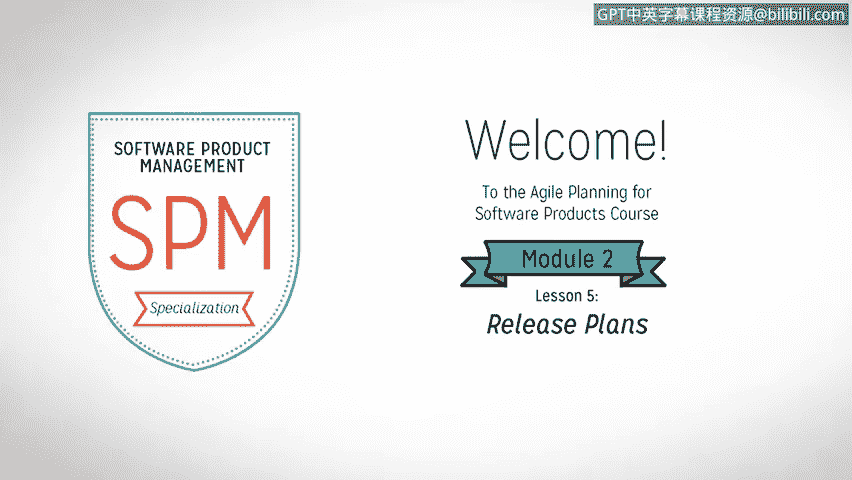
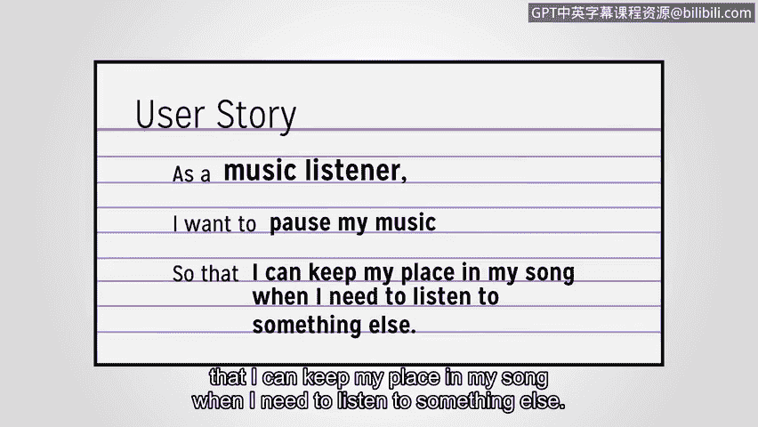
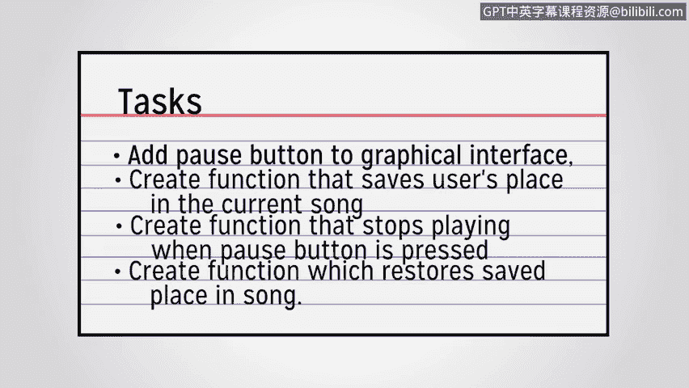
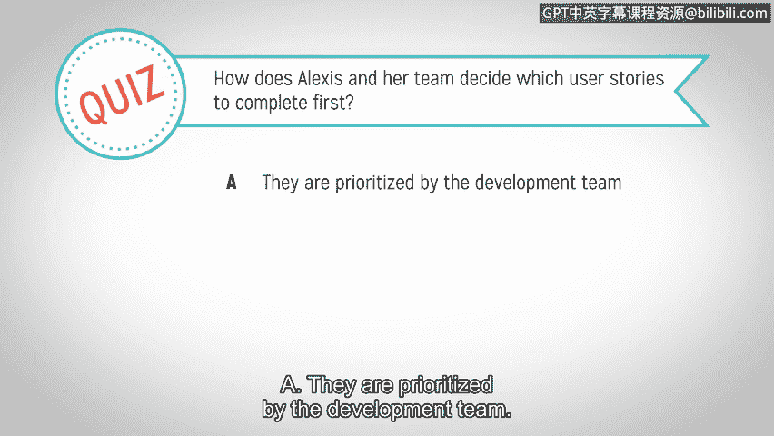
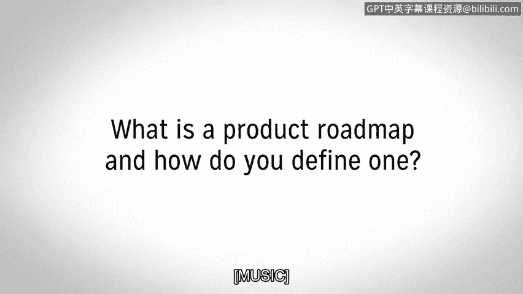
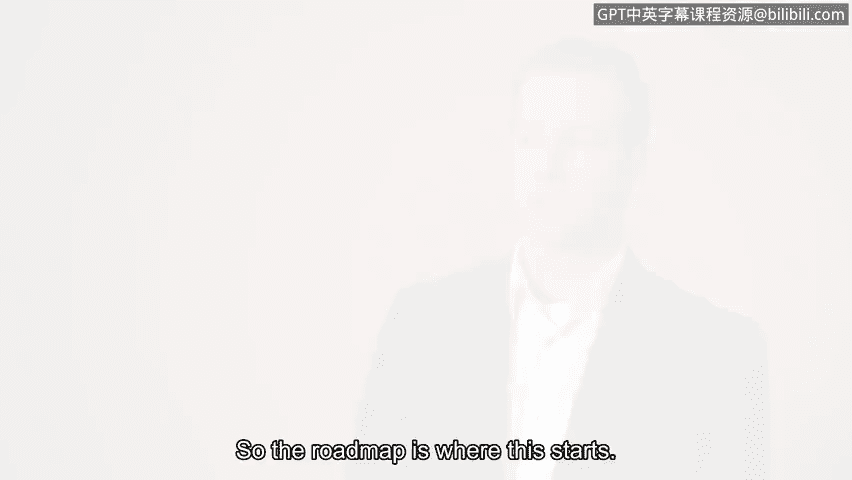
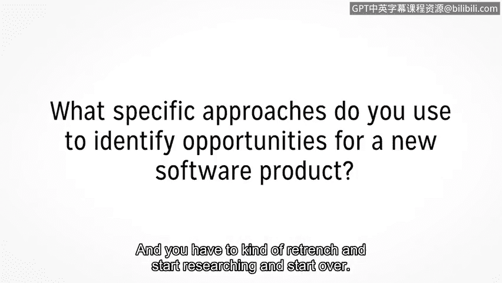

# 艾伯塔大学软件产品管理课程4：《面向软件产品的敏捷规划》｜agile-planning-for-software-products｜ - P40：12_01_4-2-5-release-plans.en_subtitled - GPT中英字幕课程资源 - BV14w411a7jH

🎼。😊。

Welcome to the final lesson of this module。In the last lesson。

 I introduced the Gt chart as a tool for planning your projects。

It's a great way to visualize your project and see what will get done when。When I talked about GNant。

 I also mentioned that it could be used to plan both at the iteration and the release level。

This is what is called two level planning。Iteration planning is fine grained。

 dealing with tasks as the pieces of work to do。Release planning is more coar grained。

 dealing with user stories as the pieces of work。In either case。

 the notion of an iteration or sprint is important。I talked in a previous lesson about time boxing。

A sprint is a small， fixed length time box into which the work is organized。In this lesson。

 I'm going to build up the concept of release planning。In Scrum。

 we have timebox iterations called sprints。At the beginning of a sprint。

 there is a sprint planning event where an iteration plan is created。In iteration plan。

 developer tasks are scheduled to be completed within the sprint。

These tasks are listed on the sprint backlog。Tasks are self assigned by developers before the work begins。

At the end of a sprint， there's also a sprint review event。

This is when the working software is shown to the client or the product owner。

Working software should ideally be releasable at the end of each sprint。😡，Also。

 iteration planning is very short term， so release planning is used to determine which user stories should be completed and released by the end of each sprint for the next few sprints。

The user stories come from the product backlog and are scheduled into the upcoming sprints based on their priority。

Naturally， you begin with release planning to place user stories among sprints before starting the first sprint and its iteration planning。

Say you have a user story like as a music listener。

 I want to be able to pause my music so that I can keep my place in my song when I need to listen to something else。

This is way too big for a developer to just do。In order for this to become more manageable。

 you have to turn the story into a set of tasks。These tasks should align to what a single developer is capable of programming in a few hours or so。

With this in mind， a few tasks you might create to manage this user story could be。

Add a pause button to the graphical interface。Create function that saves users place in the current song。

Create function that stops playing when pauseuse button is pressed。

And create function which restore a safe place in song。

All of these tasks are actionable items that a developer might create。

They all contribute to the overall completion of the user' story from which they were born as well。

In release planning， how do you make sure that you're planning the right work to be done at the right time？

Which user story should be released and reviewed by the product owner or client in which sprint？

This is really an issue of priorities。I talked about prioritizing user stories on the product backlog in the client needs and software requirements course。

A release plan is built by taking user stories from the product backlog and distributing them throughout the sprints。

There should be a logic to how user stories are distributed among the sprints。Otherwise。

 a haphazard accumulation of user stories may result in disorganized sprints。To begin with。

 the backlog from which you're drawing your user stories should have been prioritized by your product owner or your client。

You'll have the top priority user stories assigned a must do， the medium priority ones， a should do。

 and the low priority ones a could do。What you end up with is a good idea of what your client views as a priority before moving into development。

Your prioritized user stories are then taken from the top of the priority list and distributed throughout your release plan into sprints。

Until each sprint is filled with an appropriate amount of work。

An appropriate amount of work here is a little tough to get right。

The best way to know how much work is appropriate is through experience and data。

The better your team gets at estimating work， the more you will be able to know how much they can get done in a given amount of time。

Knowing the amount of work your team can complete in a sprint and the amount of time estimated for each user story。

 you can then fill in the time you have based on user story estimates until you can't fit any more work in any of your sprints。

If done well， you end up with a reasonably accurate view of how your product should look by the end of a few upcoming sprints。

This is a great way to set expectations with your product owner or client and boost your developer's morale。

Everyone likes to see progress and a vision for the future。

Release plans are a fantastic way to give them that vision。

Alexis is a software product manager working with her development team to plan her project。

They are creating a release plan and are choosing user stories to include in their first sprint。

How do Alexis and her team decide which user stories to complete first。A。

 they are prioritized by the development team。

B， they are assigned at random to avoid bias。C， they are prioritized by the client。Or D。

 they are prioritized by the users。In Agile， user stories are prioritized by the client or in Scrum the product owner。

So a release plan should reflect these priorities。 therefore， the correct answer is C。

Release planning is a valuable technique for your tool box。It's not only a fantastic planning piece。

 but it also serves as a morale booster。When your developers can see their work in context。

 it's easy for them to keep motivated。Let's hear how industry professionals manage long term planning。

🎼。😊，🎼不。🎼。

So a roadmap is a strategic document that charts the course of our product or service and a roadmap is one of the most important tools that a product manager can use because it helps get。

alignment between different groups that may seem to have disparate views on what should be done。

 so developing one and defining one。Is a difficult task and it can be quite time consuming but there's a lot of research。

 a lot of talking and conferring with different people and making sure that their perspectives are heard and then the roadmap itself I look at three areas。

 I look at current development， I look at nearterm development and I look at future so with current what are we working on now it's quite concrete and specific and as we move towards the future it's more abstract and gives us more room to change when we need to。

🎼And this document is a living document， we update it when we need to if there's very good reason either technical or business or market reasons to change as we learn more information。

 but it's something we try to stick to to help create the context around what are we building so how do we solve a problem or set of problems for particular users What's our diversification how are we different from other people and I share this and make sure that it's visible and it helps frame our planning if we're on an agile team。

 we're planning for sprints， every sprint， we look at the roadmap and make sure what we're doing fits that type of or fits the goals of the roadmap。

🎼，🎼，So the roadmap is where this starts so when I'm creating a roadmap it's a very collaborative thing I have to get everybody on board and agree with it and I kind of need to throw in a little bit for everyone so that they can identify with it and they feel like they've been heard and their perspective is going to be realized in the product So one of the things I push really hard on is differentiators a lot of people build products that are copycats of others and you put an enormous amount of resources into something and you go talk to your friend over a coffee and say。

 oh， we built this thing and they'll say well。

I'm using this competing offering how are you different and then you start talking oh we're using this latest JavaScript framework and using this database and we're using no and their eyes roll back in their sockets and they don't care so a differentiator is really important so I look at sort of three areas table stakes is one so what are the minimal things that we need to be able to provide to just even be taken seriously in this area of the market then the next thing is the differentiator we what do we do that's different from everyone else。

🎼And are we making sure that we're enhancing that and our features are adding features that are part of the differentiator。

 And then the other thing I like to call tiny moments of awesome So little delighters。

 So I want to make sure when we're building things that we sprinkle in some some shortcuts some fun things something that works in context that when someone's using the software they get a little surprise or their friends says oh did you know if you hold down if you tap on this one part of the screen and and you hold down the button。

 this cool thing happens No， I didn't know that and it just it makes things a little bit more interesting and gives them a little bit of a feeling a little bit of a bright feeling so this tiny moment of awesome So those are three areas that I really focus on and a lot of technical teams will get focused and work towards a solution and visionaries are thinking five years ahead So they will often come up with ideas you know you often joke I'll tease some of my CEO friends that when they come in with a new。

After being on a trip that they read it in magazine on the plane， you know。

 so a b of what happens here is making sure we're sticking to the roadmap and managing the queue and so I'll often spend time。

🎼With the technical team making sure that we're delivering against the roadmap。

 but I'll also spend time with the visionaries to let them spitball and brainstorm ideas we may or may not include and then you have a bit of a process in place if you have to change gears。

 you know CEO or a project sponsor can always veto but I let I warn them of what are the consequences of that and you don't want to change too often but I put in a process to override if we need to change put in a process for veto because a lot of visionaries have't gut feel and they're right more often than not。

 so managing that focusing on the roadmap and protecting the team from sort of from distraction from people with ideas that may or may not be included in the short term is a really important part of making sure that you're building what you need to build。

I'll look at market， I'll look at what's the team doing。

 I'll look at feedback from important stakeholders and on the whole you kind of get a sense from looking at a bunch of little things you kind of get a sense at the larger picture we need to change and then sometimes there's just something that's so disruptive either a big customer or an important customer has a concern that really needs to be addressed or someone else has come up with something and disrupted the market either there's an economic force like a recession or a commodity price change or there's some world event that can throw all of us for a loop and you have to kind of retrench and start researching and start。

Well， personally the market intelligence is an ongoing thing。

 so you look at market intelligence from project to project。

 but I also look at it in the larger view and from a more global view。

 so having an understanding of what technology capabilities are out there， what's popular。

 what are people interested in， what kinds of problems are people solving。

 and then the biggest thing， the key is going out there and finding。

🎼Problems that people need to have solved that we can address with the technology that's available。

 So talking to people and observing them a lot of times people think that you just have to ask customers to tell you what to build。

 but they don't always have the vocabulary or they may have the wrong idea。

 they may say I want you to build this but when you watch them there's another gap there。

 So when you point out that there's a gap and tell them that it can be solved with technology。

 they're often really overwhelmed by that So it's a bit of research and just getting out there and seeing what problems need to be solved I have a colleague here in town Danash who's a product manager Danshavany and he says he's always on the hunt for killer problems and they may be small problems seen like small problems to people but when people have problems that can be solved by technology it's a really great feeling when you see that fit where aha we know how to solve that for you。

 we can make your life easier。And that's the end of this module。 I covered it a lot。 So let's recap。

In the first lesson， I introduced the concept of story pointss。

I showed you how story pointss are a way to estimate the size of your user stories without turning those estimates into commitments。

Then I talked about velocity。 I showed how you can take completed user stories and track the pace of your team based on the work they've completed in each sprint。

I also showed that this pace can be used to forecast what they'll be able to get done in the next sprint using velocity estimates。

I then dove into the concept of time boxing and how organizing your work into small。

 fixed length chunks of time can help you to increase your odds of project success。After that。

 I introduced a tool for visualizing your plans called the GAt chartt。Then in this lesson。

 I introduced release planning。It's a way for you to plan your projects at the broad level。

 assigning user stories to plan sprints within your project。

Using the knowledge you gain in this module， you could run a pretty well organized software project。

 But that's on everything。 There is so much more to know and discover。😊，In this module。

 he learned how to plan across sprints。In the next module。

 Morgan is going to dive into more detail on how you can plan within a sprint。

She's looking forward to showing you and we really hope to see you there。

