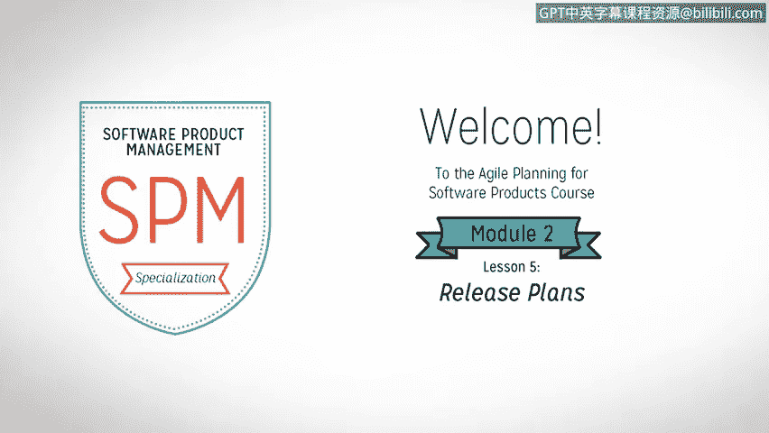
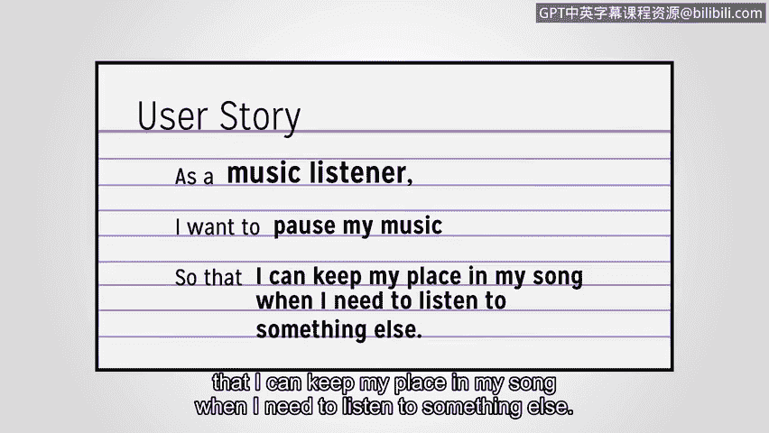
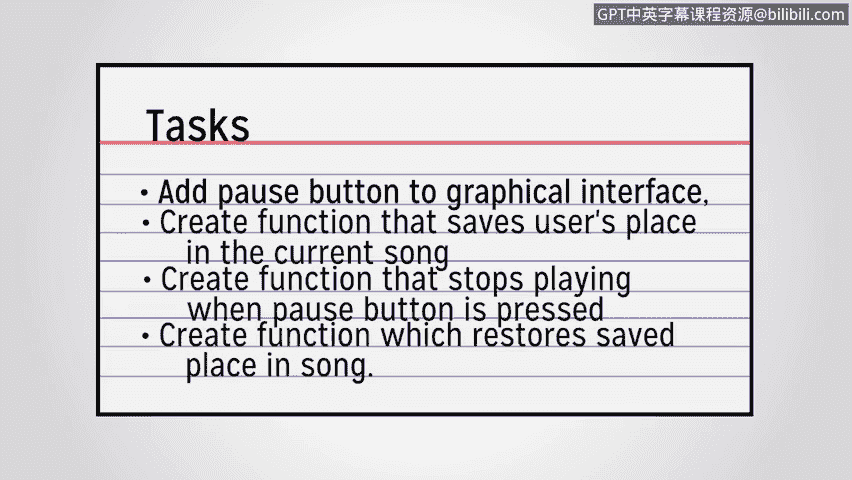
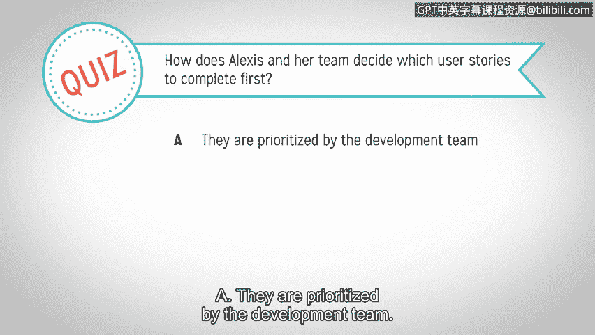
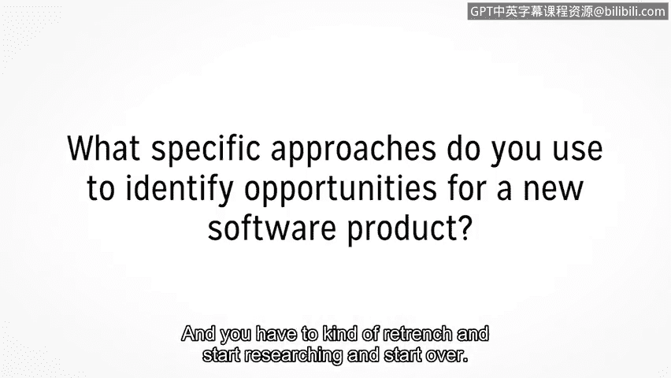

# 艾伯塔大学软件产品管理课程4：《面向软件产品的敏捷规划》：4-2-5：发布计划

## 概述
在本节课中，我们将要学习敏捷规划中的**发布计划**。发布计划是一种高层次的项目规划方法，用于将用户故事分配到项目中的各个冲刺里，从而为团队和客户描绘出清晰的产品开发路线图。

---

欢迎来到本模块的最后一课。在上一课中，我们介绍了**甘特图**作为项目规划的工具。它是一种可视化项目进度、明确工作何时完成的好方法。在讨论甘特图时，我也提到它可以用于**迭代层面**和**发布层面**的规划。这被称为**两级规划**。

迭代规划是细粒度的，处理的是具体的**任务**。发布规划则是粗粒度的，处理的是**用户故事**。在这两种情况下，**迭代**或**冲刺**的概念都非常重要。我在之前的课程中讨论过**时间盒**。冲刺是一个小的、固定长度的时间盒，工作在其中被组织起来。

本节中，我们将逐步构建发布计划的概念。

---

## 什么是发布计划？
在Scrum中，我们有被称为**冲刺**的时间盒迭代。在每个冲刺开始时，会有一个**冲刺规划会议**，用于创建迭代计划。在迭代计划中，开发任务被安排在这个冲刺内完成。这些任务被列在**冲刺待办列表**上。任务由开发者在工作开始前自行认领。

在每个冲刺结束时，还会有一个**冲刺评审会议**。这时，可工作的软件会展示给客户或产品负责人。理想情况下，每个冲刺结束时产生的软件都应该是**可发布的**。

然而，迭代规划是短期的。因此，**发布计划**用于确定在接下来几个冲刺中，哪些用户故事应该在每个冲刺结束时完成并发布。用户故事来自**产品待办列表**，并根据其优先级被安排到即将到来的冲刺中。

自然地，你需要在开始第一个冲刺及其迭代规划之前，先进行发布计划，将用户故事分配到各个冲刺中。

---

## 从用户故事到任务
假设你有一个用户故事：“**作为一个音乐听众，我希望能够暂停我的音乐，以便在我需要听其他东西时能保持在我歌曲中的位置。**”

这个故事对单个开发者来说太大了，无法直接完成。为了使其更易于管理，你需要将这个故事转化为一系列**任务**。这些任务应该与单个开发者在几小时内能够编程完成的工作量相匹配。

基于这个思路，为管理这个用户故事，你可能会创建以下几个任务：
*   在图形界面添加一个暂停按钮。
*   创建保存用户在当前歌曲中位置的功能。
*   创建当按下暂停按钮时停止播放的功能。
*   创建恢复歌曲中保存位置的功能。

所有这些任务都是开发者可以创建的可执行项。它们共同促成了其来源用户故事的总体完成。

---

## 如何制定发布计划？
在发布计划中，你如何确保在正确的时间规划了正确的工作？哪个用户故事应该在哪个冲刺中发布并由产品负责人或客户评审？

这实际上是一个**优先级**问题。我在《客户需求与软件需求》课程中讨论过产品待办列表中用户故事的优先级排序。

发布计划是通过从产品待办列表中取出用户故事，并将它们分配到各个冲刺中来构建的。用户故事在冲刺间的分配应该有其逻辑。否则，用户故事的随意堆积可能导致冲刺混乱无序。

首先，你从中提取用户故事的待办列表应该已经由你的产品负责人或客户排定了优先级。你会将最高优先级的用户故事标记为“**必须做**”，中等优先级的标记为“**应该做**”，低优先级的标记为“**可以做**”。这样，在进入开发之前，你就能很好地了解客户眼中的优先级。

然后，从优先级列表的顶部开始，将已排定优先级的用户故事分配到你的发布计划中的各个冲刺里，直到每个冲刺都填充了适量的工作。

“适量的工作”在这里有点难以准确把握。了解多少工作量合适的最佳方式是通过**经验和数据**。你的团队在估算工作方面做得越好，你就越能知道他们在给定时间内能完成多少工作。

知道了你的团队在一个冲刺中可以完成的工作量以及每个用户故事的估算时间，你就可以根据用户故事的估算来填充可用时间，直到你的任何一个冲刺都无法容纳更多工作为止。

如果做得好，你最终会对接下来几个冲刺结束时产品应该是什么样子有一个相当准确的看法。这是与你的产品负责人或客户设定期望、并提升开发团队士气的好方法。每个人都喜欢看到进展和对未来的愿景。发布计划是提供这种愿景的绝佳方式。

---

## 小测验
Alexis是一名软件产品经理，她正与她的开发团队一起规划项目。他们正在创建一个发布计划，并选择要包含在第一个冲刺中的用户故事。Alexis和她的团队如何决定先完成哪些用户故事？

A. 由开发团队确定优先级。
B. 随机分配以避免偏见。
C. 由客户确定优先级。
D. 由用户确定优先级。

在敏捷中，用户故事由客户或在Scrum中由产品负责人确定优先级。因此，发布计划应反映这些优先级。所以，正确答案是 **C**。

---

## 发布计划的价值
发布计划是你工具箱中的一项宝贵技术。它不仅是一个极好的规划工具，还能起到**鼓舞士气**的作用。当你的开发者能在整体背景下看到他们的工作时，他们很容易保持积极性。

让我们听听行业专家如何管理长期规划。

> **行业专家观点：产品路线图**
>
> 路线图是一份战略文件，规划了我们产品或服务的发展路线。它是产品经理可以使用的最重要的工具之一，因为它有助于在不同团队之间达成一致，这些团队可能对应该做什么持有不同的看法。
>
> 制定和定义路线图是一项艰巨的任务，可能相当耗时。它需要大量的研究、与不同人员的交谈和协商，确保他们的观点被听取。对于路线图本身，我关注三个领域：**当前开发**、**近期开发**和**未来**。当前开发非常具体，而随着我们走向未来，它变得更加抽象，为我们提供了更多根据需要改变的空间。
>
> 这份文件是**活的文档**，当我们获得更多信息，有充分的技术、业务或市场理由时，我们会更新它。我们努力坚持它，以帮助构建我们正在建设的内容的背景：我们如何为特定用户解决问题？我们的差异化是什么？我们与其他人有何不同？
>
> 我分享这份路线图并确保其可见，它有助于构建我们的规划框架。如果我们是一个敏捷团队，我们为冲刺做规划，每个冲刺我们都会查看路线图，确保我们所做的工作符合路线图的目标。
>
> 在创建路线图时，我关注三个领域：
> 1.  **基本要求**：为了在这个市场领域被认真对待，我们需要提供的最低限度的东西。
> 2.  **差异化**：我们做的与其他人不同的地方。我们要确保我们正在增强这一点，并且我们添加的功能是差异化的一部分。
> 3.  **微小而精彩的瞬间**：一些令人愉悦的小惊喜。当用户使用软件时，他们会得到一点惊喜。
>
> 管理路线图，保护团队免受那些可能不会在短期内被纳入的想法干扰，是确保你正在构建所需内容的重要组成部分。

---

## 总结
本节课中，我们一起学习了**发布计划**。发布计划是一种高层次的项目规划方法，用于将用户故事分配到项目中的各个冲刺里。我们了解到，制定发布计划的关键在于依据客户或产品负责人设定的**优先级**，从产品待办列表中提取用户故事，并根据团队**估算的能力**将其分配到冲刺中。一个好的发布计划不仅能有效规划工作，还能为团队和客户提供清晰的**产品愿景**，从而提升团队士气并管理客户期望。

在本模块中，我们学习了如何在多个冲刺间进行规划。在下一个模块中，Morgan将深入探讨如何在单个冲刺内进行更详细的规划。我们期待在那里见到你。