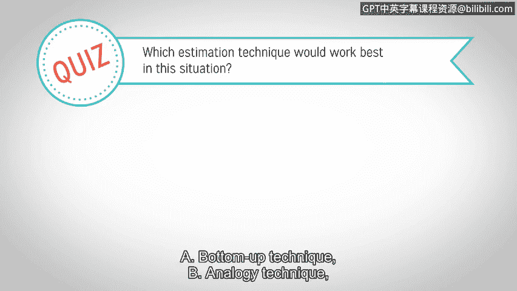

# 艾伯塔大学软件产品管理课程4：《面向软件产品的敏捷规划》｜4.3.1：任务时间估算

在本节课中，我们将要学习软件项目中的任务时间估算。我们将探讨估算的重要性、估算准确性随时间变化的规律，并介绍几种实用的估算技术。

## 概述：估算与不确定性

估算是一个在本系列课程中频繁讨论的话题。你已经了解到，做出良好的估算对于制定时间表和达成目标至关重要。现在，是时候获取一些创建估算的实际经验了。

我们将从整体审视项目开始，了解估算在何时何地最为准确。接着，我们将探讨几种不同的估算方法。你可以采用多种途径，本节课将引导你了解其中一部分。

## 不确定性锥

首先，我要向你介绍“不确定性锥”。在项目开始时不确定性很高，而在项目结束时不确定性很低，这并不令人意外。这是我们在讨论不确定性空间时曾提及的内容。

当不确定性很高时进行估算，你的估算很可能极不准确。随着项目推进，需求和发展节奏变得更加清晰，做出准确估算会容易得多。这正是“不确定性锥”所展示的。

在我们更详细地讨论不确定性锥之前，先来看看你是否能解读图表所展示的信息。

在不确定性锥图表上，当垂直区间最大时，变异性最高。随着时间的推移，变异性越来越小。因此，位于项目起始点的圆圈A具有最高的变异性。此时的估算可能比实际小四倍或大四倍。所以，答案A是正确的。

在Y轴上，我们表示的是变异性。这是估算可能变化的倍数。区间越大，变异性越高。从图表中可以看到，随着时间沿X轴推进，我们的变异性变得越来越小，从而形成了一个锥形，因此得名“不确定性锥”。

那么，如何将其应用于项目呢？随着项目进行，不确定性得以解决，因此估算的变异性变小。

你从初始产品定义开始一个项目。这是产品初步想法形成的阶段。你脑中有一个大致概念，但没有真正的解决方案。此时的变异性相当高。如果你在这个早期阶段进行估算，可能需要一个很大的范围。

当你进展到需求启发活动时，变异性变小。此时，产品的特性更加明确，因此更容易做出准确估算，你的估算范围也可以更小。

随后，你制定潜在方案，变异性进一步减小。一旦架构设计和最终的详细设计完成，变异性就小得多，你的估算也更加可靠。

你可以利用这些变异性来为项目进行估算。根据你在项目时间线中所处的位置，可以将估算乘以相应的变异性倍数，以获得更准确的范围。

例如，假设你猜测一项任务需要4小时完成。如果你正处于需求启发活动阶段，图表估计变异性倍数为2和0.5。那么，你可以将4小时的猜测乘以2和0.5，得到完成该任务的估算范围为2到8小时。

## 估算技术

到目前为止，你已经了解了估算是什么、如何使用以及何时变异性最小。但你还没有学习如何进行估算。现在让我们来探讨这一点。

你可以采用多种方法来生成估算。我们之前说过，估算应该是不可协商的，并且应基于某种数据。

以下是几种估算技术：

**自下而上技术**

在这种技术中，你需要将项目分解为小的、可管理的任务，就像我们在本课程前面创建工作分解结构时所做的那样。估算小任务比估算整个项目更容易、更准确。

一旦分解了任务，你就为每个任务生成一个估算。然后将它们全部加起来，这就成为了你的项目估算。这种方法有优点也有缺点。该方法基于小任务的估算，这些估算的不确定性应该较低。然而，这些任务的估算可能并非基于任何实际数据。你可能希望将此技术与另一种技术结合使用，以获得最准确的结果。

**类比技术**

在这种技术中，你利用类似项目的经验进行估算。当然，如果你和你的团队已经完成过一个类似的项目，这种技术是适用的。你需要确保工作流程和所使用的技术与之前使用的相似。

这种技术的优点是易于使用和理解。如果团队完全相同，并且项目与你过去见过的项目相似，它还可以基于团队完成的工作提供准确的结果。但这种情况很少见。每个软件项目都有独特的需求，随之会产生独特的问题。因此，这种技术肯定有许多缺点。

**专家技术**

在这种方法中，你汇集来自多个估算者的估算。如果你让多个估算者专门审视你的项目，这种技术可能成本很高。然而，你会得到更准确的结果。如果你使用的是专家对类似项目的估算，请注意你的项目可能有其独特的问题，因此不会与估算完全吻合。

## 技术应用场景分析

假设你是一名软件产品经理，正在开发一个小的移动应用程序。你刚刚完成了一个类似的移动应用程序项目。你之前项目中的两名开发人员也在这个项目的团队中。你总共有八名开发人员。你已经创建了工作分解结构。你有一些来自专家的估算，但它们是基于一个更大的移动应用程序。你需要为你的项目创建估算。你的客户希望在一小时内得到估算，因此你只有时间完成一种技术。

在这种情况下，哪种估算技术效果最好？

理想情况下，你应该能够利用所有可用的信息来生成准确的估算。如果你在这种情况下只能选择一种技术，最好的选择是使用自下而上技术。因此，答案A是最佳答案，因为你已经有了可供使用的工作分解结构。

类比技术在这里并不理想，因为团队与你之前的团队有很大不同。新开发人员开发这个产品可能需要更多或更少的时间。由于专家的估算是基于一个更大的移动应用程序，它们可能对你来说不准确。而你绝不应该仅仅猜测估算。

## 总结

本节课中，我们一起学习了软件项目中的任务时间估算。我们首先通过“不确定性锥”理解了估算准确性随项目进展而提高的规律。然后，我们探讨了三种主要的估算技术：**自下而上技术**、**类比技术**和**专家技术**，并分析了它们各自的优缺点及适用场景。记住，良好的估算应基于数据，并结合项目所处的具体阶段和可用信息来选择最合适的技术。