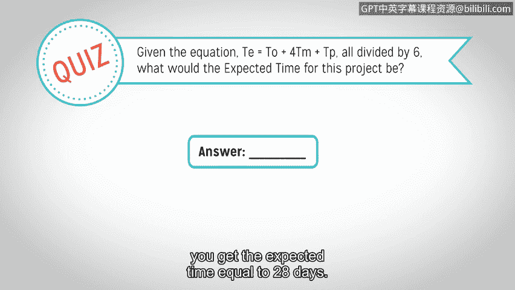

# 艾伯塔大学软件产品管理课程4：《面向软件产品的敏捷规划》｜agile-planning-for-software-products｜ - P42：14_02_4-3-1a-estimating-task-time.en_subtitled - GPT中英字幕课程资源 - BV14w411a7jH

Finally， one other approach that you can take would be to calculate better estimates using a formula。

Because of variability， an estimate should really be arranged， not just a single number。

This formula derives that range。This formula is based upon the most probable time。

 which we will call TM。It also uses the optimistic time， which we will call TO。

And the pessimistic time， which we will call TP。The most probable time or TM is your estimate of the most likely time for the task or project。

You may want to use one of the techniques that we just covered to generate this figure。

The Op time or TO is what you would consider the least time this task or project could be completed in。

So if no issues arrive and your development team works efficiently。

 how fast could they complete this task or produce this product？

The pessimistic time or TP is what you would consider the most time that this task or project could be completed in。

 so think of the worst case scenario。Based on these numbers。

 you are going to calculate the expected time， which we will call TE。

You will also calculate the deviation or sigma。Sigma is a Greek letter that we use in the math world to represent the deviation。

This deviation will give you a range。The smaller the difference between your optimistic and pessimistic time。

 the smaller your deviation range will be。To calculate your expected time， TE。

 enter your figures into the equation。TE is equal to TO plus4 times TM plus TP all divided by 6。

To calculate your deviation or sigma， enter your figures for optimistic time and pessimistic time into this equation。

Sigma is equal to TP minus TO， all divided by 6。To calculate your range， take your expected time， TE。

 and subtract your sigma value from it to get the bottom of your range。Similarly。

 you take the expected time and add your sigma value to get the top of your range。In math terms。

 we would say T plus or minus sigma。These values show you a range that is 68。

3% likely to be accurate。This means that the actual task time is 68。

3% likely to be in the range you just calculated。You can increase the likelihood to 95。

5% if you double your deviation。This means that you take your expected value and first subtract your sigma times 2。

This would give you the bottom of your range。To get the top of your range。

 you take your expected value and then add your sigma times 2。In math terms。

 we would say T plus or minus2 sigma。These values are more likely。

 since you will have a larger range。You need to determine what is more important in your project having an estimate that is 95。

5% likely to be right， but with a larger range， or having an estimate that is only 68。3% likely。

 but with a smaller range。Lindsay is a software product manager。

She is using the formula that we just examined to calculate the range of estimates for her development team。

Due to the timeline and budget of her project， the ranges that she's calculating need to be very accurate。

It will cost her less to have large ranges with accurate timelines than it would to have smaller。

 more precise ranges， but at risk than being inaccurate。

Which equation should she use to create her estimate ranges？A T E is equal to TO plus 4 TM plus TP。

 all divided by 6。B sigma is equal to Tp minus TO all divided by 6。C。😊，T E plus or minus sigma。

Or D T E plus or minus2 sigma。When you are calculating the ranges。

 you add and subtract the sigma value from the expected time。Therefore。

 answers A and B are incorrect， since those are used to calculate the expected time and the deviation respectively。

Both answers C and D can be used to calculate the range。 however。

 answer C T E plus or minus sigma only gives you a 68。3% likelihood。

Lindsay needs her ranges to be very accurate， and a 68。

3% likelihood would not be the most accurate answer， so answer C isn't correct。

If you double the sigma value， like we see in answer D， TE plus or minus2 sigma， then you get a 95。

5% likelihood。This is a more accurate and dependable answer。

Since larger ranges weren't as important as accuracy。

 this is the correct equation that Lindsay should use； therefore， D is the correct answer。

It is much easier to visualize with an example， so let's look at one using these formulas。

Let's say our most probable time or TM is 15 days。Our optimistic time TO is 12 days。

 and our pessimistic time TP is 30 days。First， let's calculate our expected time， TE。

Let's get our equation， T is equal to TO plus or minus 4 TM plus TP all over 6。

 and enter our figures。Our TO was 12， so let's put that into the equation where the TO was。Now。

 our TM was 15 days， so we are going to enter this into our equation where the TM was。

Remember that this value is going to get multiplied by4。Finally， let's enter our TP。

 which was 30 days。Our final expression is T is equal to 12 plus 4 times 15 plus 30。

 all divided by 6。When we multiply4 by 15， we get60。

So our equation is now T is equal to 12 plus 60 plus 30， all divided by 6。

If we add up all those numbers on the top of the fraction， they equal 102。

So our equation is now T is equal to 102 divided by 6。When you divide 102 by 6。

 you get TE is equal to 17。So this means that our expected time is 17 days。

Let's now calculate the deviation or sigma。Let's get our original equation。

Our deviation or sigma is equal to Tp minus TO all divided by 6。So now let's enter our figures。

We had our pessimistic time or TP equal to 30 days。

 so let's put that into the equation where the TP was。Our optimistic time was 12 days。

 so let's put that into the equation where TO was。Now our equation is sigma is equal to 30 minus 12。

 all divided by 6。If we subtract 12 from 30， we get 18， so sigma is now equal to 18 divided by 6。

 which equals 3。So we have sigma equal 3。This means that our deviation is three days。

So what does this look like in an estimate？Remember， we said that our estimate is 68。

3% likely to be right if we take our estimated time TE。

 and then plus or minus the deviation or sigma。So this looks like 17 days plus or minus three days。

To turn this into a range， we take 17 and subtract3 to get the bottom of our range， so 14 days。

And then we add 3 to 17 to get the top of our range， so 20 days。

Which gives us the range of 14 to 20 days。So now we can say that there is a 68。

3% likelihood that our project will take between 14 days and 20 days to complete。

Or if we want to be more sure， we can double our deviation to give us a 95。5% likelihood。

So we would get 17 days plus or minus two times three days。Using the same steps we just use。

 this gives us the range of 11 to 23 days。So we could say that there is a 95。

5% likelihood that our project will take between 11 days and 23 days to complete。

Notice how the range for the 95。5% likelihood is larger than the range for the 68。3% likelihood。

You are working on a project that has a most probable time equal to 26 days。

The optimistic time is 18 days， and the pessimistic time is equal to 46 days。Given the equation。

 TE is equal to TO plus 4TM plus TP all divided by 6。

 what would the expected time for this project be？To calculate the expected time。

 we use the equation TE is equal to TO plus 4 TM plus TP， all divided by 6。

We put our optimistic time 18 days into the equation where TO was。

We do the same for our most probable time， TM， which was 26。

Then we replace the TP in the equation with our pessimistic time of 46。

When you carry out the math from this equation， you get the expected time equal to 28 days。

If your numbers do not perfectly work out to numbers like they do in this example。

 make sure that you always round up。So if it is calculated to be 54。5， round up to 55。If it is 6。9。

 round up to 7。If it is 23。1， round up to 24。I personally am a huge math nerd。

 and these expressions come naturally to me。But I realized that that is not always the case。

So I've provided a worksheet for you to practice generating estimates using these equations。

Don't worry， I've also given you an answer sheet that shows you step by step。

 how to get to the answers。If you require extra assistance。

 please do not hesitate to ask in the course discussion。

I highly recommend that you work through the three examples in the worksheet to make sure that you are on the right track。

It's easy to watch someone fill in formulas， but it can often be difficult to carry out the math yourself。

Generating estimates using this technique is one way to improve your estimates。

 so it will be very helpful for you to know how to use them comfortably。

So now that you know how to generate estimates， we can begin talking about iteration plans。

In your next lesson， we are going to talk about task dependencies and how you can account for them in your iteration planning。

