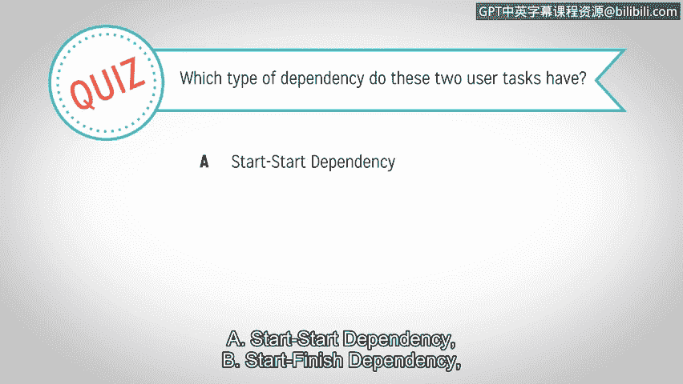

# 艾伯塔大学软件产品管理课程4：《面向软件产品的敏捷规划》：P43：任务依赖关系

在本节课中，我们将深入学习任务依赖关系。任务依赖关系是项目规划与排程中的一个核心概念，理解它对于制定有效的项目计划至关重要。

## 概述

任务依赖关系指的是一个任务的开始或结束，依赖于另一个任务的开始或结束状态。在软件过程和敏捷实践的课程中，我们曾提及此概念，并在本课程的第一课中简要介绍过。当我们开始进行任务排程时，这是一个必须仔细考虑的重要方面。

## 任务依赖关系的四种类型

两个任务之间可能存在四种类型的依赖关系。我们将以第一个任务的状态为基准，来考察第二个任务如何依赖于它。这四种类型是：开始-开始、开始-结束、结束-开始、结束-结束。

### 开始-开始依赖

这种依赖关系关联两个任务的开始。具体而言，**第一个任务必须开始后，第二个任务才能开始**。它不规定任务何时结束。

想象一个两人赛跑的场景，跑者A先起跑。跑者B必须在跑者A开始跑之后才能起跑。至于谁先冲过终点线，依赖关系本身并未规定。

一个更具体的例子是编写教材和创建术语表。这两个任务可以并行进行，但你必须先开始编写教材并识别出重要术语，才能将它们添加到术语表中。因此，**编写教材的任务必须先于创建术语表的任务开始**。无论你是先写完教材还是先完成术语表，只要没有新术语需要添加，这都不影响依赖关系。

### 开始-结束依赖

在这种依赖中，**第一个任务必须开始后，第二个任务才能结束**。它不规定第二个任务何时开始。

开始-结束依赖常出现在需要交接班或工作重叠的场景中。例如，夜班保安必须等到接班的保安开始工作后，才能结束自己的班次。

在敏捷开发中，假设你的冲刺周期是每周三开始，下周二结束。你可能会在当前冲刺期间规划下一个冲刺。这样，开发人员就能在周三准时开始下一个冲刺的任务。因此，**规划下一个冲刺的任务，必须在当前冲刺结束之前开始**。或者说，规划下一个冲刺的任务，在开始-结束关系上依赖于当前冲刺。

**思考题：**
罗纳德是一位为婚礼制作蛋糕的面包师。他需要设计蛋糕、烘烤蛋糕、装饰蛋糕，并将蛋糕交付给客户。以下哪组任务之间存在开始-开始依赖关系？
A. 设计蛋糕和烘烤蛋糕
B. 烘烤蛋糕和装饰蛋糕
C. 设计蛋糕和装饰蛋糕
D. 装饰蛋糕和交付蛋糕

**答案分析：**
罗纳德必须在开始烘烤蛋糕之前开始设计蛋糕，以便知道要烘烤哪种面糊以及大致需要制作多少蛋糕。他可以在蛋糕烘烤期间继续设计，并在蛋糕烘烤完成之前或之后完成设计。这符合开始-开始依赖的定义，因此**A是正确答案**。

### 结束-开始依赖

这是**最常见**的任务依赖类型，大多数依赖关系都属于此类。它指的是**第一个任务必须结束后，第二个任务才能开始**。

例如，你必须先完成给汽车加油，才能开始驾驶汽车。在软件开发中，你必须先完成一个功能的设计并明确其作用，才能开始编写该产品的用户手册或培训手册。

### 结束-结束依赖

正如你可能已经猜到的，这种依赖是指**第一个任务必须结束后，第二个任务才能结束**。

例如，在将产品交付给客户之前，你必须先完成对客户的账单结算，以避免无法获得工作报酬。

**思考题：**
你的开发团队创建了一个数据库程序，用于存储医生诊所的病人信息。用户可以输入病人信息到数据库，也可以按姓名搜索病人。这两个用户任务之间存在哪种类型的依赖关系？
A. 开始-开始依赖
B. 开始-结束依赖
C. 结束-开始依赖
D. 结束-结束依赖

**答案分析：**
要搜索数据库，必须先有病人信息被录入。因此，**搜索病人的任务在开始-开始关系上依赖于向数据库输入病人信息的任务**。这两个任务如何或何时结束并不重要，用户不需要录入所有病人信息后才能使用搜索功能。因此，**A是正确答案**。

## 总结

本节课我们一起学习了任务依赖关系的四种基本类型：**开始-开始**、**开始-结束**、**结束-开始**和**结束-结束**。理解这些依赖关系是进行有效项目排程的基础。现在你已经了解了任务依赖的类型，接下来需要思考如何将这些依赖关系整合到项目日程表中。

在接下来的课程中，我们将开始学习基于依赖关系组织任务的规划技术，首先介绍关键路径法图表。