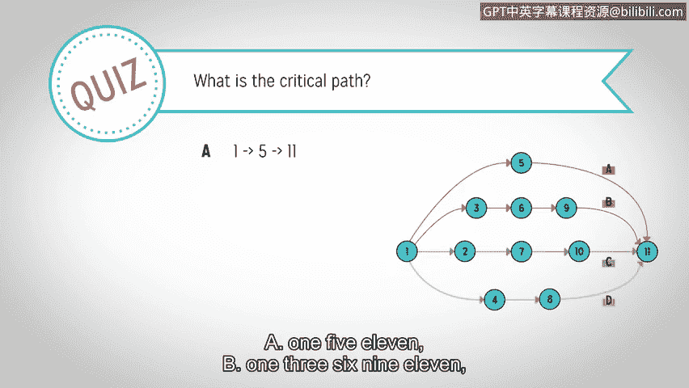

# 艾伯塔大学软件产品管理课程4：《面向软件产品的敏捷规划》｜agile-planning-for-software-products｜ - P45：17_01_4-3-4-pert-chart.en_subtitled - GPT中英字幕课程资源 - BV14w411a7jH

🎼。😊。

Now we are going to look at a task planning tool that is quite similar to the CPM chart。

 the perRT chart。PerRT stands for Program Evaluation and Review Tech。

 The PerRT chart was developed by the US Navy in the 50s to manage the Polis submarine Missile program。

Similar to the CPM chart， a perRT chart is a visual representation of a project。

It depicts a network or graph with nodes and edges。Edges are the lines that connect the notes。

In a perRT chart， the nodes which represented tasks in the CPM chart now represent milestones。

We talked about milestones earlier in the course。Recall that milestones are not time based。

 so each of these nodes represents something happening。

Usually a work product being produced or some event occurring。The tasks are represented by the edges。

The direction of the arrows represents the order that the tasks must be completed in。

 the same as the CPM chart。Here， a sequence of dependent tasks is represented by a path along the edges following the arrows。

Each edge is denoted with the task and the time estimate。

When there are multiple independent paths leading out of a node。

 that indicates that tasks can be done in parallel。

This means the parallel paths can be completed at the same time， if the resources exist。

 since there aren't any dependencies between the tasks across the paths。Alternatively。

 when there are multiple paths leading into a node。

 that indicates that the paths need to synchronize。

This means that all the paths need to be completed before you can move on to the path or paths leading out of that node。

Let's look at our spaghetti and meatball example again， this time we'll turn it into a pert chart。

Again， we'll start by making our pasta。Here you can see that the edges are labeled with both the task and the time estimate。

The notess are just labeled with numbers for reference and simplicity。Similar to the CPM chart。

 you can see that tasks in the path 1， 2，4，5 can be completed independently of the tasks in pathth 135。

Pert charts make it a bit easier to see dependencies。

We know that there are two tasks that must be completed before node 5。In this simplified perRT chart。

 how many different tasks is task X directly dependent upon？A1。B 3。C8 or D 9。

Since there are three edges pointing towards node 8， which is the node prior to Task X。

 there are three tasks that T X is directly dependent upon。Therefore， B is the correct answer。

Task X is dependent on the other earlier tasks as well， but those are indirect dependencies。

Let's now look at our meatball tasks。In this section of the pert chart。

 a critical path would be the path 7，8，9，10，11，12。But there is another path from 7，10，11，12。

Let's now get our salad chart。This per chart demonstrates how there are sometimes tasks that are independent of order。

 but all must be completed before advancing to the next step。In this case， adding the croutons。

 cheese and dressing are all independent of order， but must all be completed before you toss the salad。

Let's now combine our per chart to make one chart for the entire project。

Here's what the finished per chart would look like。When I combined the charts。

 some common node had to be joined。I kept the original numbering so that you can see where the nodes were joined。

It doesn't matter what ordering scheme you use I like to number them left to right so that when I am referring to a path。

 the nodes are always increasing。Similar to the CPM chart。

 the critical path is important in a perRT chart。In a per chart。

 you want your critical path to be depicted horizontally across your chart。

All other paths can be drawn above or below the critical path。In this per chart。

 what is the critical path？A1，511。

B。1，3，6，9，11。C。One，2，7，10，11。D one four eight eleven or e you need more information，In a per chart。

 the critical path is depicted horizontally across the chart， so we do not require more information。

We know that the path 1，2，7，10，11 is the critical path。

 even though we don't know the time estimates for the tasks， therefore C is the correct answer。

You can use the critical path in the same way that we talked about in the CPM chart to calculate the minimum time it would take to complete the project。

Since it takes longer to complete the critical path than it does any other path。

 you have some flexibility with scheduling the tasks that are not a part of the critical path。

As long as the other beginning to end paths get completed in less time than the critical path is completed。

 it doesn't affect the overall project time。When you have tasks that do not appear on the critical path and can be delayed without increasing the timeline of the project。

 we say that there is slack with these tasks。If we look at our example pert chart。

 if you add up the time it takes to complete all tasks in the critical path， it takes 38 minutes。

This is the minimum amount of time the project could take。

This would require that we sequentially complete all tasks on the critical path with no time in between。

And that we would fully multitask and complete all other tasks while this critical path is being completed。

Since no other path takes as long as a critical path。

 we have some flexibility or slacklack with scheduling。For example。

 it takes five minutes to complete the salad path， it takes two minutes to cut the lettuce。

 one minute to add the crouts cheese and dressing in parallel。

 and then two minutes to toss the salad。We can schedule when we make our salad at any point during the 38 minutes that it takes to complete the critical path。

No matter where we schedule it in the 38 minutes， it will not add extra time to our project。

We could start it while we are preparing ingredients or complete it all while the meatballs are baking。

This is because there is slack。If we extend the time to complete a task on the critical path。

 it is going to increase the minimum time to complete our project。For example。

 if we had a five minute break between mixing the ingredients and forming the meatballs。

 then our minimum time is now 43 minutes。This is because there is no slack on the critical path。

Now that you know both the CPM chart and the perRT chart， which one should you use？

It's really a matter of preference and what you are trying to do。In this example。

 and most situations you will face， either one works great。The CPM chart is more task focus。

 you could add more information to the tasks like cost and then create a critical path based on time and a critical path based on cost。

Per charts work better if your project is event or milestone based。

It shows you all the tasks that need to be completed prior to an event。

Regardless of the method you choose， both are great steps towards completing your task planning。

In the next and final lesson in this module， we are going to look at the iteration plan。

This will be a schedule that you will use often to manage tasks within a sprint。

