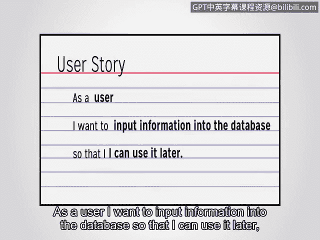
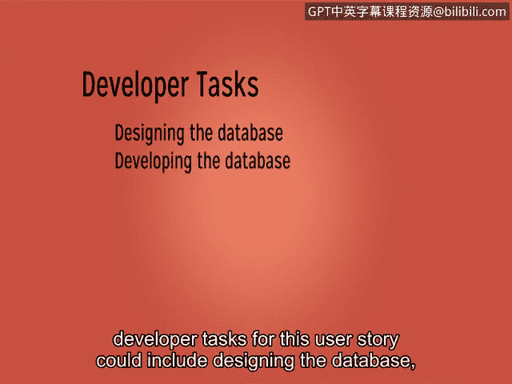
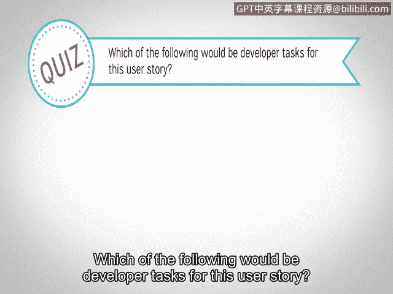

# 艾伯塔大学软件产品管理课程4：《面向软件产品的敏捷规划》｜agile-planning-for-software-products｜ - P46：18_01_4-3-5-iteration-planning.en_subtitled - GPT中英字幕课程资源 - BV14w411a7jH

Let's now talk about iteration planning。

Ittereration plans are imperative for keeping your developers on task and the project on schedule。

Iteration plans help to make sure that your development team is not over or undercomting in each iteration。

This keeps development at an effective and sustainable pace。

Iteration plans are a part of most agile methodologies。Notably。

 both Scrum and XP use iteration plans。In this lesson， we will use terminology from Scrum。

 for example， sprints， product owner and Scrum master。

These terms were introduced in the softwareft Processes and Agile Practices course。Here。

 the terms iteration and sprint are synonymous。The iteration plan is generated in a sprint planning meeting。

These meetings should be time boxed。This means that the length of the meeting is fixed at the beginning of the meeting and that it should be strictly adhered to。

This prevents your meeting from getting off topic and prevents unnecessary over planningning。

Four hours tends to be a good time box first print planning meeting。

Teams should establish a sprint goal at the beginning of the sprint planning meeting If you have not already done so in your release planning。

We talked about this when you learned about scrum。This is the general focus for the sprint being planned。

This can help to keep development focused on the relevant tasks。Nextext。

 you want to report the project velocity from the last sprint。This is an important step。

All development commitments for this sprint will be based on this velocity。😊。

But what if your last sprint was an abnormal sprint that is not representative of your team's actual development rate？

In this case， use the lowest velocity from your previous sprints。

You and your development team have reached the fourth sprint of the project。

You are conducting the Sprint planning meeting for this sprint。In the first sprint。

 your development team was able to complete 10 story pointss of work from the backlog。

In your second iteration， your team completed 12 story points。In the third sprint。

 your team experienced a hardware malfunction that resulted in some lost development days。

This malfunction has since been fixed。 However， your team is only able to complete five story points of work that was scheduled for that sprint。

You know that you are supposed to base development for the fourth sprint on the previous one。

But you do not think that it is representative of your team's development rate。

You look at your release plan and you have 13 story pointss of user stories scheduled。

How many story pointss of user stories do you think you should base your commitment on？A。

 10 story pointss， B， 12 story pointss， C，5 story pointss， or D13 story pointss。

If your team experiences a sprint that is abnormal compared to their usual development rate。

 then you should not use that velocity for the subsequent sprint。

It is not representative of your team's usual output。In this case。

 you want to base your estimate on the lowest previous velocity from the project。In this example。

 the lowest previous output was 10。This value should be used when generating your iteration plan for the upcoming sprint。

Therefore， a is the correct answer。Next， you're going to determine all the potential user stories for the sprint。

This would include all the user stories that have been planned to be completed in this sprint based on the release plan。

This may also include any user stories that were not completed but supposed to be from the previous iteration。

These incomplete user stories are the ones that did not meet your team's definition of done。

It is important that your team adheres to the definition of done that they committed to。

These user stories may include any that failed to pass their acceptance tests。

From the potential user stories， your product owner is going to select the stories they would like completed in this sprint。

Remember that this is based off of the previous velocity。

So the product owner can keep choosing user stories as long as the sum of their storyPo estimates is less than or equal to the velocity。

All other user stories not chosen will have to wait until a future sprint。

The chosen user stories are then broken down into developer tasks。

This is done by the development team without input from the product owner。

Developer tasks should be small enough that they can be completed in a day or two。

If you take a generic user story， such as as a user。

 I want to input information into the database so that I can use it later。

Developer tasks for this user story could include designing the database， developing the database。

 creating the input field on the user interface， creating the documentation for this feature。

 writing tests for this feature， and running tests for this feature。

Once all the developer tasks have been established， you want to express these tasks somehow。

You could do this by using techniques such as a work breakdown structure， a perk chart。A CPM chart。

Or a can ban board。Use a technique that your development team is comfortable and effective at using。

You are the software product manager for a team that is developing a music streaming application。

Your development team is determining developer tasks based on the user stories for the iteration。

You come across the user story as a listener， I want to save songs to a playlist so that I can easily find these songs to be played later。

whichhich of the following would be developer tasks for this user story。

A， write tests to ensure saved songs appear on a playlist。B。

 program functionality to save a song to a playlist。C。

 generate a wire frame for the application and or D。

 add instructions to Use manualual for adding a song to a playlist。Writing tests。

 programming functionalities， and creating documentation are all common developer tasks that stem from user stories。

 therefore answers A， B， and D are all correct。A wire frame for the application should have already been established in an earlier requirements or user interface design activity。

The functionality to add a song does not change the user interface much。

 maybe a button to add a song and a link to the playlist。

 so it would not pose significant changes to the user interface。

Generating a wire frame would not be a developer task for this user story。

Next， the developers need to jointly create an estimate for how long they think each task will take。

A scrum team is cross functional， so any developer should be able to take on any task。However。

 the developers are each unique in pace， so each task estimate is really an agreed average across the team。

If a task requires specialized skills and must be assigned to a specific person。

 then the estimate can be based on that person。Still， the team must agree to it。

The task estimate should be in hours， half days or days。Small tasks under an hour。

 should be grouped together。Also， large tasks that are estimated to take more than three days should be broken down into smaller tasks。

Once the task estimates have been made， you will want to revisit the chosen user stories for the sprint。

Given the total available time of the developers and the task estimates。

 can the developer tasks for the chosen user stories be fitted and realistically done within the sprint？

If all the user stories cannot be achieved， then the developers need to adjust their commitment。

The product owner needs to remove user stories until the total estimated time for tasks of their remaining stories matches the total available time of the developers。

The associated developer tasks for the removed user stories are also removed from the iteration plan。

Conversely， if the user stories can be achieved with significant time left。

 then the product owner can choose additional user stories。

The developers still need to determine the associated developer tasks for these stories。

The product owner can add a user story to the sprint as long as the total estimated time for the tasks does not exceed the total available time of the developers。

The task estimates generated at the iteration level override the user story estimates generated at the release plan。

Since they are more specific and likely more accurate。

You may need to adjust your release plan accordingly。Because of such uncertainties。

 it is common for a release plan to only look at most a few sprints ahead and be adjusted regularly。

Now it's time for your development team to sign up for tasks。

Recognize that it is important that they self assigned tasks and managers are not doing the assignment。

Self assignment results in developers working on tasks they are interested in。

This results in happier developers， as well as better software。😊。

Similar to the way user stories were chosen for the sprint。

 developers should self assign and choose tasks based on their available time。

This also allows developers to account for other commitments and projects they may be involved in at work。

Now you， your product owner and your development team are all on the same page for what is expected of them in the upcoming sprint。

You have generated a realistic commitment based on velocities， task estimates， and available time。

Developers all know what they will be completing and what is expected of them。

Your product owner knows exactly what to expect in the next product demo。

All is good for now in the land of development。In the next module。

 Bradley is going to take you through the basics of risk planning。Identifying， mitigating。

 and preparing for risks is an important planning step that can save your product from unforeseen issues。

