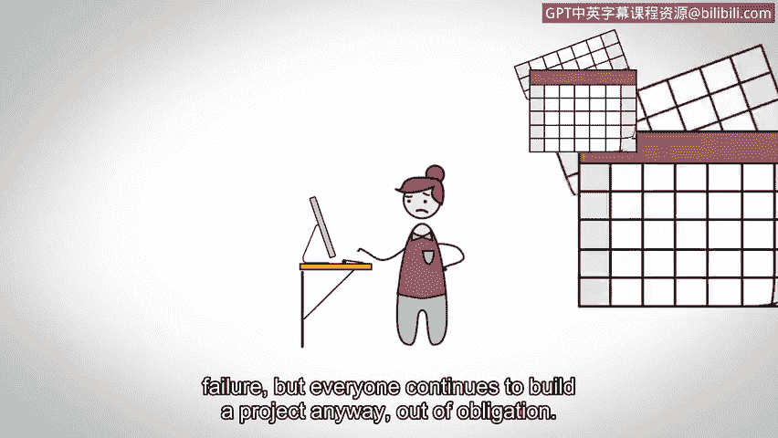

# 艾伯塔大学软件产品管理课程4：《面向软件产品的敏捷规划》｜agile-planning-for-software-products｜ - P49：21_03_4-4-1b-anti-patterns-development.en_subtitled - GPT中英字幕课程资源 - BV14w411a7jH

🎼。😊。

It may seem strange at first， but putting in too much effort into a project can be a problem。However。

 what about the case of putting too little effort into the project？

I'm not talking about hiring lazy developers and not meeting deadlines because of it。

 That's another problem， entirely。No， I'm talking about management practices that make it difficult for developers to do development work because they're so focused on doing other things。

There's a reason why Agile software development focuses on working software over comprehensive documentation。

That reason is that comprehensive documentation takes time。Valuable developer time。

I'm not saying that documentation shouldn't be created at all。 That brings about its own problems。

Focusing on comprehensive documentation is an example of an antipattern called Viewgraphph engineering。

Like gold plating， this is a result of unfocused work or not working on important， high value things。

ViewGraph engineering is when developers kill their productivity by spending more time building presentations。

 reports and documentation instead of developing code。

This often happens at organizations with a vertical management structure。

Organizations where in order to prove a concept， a developer must fully analyze its potential before going forward。

It's a lot like analysis paralysis， but at an organizational level。

The best solution is to remove barriers blocking your developers from developing the product。Often。

 the time spent creating all the necessary reports and presentations would be enough to create a basic product prototype。

The prototype is often more informative than any report could be and comes with the bonus of having working software off of which successive products can be built。

If this decided that the product wouldn't be worth your developer's time。

 then the prototype serves as a lesson learned， a lesson that can be carried on towards future projects。

Rayhan is a software product manager who has her developers present ideas to her weekly meetings using a slideshow format。

She does this so that everyone's ideas can be expressed accurately and clearly。

What is the problem with Rayhan's expectations here？A。

 the developer's time would be better spent developing code。B， nothing。

 this is a good communication practice。C， software developers are bad at making slideshows。Or D。

 slideshows do not give the full scope of a problem。The answer is a。

 software developers have only a finite amount of time to work on projects。

If they spend their time building presentations， then they'll have less time to create the actual product。

Imagine that your development team is focused on coding and managed to complete all their work。

Is that enough to say that the project was successful？Well， not exactly。

What about the all too common situation where developers are forced to work over time？

Towards the end of the project to meet deadlines。This happens all the time。

This anti patternttern is referred to as a fire drill。

A fire drill is what happens when developers do too little work throughout the majority of the project。

 and then all of a sudden need to make a big push toward the end。

This can be a result of a lack ofadasical management or the impact of the developers themselves wasting time。

It can also occur when expectations are not properly set with the client。

The fire drill is dangerous because it often leads to sacrificing code quality in favor of getting the product out the door quickly。

What could have been a wonderful product ends up being mediocre since there wasn't enough time to build the product properly。

Fire drills often lead to another anti patterntter called heroics。

This is a tongue in cheek way of describing what happens when your project relies on one developer's nearly superhuman technical skills to get the project done。

This is risky。 People become reliant on that person to get the work done。

 even outside of the big push at the end。The best way to avoid this is to establish expectations with your client early in your project and follow an agile software development practice。

You could implement timeboxing and other planning techniques that give your developers the structure they need to get things done on time。

It also helps when managers and their development teams are equally motivated to complete the project。

If everyone works at a steady pace， there's no need for fire drills or heroics。

Which of the following describes heroics as it happens in software development。

The software development team。A is award winning。B often relies on one person to solve their problems。

C， contains someone who is benighted or D regularly rewards good behavior。The answer is B。

 heroics and software development is not a good thing。

It's usually a sign that your projects could stand some improvement in the processes or training。

What happens when the development team and management are at odds？

What about when management struggles to get the development team to believe in the work they're doing？

This is called a death march。Everyone on the development team knows that the project is destined for failure。

 but everyone continues to build a project anyway， out of obligation。

Imagine the terrible consequences of this。Some causes for how this might arise are management forcing the project on a development team for financial reasons。

Or management might be stubborn and in denial of the inevitable failure。Whatever the cause。

 if the very people who build the product don't believe in it。

 you can pretty much assume that the product isn't going to be the best it can be。

Developer morale in death marches is low， and the product quality suffers for it。

