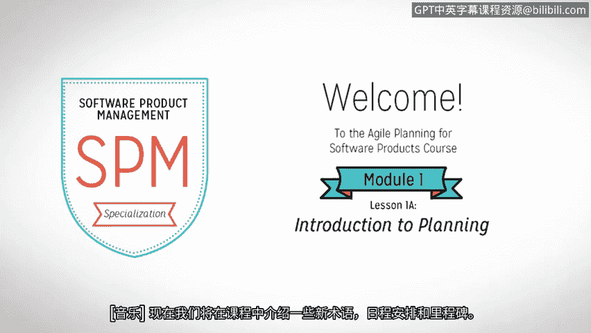
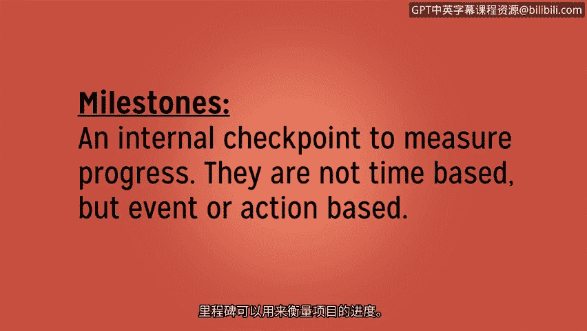
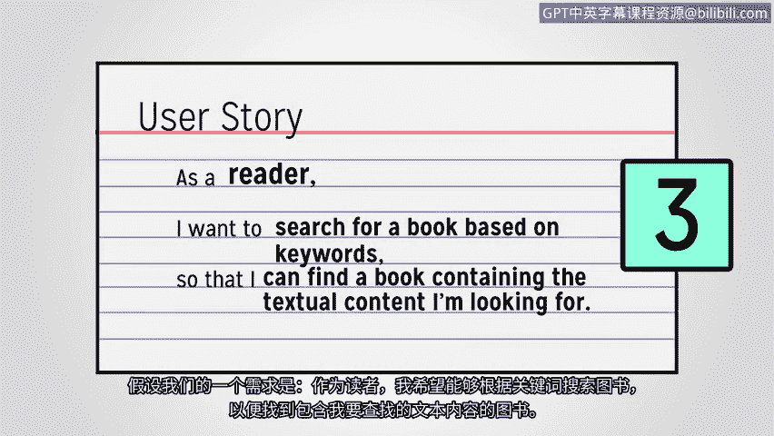
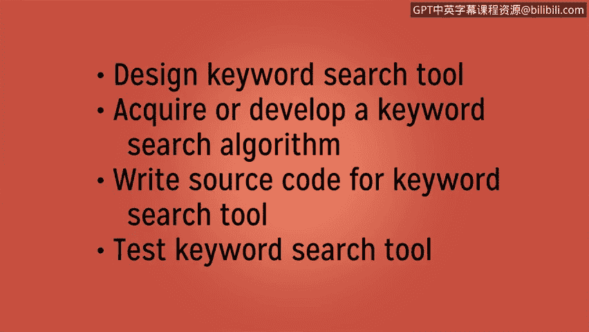

# 艾伯塔大学软件产品管理课程4：《面向软件产品的敏捷规划》｜agile-planning-for-software-products｜ - P4：3_第4.1.1a节 计划简介.zh - GPT中英字幕课程资源 - BV14w411a7jH

🎼The。Now we are going to introduce a few new terms to the course， schedule and milestones。

A schedule is the mapping of tasks to a timeline。So again。

 tasks are an essential aspect of a project。As we talked about before。

 tasks have dependencies based on their work products。

Recognizing the dependencies of tasks will be an important step in creating schedules。

You need to map tasks to a timeline in such a way that work products will be used as an input are created before they are needed。

You also need to make sure that high priority requirements are created first。

You need to plan what will get completed in each iteration。Sounds complicated。

 but this course will show you techniques to schedule each of these effectively。Next。

 let's talk about milestones。Milestones are an internal checkpoint to measure progress。

They are not time based， but event or action based。

Milestones can be used to measure the progress of a project。 However。

 they are more common in linear and early iterative processes。

You learned about these linear and early iterative processes in the course on software processes and agile practices。

When examining the agile manifesto in the previous courses， we learned that in agile。

 you tend not to have milestones。Progress is measured by working software， not by events。

All releases and iterations are time based， so they do not fit with milestones。

Sierra is working on a project that allows users to monitor and track monthly spending。

Sierra and her development team have decided to measure their progress based on milestones。

Which of the following is an example of a milestone？A， the end of a two week sprint， B。

 the one year anniversary of the start of their project， C， the due date for the product。

 or D requirements have been written and reviewed。Milestones are not time based， therefore。

 the end of a two weeks sprint is not a milestone， as that is measured by two weeks。Similarly。

 the one year anniversary is also time based， therefore， answers A and B are incorrect。

The due date might be seen as a milestone， but that is still time based。

 therefore answer C is also incorrect。If Sierra wanted to phrase this as a milestone。

 it would be better to word it as final product delivered。 however。

 the date the final product is delivered is not always the due date for the product。

Answer D is not time based， but action based。 You know that this milestone has been reached when all the requirements have been written and reviewed。

This could be a major milestone for a project， therefore answer D is the correct answer。

As I've already said in this lesson， everything that occurs in a project can be broken down into tasks。

They are an important aspect of planning。But tasks are also an important part of previous courses。

In the course on client needs and software requirements， you learned how to create requirements。

Once you have created and prioritized software requirements。

 you need to break those down into developer tasks to be completed。Let's look at an example of this。

Imagine that we are creating an application that allows users to browse digital versions of books like a virtual library。

Let's say one of our requirements was， as a reader。

 I want to search for a book based on keywords so that I can find the book containing the textual content I am looking for。

We have a requirement， but how is your development team going to turn this into a part of the product。

Some examples of developer tasks that could result from this requirement could be。

Design keyword search tool， acquire or develop a keyword search algorithm。

Rrate source code for keyword search tool。Or test keyword search tool。

Developer tasks are where you can be more technology specific。

 whereas requirements should be independent of technology。With developer tasks。

 the development team is coming up with a solution to the problem。

These developer tasks are commonly scheduled using an iteration plan。

You will learn how to do this later in this course。

In the course on software processes and Agile practices。

 we talked about how tasks make up activities and how activities make up phases。

Each phase has specific tasks that are completed。Therefore。

 tasks are essential to creating processes。Tasks also played a role in agile practices。

Agile practices provide ways of organizing tasks and ensuring they are effectively completed。

Using an iteration plan is an agile practice that is common in the scrub methodology。

As I said before， an iteration plan is a technique to schedule tasks。

Canban is a visual way to track the progress of tasks through a series of steps。

So now you've got a great basis to begin learning more about planning。In the next lesson。

 you will learn about uncertainty space and how to navigate your way through a project。

 I'll see you there。😊。