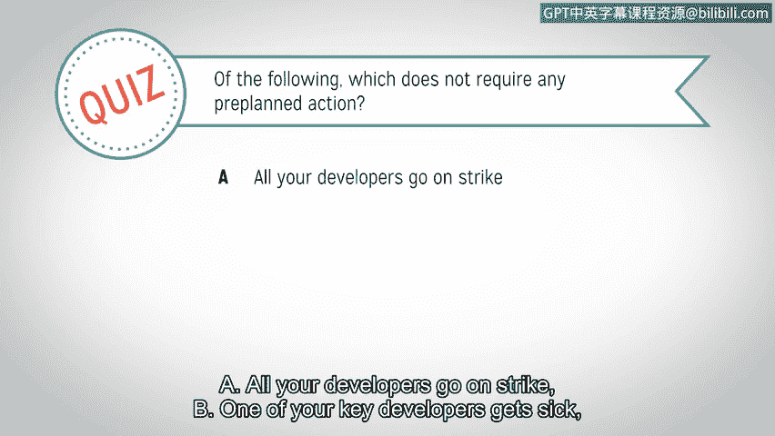
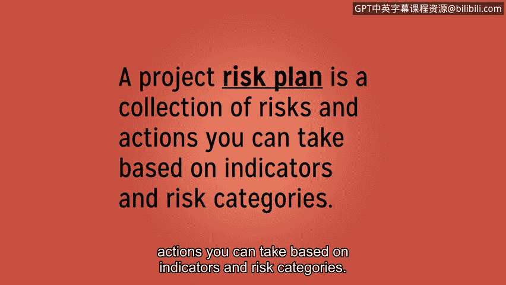

# 艾伯塔大学软件产品管理课程4：《面向软件产品的敏捷规划》｜agile-planning-for-software-products｜ - P54：26_01_4-4-4-risk-strategies-contingency-mitigation.en_subtitled - GPT中英字幕课程资源 - BV14w411a7jH

🎼。😊。

In the last lesson， I talked about how to assess project risks by placing your risks within an impact versus likelihood matrix。

In that lesson， you saw that risks can be assigned a priority by assigning them of value on the impact versus likelihood matrix。

Using this priority， you can then plan for how to deal with at risk as appropriate for the level of magnitude the risk poses to your project。

In this lesson， I'm going to outline what a risk plan is and how to implement one。

A risk plan or a risk management plan consists of a list of potential project risks。

 their associated impacts and likelihood， and any planned action for how to address the risk if it should come up。

You could write your risk management plan down in a simple table like this。

Across the top of the table， you have your risk， its associated rank or risk category。

 a description of the risks's indicators， and a description of the action to be taken if the risk presents itself。

A risk， of course， is what we've been talking about this whole module。

It's something that has the potential to cause your project to fail。

An indicator is what you should be looking for to identify that you might be facing this risk。

It's basically a description of the signs that your project is at risk。

And action is what should be taken if you notice what risks your project is facing through the indicator。

When I talked about the impact versus likelihood matrix。

 I identified three risk categories simply called one， two， and3。If you recall。

 risks placed in the one category are considered risks that should be addressed as soon as possible。

They represent the most danger to your project。😡，These risks are placed in your project's plan。

And the associated action is usually immediate。Risks placed in the two category are less severe。

 but are still placed in your risk plan。These risks pose a moderate threat to your project。

 so any actions that should be taken are planned seriously。

 but not to the same extent as category1 risks。Category three risks aren't planned much at all because they represent a low threat to your project。

Let's take a look at a few examples of how risks might appear。In our music Player app。

 your client will have to get copyright access to any of the content they provide to their users。

You place this in your impact versus likelihood matrix and determine that the risk of your client not getting copyright access is a category2 risk。

 it's pretty high impact， but only moderately likely to happen。

You already have the first two columns of your risk plan done for this particular task。

 the risk rank， and its description。An indicator that your client is not going to get copyright from the artists that they want in their app is that they're communicating this issue to you or they're showing signs that they're losing interest in the app。

An appropriate action for this risk might be that you ensure that your development team delivers the product in increments so that the client sees progress from your side。

Another potential action item here is to settle any financials on the project appropriately and get a guarantee that you'll be compensated for the work done。

Some product managers might think it prudent to help the client get copyright access to content for the sake of the project。

It really depends on the scope of your individual position as a product manager。

 but sometimes actions like this will determine whether your project will live or die。

Here's another example from our music Play app。Your development team decides that they want to use a compression algorithm that uses a special technique to increase the loading speed of the app's content。

However， this algorithm was only just conceived in a hotel room by one of your developers the night earlier。

 and is essentially untested。The details on the algorithm aren't clear。

 and your development team is unsure whether it would actually work。

So you enter this into your impact versus likelihood matrix and determine that the risk of your team not being able to implement the algorithm is a category one risk。

 It's highly impactful to the project and highly likely to happen。

An indication that this risk is impacting your project。

Could be that your team has made no progress over one week of development。

Another indicator could be that your development team tells you outright that the work on the algorithm just isn't getting anywhere。

In order to dampen the blow of this risk on your project， there are a few actions you could take。

One would be to warn your client that the algorithm you're trying to implement is not ready and may not work。

You may want to make managing expectations with your client your first priority。

You should also have a backup plan for if the algorithm doesn't work。In this case。

 you could decide with your development team that if no progress is made within one week of the developer starting work on the algorithm。

 they will use a standard compression algorithm instead。

Don't forget to tell your clients about this backup plan。

 so they aren't left wondering what would happen if the algorithm is unsuccessful。

If you do this for all the risks that you've categorized as a one or a two in your project。

 you'll be much more likely to see your project succeed。However。

 what about those risks you don't know about？Unfortunately， you can't plan for what you don't know。

 There will always be unforeseen risks in your projects。

Sometimes your project's success comes down to how you deal with these risks in the moment。

That's not to say that you shouldn't plan your projects or that you should run your project by the sea of your pants。

All I mean is that you're not going to be able to plan for everything。

Dealing with unforeseen risks is a skill that you should develop as a product manager just as much as dealing with foreseen risks is。

You're a project manager for a software company which is renowned for its employee health and award won primarily because of your fantastic management style。

Of the following， W does not require any preplanned action。A， all your developers go on strike。

B， one of your key developers gets sick。C， your competition launches their competing product before you do。

D， you get promoted to another position in another department。The correct answer is a。

 If you place this on an impact versus likelihood matrix。

 the resulting category for this risk would be a three。If you recall。

 category three risks don't require any action because they don't pose much danger to your project。

Next， let's hear about how risks are managed in the industry。🎼，🎼ふ。To mitigate project risks。

 we look at a few different factors， so we'll create what we call brainstorming workshops where we'll actually identify and brainstorm risks associated to certain projects and different technologies。

 we'll understand who wants to own the different risks that we have。

 how we have risk responses to those risks， including you know avoidance strategies to mitigation strategies transferring risks or just accepting the risks as well we'll better understand the impact and probability of each of those risks so we can actually assess what kind of response we need to actually tailor who needs to own those risks and by what timelines。

There you have it， a project risk plan is a collection of risks and actions you can take based on indicators and risk categories。

And that concludes this lesson and this course。Let's do a quick recap of what we covered。

In the first module， Morgan introduced the concept of planning。

She described work breakdown structures， uncertainty space， and defined the terms estimate。

 target and commitment。Then I described how to plan your projects at the release level。

And time boxing for coordinating your project's development in small time chunks。

Then I introduced Gantt charts as a means of visualizing your project's schedule and dependencies。

And work you through how to create a release plan。In the third module。

 Morgan went deeper to the iteration level。 She described how to estimate task time and showed what a task dependency is。

Then she gave examples of two diagrams used when planning projects。

Critical path method diagrams and pert charts。She concluded that module by showing you how to create an iteration plan。

In this final module， I showed you how things can go wrong in your project by describing common project risks。

We then assessed and prioritize those risks using an impact versus likelihood matrix。

 and planned how to address risks by using a risk plan。

We covered a lot of different techniques for improving your chances at project success in this course。

You can take any of these techniques and apply them to your next software project。

There's nothing stopping you from applying them to your current projects， too。 What's more。

 these methods aren't limited to software。Planning methods have been used everywhere from household chore management to building spaceships。

If you apply any of these techniques to your projects， please come back and report your experiences。

I'll open a discussion forum here for that purpose。This is the fourth course in our specialization。

 Your next step is to take our fifth course， reviews and metrics for software improvement。😊。

There we'll show you how to monitor your projects and make sure that you're staying on the path to success。

 We'll see you there。