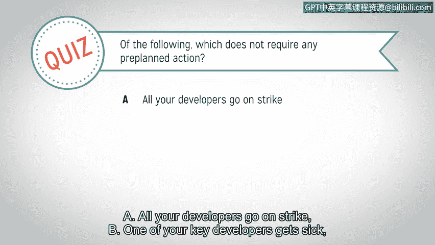
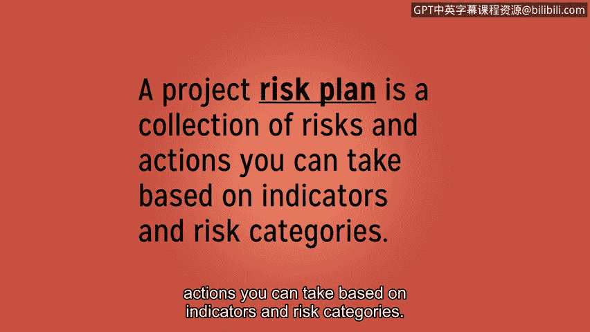

# 艾伯塔大学软件产品管理课程4：《面向软件产品的敏捷规划》：4-4-4：风险策略：应急与缓解 🛡️

在本节课中，我们将学习如何制定风险计划，以应对项目中可能出现的风险。我们将了解风险计划的构成要素，并通过具体示例学习如何识别风险指标并规划应对行动。

## 概述

在上节课中，我们介绍了如何通过将风险置于**影响与可能性矩阵**中来评估项目风险。根据风险在该矩阵中的位置，我们可以为其分配优先级。本节课，我们将以此为基础，探讨什么是风险计划以及如何实施它。

## 什么是风险计划？

一个**风险计划**或**风险管理计划**，包含一系列潜在的项目风险、其相关的影响与可能性，以及当风险出现时计划采取的应对行动。

你可以用一个简单的表格来记录你的风险管理计划，表格的列通常包括：**风险**、**风险等级/类别**、**风险指标描述**以及**应对行动描述**。

*   **风险**：即我们整个模块讨论的对象，指可能导致项目失败的事件。
*   **指标**：用于识别可能面临此风险的迹象或信号。
*   **行动**：当通过指标发现项目面临风险时，应采取的措施。

## 风险类别与应对

回顾影响与可能性矩阵，我们将风险分为三类：

1.  **第一类风险**：应尽快处理，对项目威胁最大。这类风险会被纳入项目主计划，相关行动通常是立即执行。
2.  **第二类风险**：严重性较低，但仍需记录在风险计划中。它们对项目构成中等威胁，应对行动需要认真规划，但紧急程度不如第一类。
3.  **第三类风险**：对项目威胁很低，通常无需过多规划。

## 风险计划示例

以下是针对我们的“音乐播放器”应用的两个风险规划示例。

**示例一：版权获取风险**

*   **风险**：客户无法为其提供给用户的内容获取版权许可。
*   **类别**：第二类（影响高，可能性中等）。
*   **指标**：客户向你传达此问题，或表现出对应用失去兴趣的迹象。
*   **应对行动**：
    *   确保开发团队以增量方式交付产品，让客户看到进展。
    *   妥善处理项目财务，确保已完成的工作能获得报酬。
    *   有时，产品经理帮助客户获取版权或许可，可能直接决定项目的成败。

**示例二：未经验证的算法风险**

*   **风险**：开发团队尝试使用一个全新、未经验证的压缩算法来提升加载速度，但可能无法实现。
*   **类别**：第一类（影响高，可能性高）。
*   **指标**：团队在一周的开发中毫无进展；或开发团队直接告知算法工作无法推进。
*   **应对行动**：
    *   首先管理客户期望，告知其尝试的算法可能不成功。
    *   制定备用计划：例如，与开发团队约定，若算法开发一周内无进展，则改用标准压缩算法。
    *   务必告知客户此备用计划。

## 应对未知风险

遗憾的是，我们无法为未知的事物做计划。项目中总会出现无法预见的风险。有时，项目的成功取决于你如何即时应对这些突发风险。这并非否定计划的重要性，而是强调作为产品经理，处理预见性风险和突发风险的能力同样需要培养。

## 行业实践

在行业中，我们通过多种方式缓解项目风险。例如，我们会组织**头脑风暴研讨会**来识别和讨论与特定项目及技术相关的风险。我们会明确不同风险的负责人，制定风险应对策略（包括规避、缓解、转移或接受），并评估每个风险的影响和概率，从而制定 tailored 的应对措施、明确负责人和时间线。

## 总结

本节课中，我们一起学习了如何制定风险计划。风险计划是基于风险指标和类别，对风险及应对行动的集合。通过系统地识别、评估和规划应对措施，你能显著提高项目成功的概率。

## 课程回顾与展望

至此，本课程全部内容结束。让我们快速回顾一下所学内容：

*   **第一模块**：Morgan 介绍了规划的概念，描述了工作分解结构、不确定性空间，并定义了估算、目标和承诺。
*   **第二模块**：我描述了如何在发布级别规划项目，以及使用时间盒来协调小块时间的开发工作。介绍了甘特图作为可视化项目进度和依赖关系的工具，并引导你创建了发布计划。
*   **第三模块**：Morgan 深入到迭代级别，描述了如何估算任务时间，展示了任务依赖关系，并举例说明了关键路径法图和PERT图。最后演示了如何创建迭代计划。
*   **第四模块（本模块）**：我通过描述常见的项目风险，展示了项目可能出错的地方。我们使用影响与可能性矩阵评估和优先处理这些风险，并利用风险计划来规划如何应对。

本课程涵盖了许多提高项目成功率的技巧。你可以将这些方法应用到下一个（或当前）软件项目中。更重要的是，这些方法不仅限于软件领域，从管理家务到建造航天器，规划方法无处不在。

如果你将这些技巧应用到了你的项目中，欢迎回来分享你的经验。

这是我们专项课程的第四门课。你的下一步是学习第五门课：《软件改进的评审与度量》。在那里，我们将向你展示如何监控项目，确保你始终走在成功的道路上。我们下节课见。😊