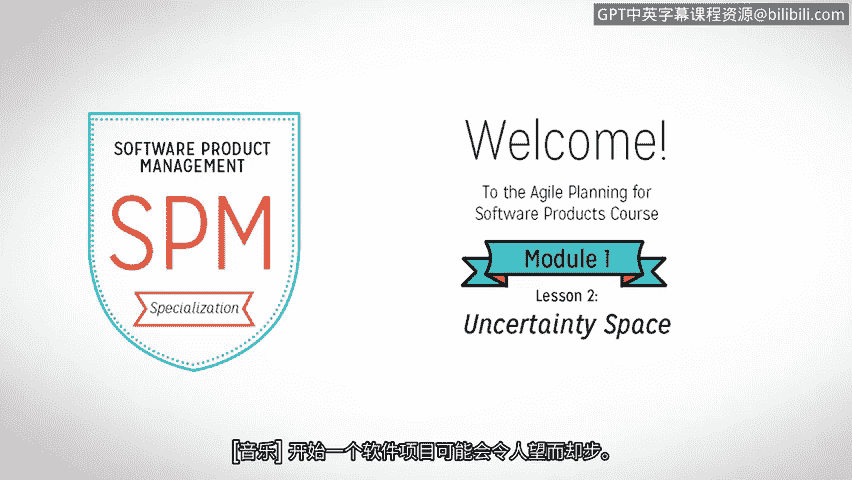
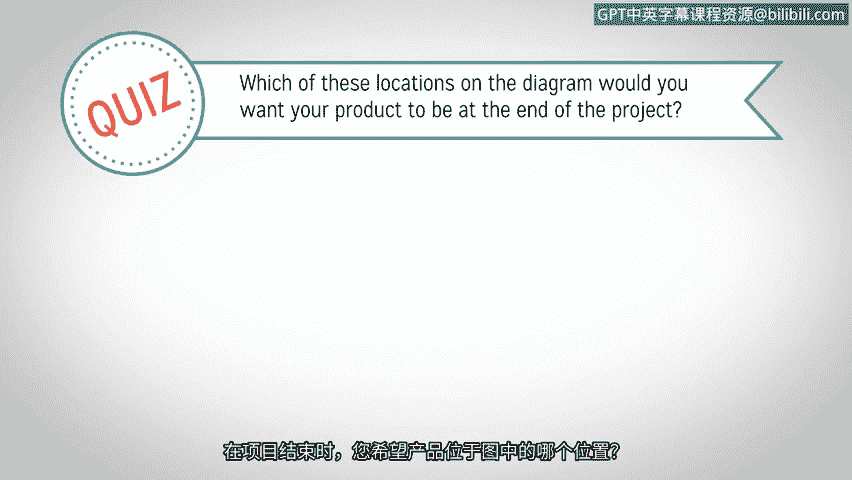
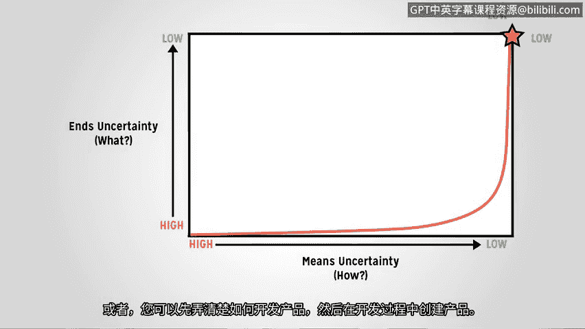
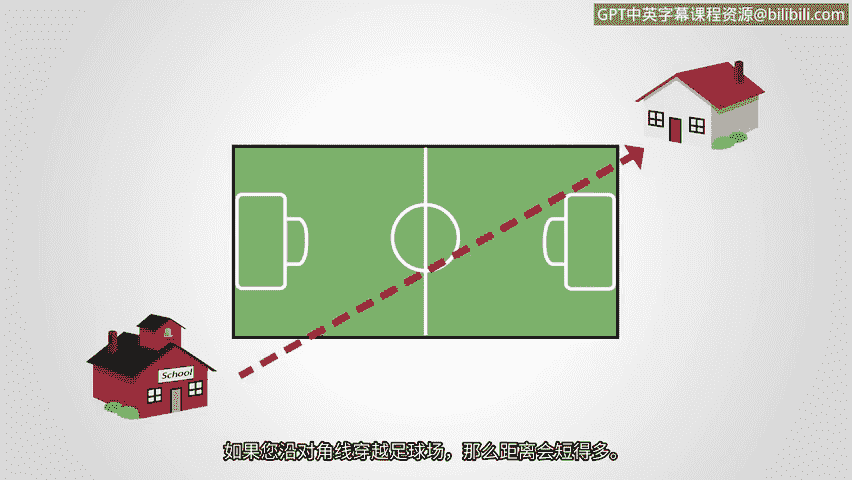
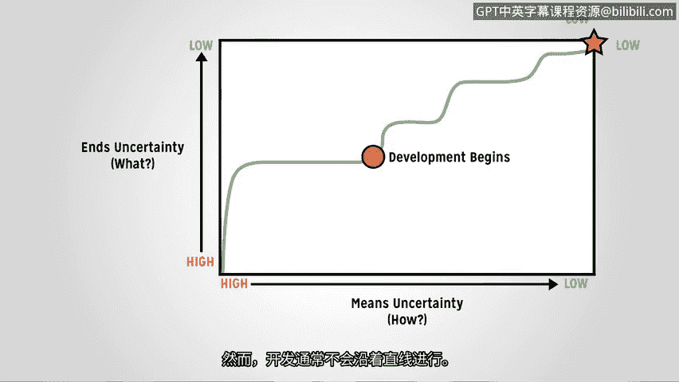

# 艾伯塔大学软件产品管理课程4：《面向软件产品的敏捷规划》｜agile-planning-for-software-products｜ - P5：4_第4.1.2节 不确定空间.zh - GPT中英字幕课程资源 - BV14w411a7jH

🎼。😊。

Starting a software project can be pretty daunting。Where do you begin， Where do you end。

 How is your team going to develop， What is your team going to develop。

How are you going to navigate through all of this uncertainty。Alexander Lefer。

 a project manager researcher， identified the need to simultaneously address two types of uncertainty。

Mike Cohn， one of the contributors to the Scrum methodology。

 depicted this issue in an uncertainty based diagram。

This diagram is used to demonstrate the levels of uncertainty as a product proceeds from concept through development towards an operational state。

For each product， you need to figure out what you are creating and how you are going to develop it。

When you start， the uncertainty for both are pretty high。Ideally。

 you want to know exactly what you are producing and how your team is going to make that happen。

Realistically， there is a lot of uncertainty， requirements change， and so do the methods。

This uncertainty space diagram measures the means uncertainty along X axis。

The means uncertainty is the how of your project。How are you going to develop this product？

Your project should go from high means of uncertainty to low means of uncertainty。

The diagram measures the end's uncertainty along the Y axis， this is the what for your project。

What are you actually developing again， this uncertainty should go from high to low。

Take a look at these points on the uncertaintytain space diagram。

Circle A has high means uncertainty and high ends uncertainty。

Circle B has high means uncertainty and low ends uncertainty。

Circle C has low means uncertainty and high ends uncertainty。

 and C D has low means uncertainty and low ends uncertainty。

Which of these locations on the diagram would you want your product to be at the end of the project？

A， high means uncertainty， high ends uncertainty， B， high means uncertainty， low ends uncertainty。C。

 low means uncertainty， high ends uncertainty， or D， low means uncertainty， low ends uncertainty。

Hopefully， at the end of your project， you have low means uncertainty team so that you know how you will create or have created your product。

Having low end's uncertainty says you know what you are creating， therefore。

 answer D is the correct answer。Having high uncertainty for either ends or means indicates that there is some pending uncertainty to resolve for the product。

Let's look at some ways that we can navigate through projects using this diagram。

One way that you can navigate a project would be to figure out what you are creating first and then figure out how you're going to create it。

This method would have you determine all requirements up front and in great detail before you plan out any means of completing these requirements。

This is like following a waterfall process。As you can see here。

 the level of end's uncertainty is low before the level of means uncertainty starts to change significantly。

This way of navigating does not allow for requirements to change easily because they are all determined upfront。

 therefore it's not very agile。Alternatively， you could figure out how you are going to develop a product and then create the product as you go。

This type of development would be ad hoc development， it would involve very little planning。

 basically the development team would be figuring out implementation solutions and making up the product as they went。

This is not a very logical way of developing software and can lead to wasted work。

Your best bet would be to navigate somewhere in the middle。Let's visualize this in a different way。

Imagine that there is a soccer field between your house and your school。

Your house and the school on opposite corners。If you are walking home from school。

 you are probably not going to walk around the field to get to your house。

It's a much shorter distance if you walk diagonally across the field。

Similarly， it's a lot less work to navigate diagonally through the uncertainty space。However。

 development doesn't often occur in a direct line。

The common case is that you will define the majority of the requirements with your client and your development team before you start designing how you are going to complete them。

Once you have established requirements， you and your development team will begin planning your solution。

Now， the project has less ends and means uncertainty certain。

 and this is a good place for development to begin。Then requirements will change and or get added。

Similarly， your solutions will change。Your development team will implement these changes and work their way towards the goal of having low uncertainty for both ends and means。

Regardless of the path you take through the uncertainty space， you are going to be completing tasks。

In the next lesson， you are going to learn how to break down work into tasks。

