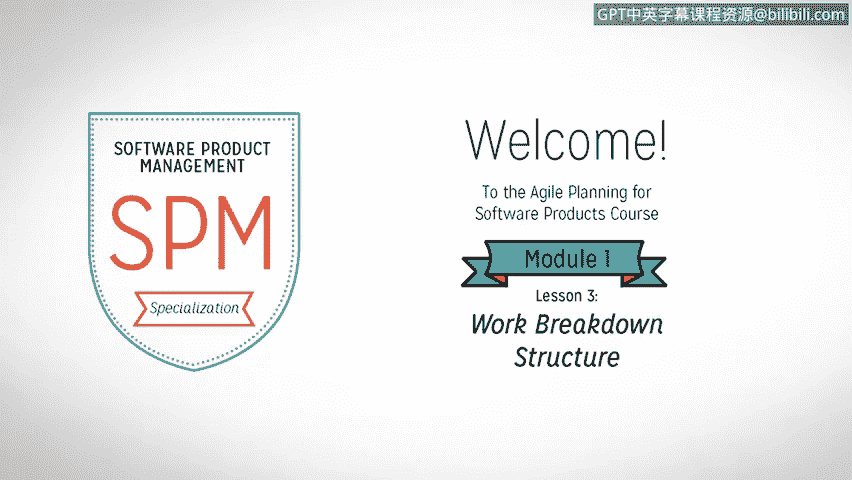
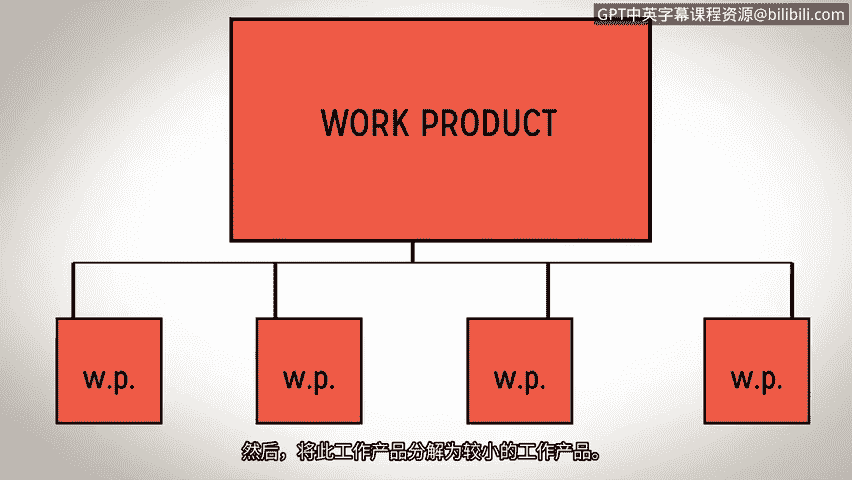
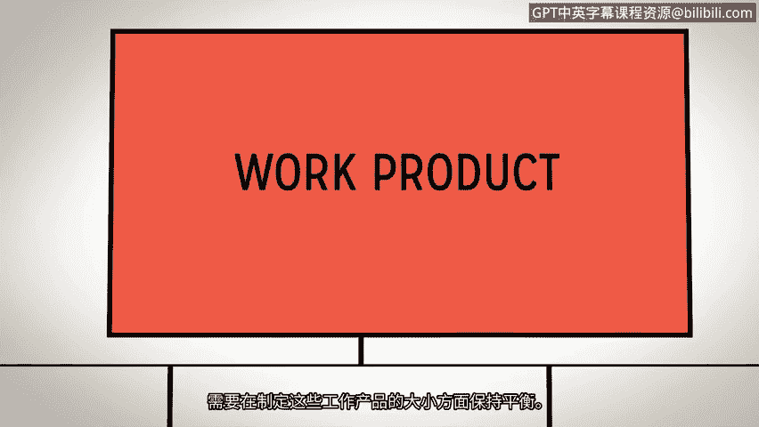
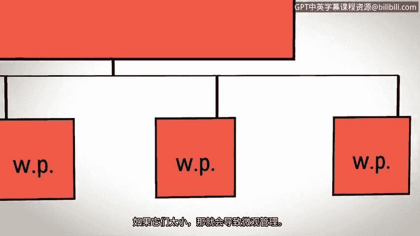
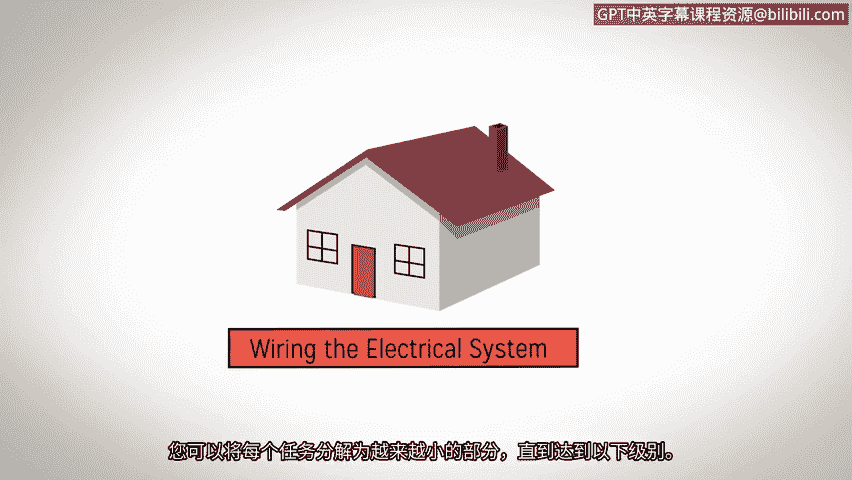
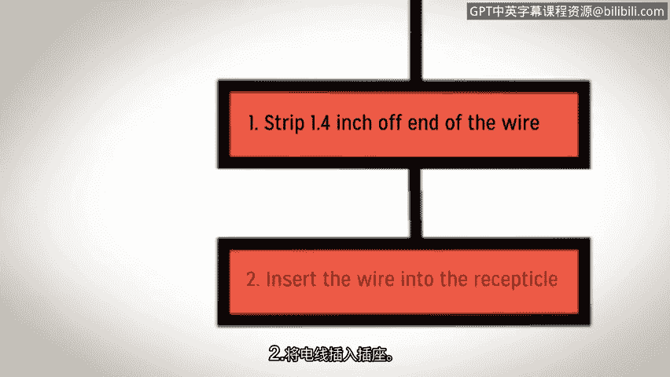

# 艾伯塔大学软件产品管理课程4：《面向软件产品的敏捷规划》｜agile-planning-for-software-products｜ - P6：5_第4.1.3节 工作分解结构.zh - GPT中英字幕课程资源 - BV14w411a7jH

🎼。😊。

The process of creating a software product can be daunting and overwhelming if you're looking at the product as a whole。

There are many features to come up with， aspects to design， code to write。

 and test to conduct before you have a fully functioning software product。

You might also need to arrange things like marketing。

 technical support and operations in that time as well。As you already know。

 you cannot simply tell a development team to go develop an application。

There is a lot of planning that goes on behind the scenes。

Whether the development team is aware of it or not， they break the project into smaller。

 manageable chunks。Breaking down a project into small。

 manageable pieces is a key step for creating and planning a software product。

In the course on software processes and agile practices， we talked about the structure of a process。

 we talked about how a process is broken down into phases which are broken down into activities。

 which can be further broken down into tasks。When you break down a large software process into manageable tasks。

 it doesn't seem as overwhelming anymore， just take it one task at a time。

Similar to a way a process can be broken down into tasks。

 you can break down a large project such as creating an application into small， manageable tasks。

Breaking down what will be done for a software product into task work products is a very helpful step for planning。

We call this the work breakdown structure。Creating a work breakdown structure or WBS is very common in project management。

A work breakdown structure takes one large work product and breaks it down into smaller。

 manageable work products into a hierarchy。A work breakdown structure is created by looking at the large work product。

Commonly， this will be the overall product that your team will deliver。

Then this work product is broken down into smaller work products。

These smaller work products are repeatedly broken down until each is small and clear enough to be assigned to a person。

Balance is needed on how small to make these work products。

If they are too small， that leads to micromanagement。

As a rule of thumb， you should break your work products down so that you can reasonably have one person create each work product。

For example， suppose you are breaking down the project of constructing a house。Specifically。

 the task of wiring the electrical system within the house。

You could break down each task into smaller and smaller pieces until you get to the level。

 number one， strip one quarter inch off the end of the wire， number two。

 insert the wire into the receptacle。

Obviously， this is micromanaging。Task breakdown is no longer needed once you reach the expertise associated with the role。

So in this case， the general contractor can outline the tasks for installing the electrical system。

 but they don't need to break things down beyond what an electrician is reasonably expected to know how to do。

Victoria is a product manager working on an animated video game。

She is working on her work breakdown structure and is unsure about the extent to which she should break down her work products。

The video game intends to have excellent background visuals and graphics。

 including a night scene background that depicts a star filled sky。😊。

whichhich of the following would be an appropriate size work product。A， animated video game， B。

 drawings， C backgrounds。D Night scene background or E， a star。

Creating the work product of an entire animated video game is way too large for one person to reasonably take on。

 therefore， answer A is not an appropriate size。Creating the work product of all the drawings for an animated video game is also too large of a task。

 therefore answer B is incorrect。Creating all the backgrounds is now a more appropriate size work product。

 however， this could still be broken down into a more reasonable size， so let's remove answer C。

Answer D is quite a good size work product。😊，You could reasonably assign the task of creating those night scene background to one person。

Assigning a person to draw a star individually is too small of a task and your work breakdown structure would be enormous。

 Therefore， answer D is the correct answer。The easiest way to learn how to break down a product into a WBS is to look at an example。

 so let's look at one together。In our example， we are going to break down the task of constructing a news application。

This application would display the news for a global news company。In the application。

 users can browse headlines， read articles， and look at different sections such as finance or entertainment。

The application also has live embedded widgets， where users can see live updates about changing information such as weather and stocks。

For our work breakdown structure， our overall work product is the news application。

This task of constructing a news application can be broken down into four main work product categories。

They are content， U I graphics， programming and documentation。Now。

 each of these work product categories have their own set of work products。For example。

 within content， we need to create the headlines section， news stories and advertisements。

Within UI graphics， we need to create logos and buttons to be used in the application。

Within programming， we need to program the links to take you to a certain page in the content。

On top of that， we need to program the layout of the application to work on multiple devices。

And we also need to program the live embedded widgets。Within documentation。

 we need to create a user manual or help page， as well as internal documentation。

Each of these work products again have associated work products Let's look at the programming work product in more detail to get a better idea of this。

The programming work product was broken down into three associated work products， links， layout。

 and live embedded widgets。Since these are all programmed items。

 we need to create source code for each of these work products；

 therefore source code is a work product for each of these。

The work product of event handlers will have an associated work product of unit tests and acceptance tests。

Recall from previous courses， unit tests are used to test the low level functionality of source code。

 and they should be written before the source code is written。

Acceptance tests verify the application as a whole。So in this case。

 the unit tests would determine if the links are working appropriately。

Acceptance tests would test the interface to ensure that none of the links are broken and that all the links take you to where you have intended the reader to go。

To program a layout， you would also need to first design it。Therefore。

 the layout design would be an associated work product。

You would also need acceptance tests to ensure the layout is compatible on multiple devices。

With the live embedded widgets work product， we would also need to test the functionality。

So unit tests and acceptance tests would be associated work products as well。

You can use the work products in the work breakdown structure to create associated tasks for developers to complete。

Which of the following would be tasks associated with the example we just looked at？

A write unit tests for live embedded widgets。B， create a news application， C。

 create the design for the layout of the user interface。D， add content to the application and or E。

 create source code for the reader chat room。We want our task to be created based on the smallest work products in the hierarchy。

Therefore， create a news application and add content to the application are too large to be good tasks。

 so answers B and D are incorrect。Answers A and C were based upon the smallest work products in the hierarchy。

Since we defined unit tests and layout design in the last level of the breakdown。Therefore。

 answers A and C are correct。Answer E is a task for a feature that is not part of the defined scope。

It would not be a task for this product at this time， so answer E isn't correct。As you can see。

 we can break a project down into tasks by looking at its work products。

This example walks you through a work breakdown structure of a product depicted as a tree。

It basically broke down the work for the design and implementation phase into tasks。

 guided by the products's required pieces。However， you could expand the tree to include the specification phase and the verification and validation phase and derive development tasks for these as well。

You can further expand the tree to include other product management concerns beyond development with their constituent tasks such as promoting the app。

 arranging tech support， setting up the servers and gathering analytics。

So how can you use a work breakdown structure in your projects？

Work breakdown structures can be used in a couple different ways。For one。

 you can determine tasks for the project based on the work product。

You can easily turn small manageable work products into small manageable tasks。For example。

 if the work product was unit tests for the links， work product。

 you can create the task write unit Test for links。

This is probably the most common use of a work breakdown structure。

It's a great first step for planning because it establishes a detail for the entire product。

 and it becomes easy to create tasks to schedule into development。However。

 you can also use a work breakdown structure to determine potential risks。

You can look at each work product individually and come up with potential risks associated with that particular work product。

This will give you a more complete and extensive list of risks than you would come up with when you are just looking at the product as a whole。

You can also use a work breakdown structure to demonstrate the product to the clients。

It shows a detailed overview of the product， and you can look at the features and work products individually。

Work breakdown structures are also useful for determining how long it will take your development team to complete a project。

It is a lot easier to estimate how long it will take developers to complete smaller tasks than it is to look at the project as a whole and take a guess at how long it will take。

Let's hear from industry professionals and see how they use work breakdown structures。🎼，🎼，🎼不。

🎼，My role as it currently stands is to create new products。

 so I will take new products and innovation and go from a sales perspective to create sales enablement strategies for the field to understand how they sell our solutions。

 all the way through service delivery， ensuring our consultants are well trained and adequate to actually deliver whatever it is that we're selling。

In order to make management decisions， we use our work breakdown structures in a few different ways。

 we use it to actually identify resources required across the different activities and tasks in a given project。

 we identify effort by resource so we understand the amount of effort and duration ultimately for the schedule of the project we also understand as a consulting agency we understand costs associated to each of those resources so those costs allocated across effort across people across tasks and activities allow us to really create the ultimate budget for the project and then overall that we add of course contingency onto all of our projects which creates our final total budget for a project。

🎼うん。🎼To help our project managers make accurate estimates for planning。

 we create things called top-down bottom up so we'll use our work breakdown structures and really understand the amount of effort required or duration required for certain project and typical tasks and activities that we would perform during that project so that topdown approach really identifies how many days or how many weeks is required for each of our different consultants or resources on a project that topdown approach allows us a more global effort and a larger effort in terms of really understanding the duration of a project and how those resources are used then we take a bottom up approach which actually takes a look at tasks and activities almost by the minutes sometimes depending on the size and scale of a project you may want to go down by the minutes of effort required if it's a smaller project if you're talking about a larger program and you have several weeks。

 possibly months， possibly even years for that project and obviously going into minutes is a little bit too deep so we'll take that。

approach to really understand what are the key tasks and activities required to fulfill certain work packages。

 and then that bottom up approach allows us to actually create our effort。

 our schedule and our budget。In the next lesson， you will be learning about the distinction between estimates。

 targets， and commitments for your projects。