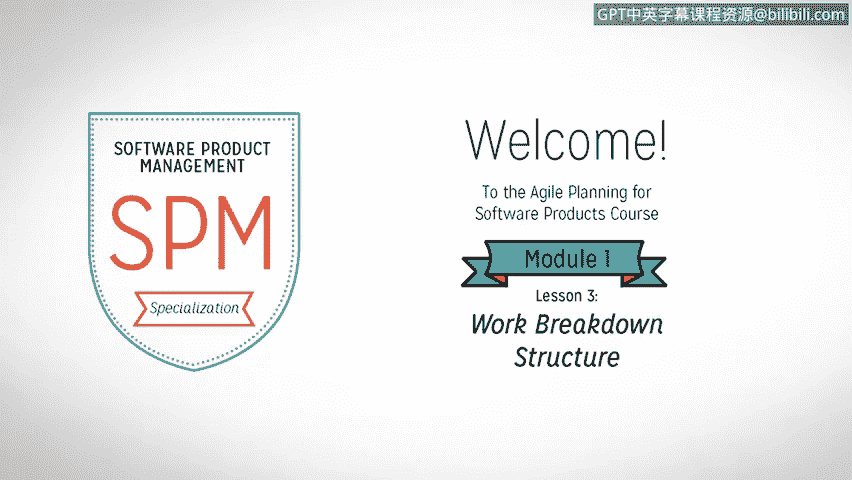
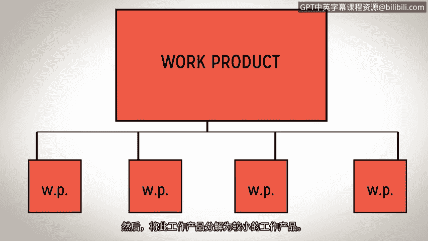
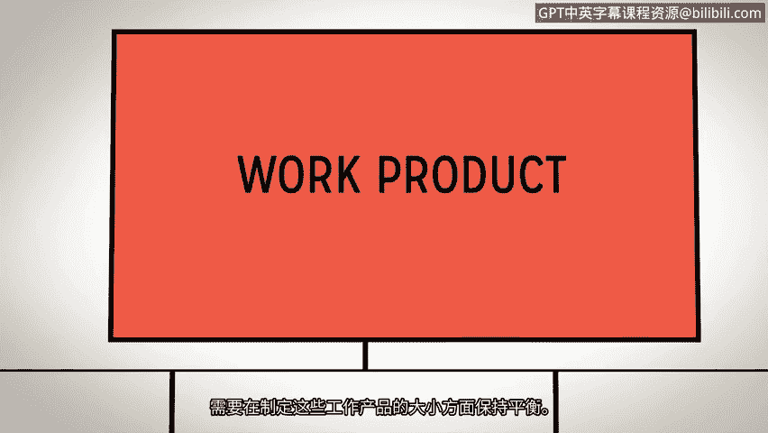
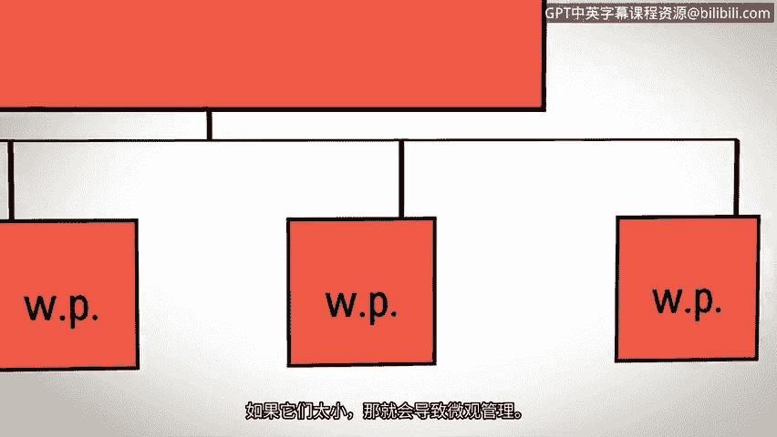
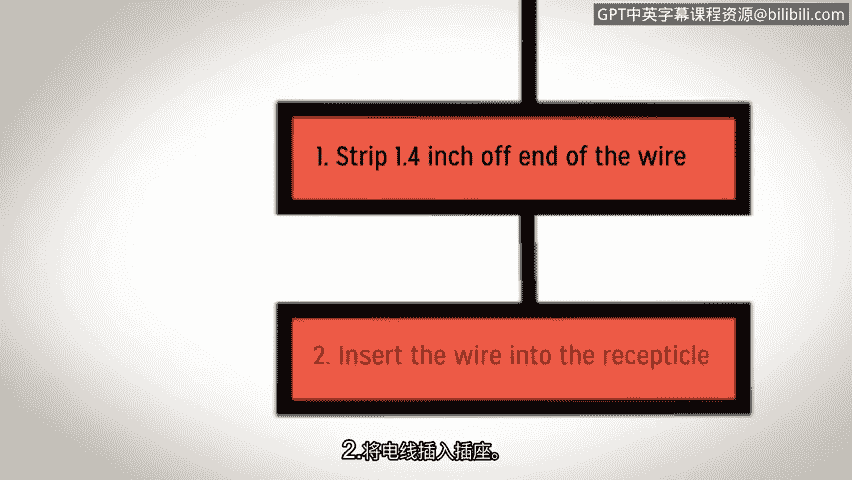

# 艾伯塔大学软件产品管理课程4：《面向软件产品的敏捷规划》：4.1.3：工作分解结构

## 概述
在本节课中，我们将要学习一个关键的规划工具——工作分解结构。我们将了解如何将一个庞大、复杂的软件产品项目分解为更小、更易于管理的部分，从而为后续的任务分配、风险评估和时间估算奠定基础。

---

将整个软件产品视为一个整体来创建，这个过程可能会令人望而生畏。你需要构思许多功能，设计各个方面，编写大量代码，并进行测试，才能得到一个功能完备的软件产品。在此期间，你可能还需要安排市场营销、技术支持和运营等事宜。

正如你已经知道的，你不能简单地告诉开发团队“去开发一个应用程序”。在幕后需要进行大量的规划工作。无论开发团队是否意识到，他们都会将项目分解成更小、更易于管理的部分。将项目分解成小而易于管理的部分，是创建和规划软件产品的关键步骤。

在关于软件过程和敏捷实践的课程中，我们讨论过过程的结构，即一个过程如何被分解为阶段，阶段再分解为活动，活动可以进一步分解为任务。当你将一个大型软件过程分解为可管理的任务时，它就不再显得那么难以应付了，只需一次处理一个任务即可。

与过程可以分解为任务类似，你也可以将一个大型项目（例如创建一个应用程序）分解为小而易于管理的任务。将软件产品需要完成的工作分解为任务工作产品，对规划非常有帮助。我们称之为**工作分解结构**。

创建**工作分解结构**在项目管理中非常普遍。工作分解结构将一个大型工作产品分解为更小、更易于管理的工作产品，形成一个层次结构。创建工作分解结构的方法是审视大型工作产品。通常，这将是你的团队将要交付的整体产品。然后，将这个工作产品分解为更小的工作产品。

这些较小的工作产品会被反复分解，直到每个都足够小且足够清晰，可以分配给一个人。在将这些工作产品分解到多小的问题上需要平衡。如果它们太小，会导致微观管理。

根据经验，你应该将工作产品分解到可以合理地让一个人来创建每个工作产品的程度。例如，假设你正在分解建造房屋的项目，具体是房屋内电气系统布线的任务。你可以将每个任务分解得越来越小，直到达到这样的程度：第一，剥掉电线末端四分之一英寸的绝缘层；第二，将电线插入插座。显然，这是微观管理。一旦达到与角色相关的专业水平，就不再需要任务分解了。因此，在这种情况下，总承包商可以概述安装电气系统的任务，但不需要将事情分解到超出电工理应知道如何做的范围。

维多利亚是一名正在开发一款动画视频游戏的产品经理。她正在制定她的工作分解结构，但不确定应该将她的工作产品分解到什么程度。这款视频游戏旨在拥有出色的背景视觉效果和图形，包括一个描绘繁星满天的夜景背景。以下哪一项会是合适大小的工作产品？A， 动画视频游戏；B， 所有绘图；C， 所有背景；D， 夜景背景；或 E， 一颗星星。

创建整个动画视频游戏的工作产品对于一个人来说太大了，因此答案A不合适。创建动画视频游戏所有绘图的工作产品也是一项太大的任务，因此答案B不正确。创建所有背景现在是一个更合适大小的工作产品，但这仍然可以分解为更合理的规模，所以让我们排除答案C。答案D是一个相当好的工作产品规模。你可以合理地分配创建那个夜景背景的任务给一个人。分配一个人单独画一颗星星的任务太小了，你的工作分解结构会变得非常庞大。因此，答案D是正确答案。

学习如何将产品分解为工作分解结构的最简单方法是看一个例子，所以让我们一起看一个。在我们的例子中，我们将分解构建一个新闻应用程序的任务。这个应用程序将为一家全球新闻公司展示新闻。在应用程序中，用户可以浏览头条新闻、阅读文章，并查看不同的版块，如财经或娱乐。该应用程序还具有实时嵌入式小部件，用户可以在其中查看关于变化信息（如天气和股票）的实时更新。

对于我们的工作分解结构，我们的整体工作产品是新闻应用程序。构建新闻应用程序的任务可以分解为四个主要的工作产品类别。它们是：内容、UI图形、编程和文档。现在，每个工作产品类别都有自己的一组工作产品。例如，在内容中，我们需要创建头条新闻版块、新闻报道和广告。在UI图形中，我们需要创建应用程序中使用的徽标和按钮。在编程中，我们需要编程链接，将你带到内容中的某个页面。除此之外，我们还需要编程应用程序的布局，使其能在多种设备上工作。我们还需要编程实时嵌入式小部件。在文档中，我们需要创建用户手册或帮助页面，以及内部文档。

这些工作产品中的每一个又有相关的工作产品。让我们更详细地看看编程工作产品，以便更好地理解这一点。编程工作产品被分解为三个相关的工作产品：链接、布局和实时嵌入式小部件。由于这些都是编程项目，我们需要为每个工作产品创建源代码；因此，源代码是每个工作产品的一个工作产品。事件处理程序的工作产品将有关联的工作产品：单元测试和验收测试。回顾之前的课程，单元测试用于测试源代码的低级功能，并且应该在编写源代码之前编写。验收测试验证整个应用程序。因此，在这种情况下，单元测试将确定链接是否正常工作。验收测试将测试界面，以确保没有链接损坏，并且所有链接都能将读者带到你预期的位置。要编程布局，你还需要首先设计它。因此，布局设计将是一个相关的工作产品。你还需要验收测试来确保布局在多种设备上兼容。对于实时嵌入式小部件工作产品，我们还需要测试其功能。因此，单元测试和验收测试也将是相关的工作产品。

你可以使用工作分解结构中的工作产品来创建供开发人员完成的相关任务。以下哪一项会是我们刚刚看到的例子中的相关任务？A， 为实时嵌入式小部件编写单元测试。B， 创建一个新闻应用程序。C， 为用户界面布局创建设计。D， 向应用程序添加内容。和/或 E， 为读者聊天室创建源代码。我们希望我们的任务是基于层次结构中最小的工件来创建的。因此，“创建一个新闻应用程序”和“向应用程序添加内容”太大，不适合作为好的任务，所以答案B和D不正确。答案A和C是基于层次结构中最小的工件。因为我们在分解的最后一级定义了单元测试和布局设计。因此，答案A和C是正确的。答案E是针对未在定义范围内的功能的任务。目前它不会是这个产品的任务，所以答案E不正确。

正如你所看到的，我们可以通过查看其工作产品来将一个项目分解为任务。这个例子引导你浏览了一个以树状图描绘的产品工作分解结构。它基本上将设计和实现阶段的工作分解为任务，由产品所需的组成部分指导。然而，你可以扩展这棵树，将规范阶段以及验证和确认阶段包括进来，并为这些阶段也推导出开发任务。你还可以进一步扩展这棵树，将开发之外的其他产品管理关注点及其组成任务包括进来，例如推广应用程序、安排技术支持、设置服务器和收集分析数据。

那么，你如何在项目中使用工作分解结构呢？工作分解结构可以通过几种不同的方式使用。首先，你可以基于工作产品确定项目的任务。你可以轻松地将小而易于管理的工作产品转化为小而易于管理的任务。例如，如果工作产品是链接的单元测试，你可以创建任务“为链接编写单元测试”。这可能是工作分解结构最常见的用途。这是规划的一个很好的第一步，因为它为整个产品建立了细节，并且很容易创建任务来安排到开发中。

然而，你也可以使用工作分解结构来确定潜在风险。你可以单独查看每个工作产品，并提出与该特定工作产品相关的潜在风险。这将比你仅仅将产品视为一个整体时得出的风险列表更完整、更广泛。你还可以使用工作分解结构向客户展示产品。它展示了产品的详细概览，你可以单独查看功能和工作产品。工作分解结构对于确定开发团队完成项目需要多长时间也很有用。估算开发人员完成较小任务所需的时间，比将项目视为一个整体并猜测需要多长时间要容易得多。

让我们听听行业专业人士的看法，看看他们如何使用工作分解结构。

> 我目前的角色是创建新产品，因此我会从销售的角度出发，为现场团队制定销售赋能策略，让他们了解如何销售我们的解决方案，一直到服务交付，确保我们的顾问经过充分培训，能够胜任实际交付我们所销售的任何产品。为了做出管理决策，我们以几种不同的方式使用工作分解结构：我们用它来识别给定项目中不同活动和任务所需的资源；我们按资源识别工作量，以便我们了解项目的努力程度和持续时间，从而最终确定项目进度；作为一家咨询机构，我们还了解与每个资源相关的成本，因此这些按人员、任务和活动分配的成本使我们能够真正创建项目的最终预算；当然，我们还会在所有项目上添加应急储备，从而形成项目的最终总预算。

> 为了帮助我们的项目经理做出准确的规划估算，我们会创建所谓的自上而下和自下而上的方法。我们将使用工作分解结构，真正了解特定项目以及我们在该项目期间通常会执行的任务和活动所需的工作量或持续时间。这种自上而下的方法真正确定了我们不同的顾问或项目资源各自需要多少天或多少周。这种方法使我们能够从更全局、更宏观的角度理解项目的持续时间以及这些资源的使用情况。然后，我们采用自下而上的方法，有时甚至按分钟来审视任务和活动，这取决于项目的规模和范围。如果是较小的项目，你可能需要按所需努力的分钟数来分解；如果你谈论的是一个较大的项目群，并且该项目有几周、几个月甚至几年的时间，那么深入到分钟显然就太细了。我们会采用这种方法来真正理解完成某些工作包所需的关键任务和活动，然后这种自下而上的方法使我们能够实际创建我们的工作量、进度和预算。

---

## 总结
在本节课中，我们一起学习了工作分解结构。我们了解到，WBS 是一种将大型、复杂的项目（如软件产品）分解为更小、更易于管理的工作产品的层次化方法。这有助于将工作产品转化为具体的开发任务，识别潜在风险，向客户展示产品细节，以及更准确地进行时间和成本估算。关键在于找到平衡点，将工作产品分解到足够小以便于管理，但又不会小到导致微观管理。在下一课中，你将学习项目估算、目标和承诺之间的区别。