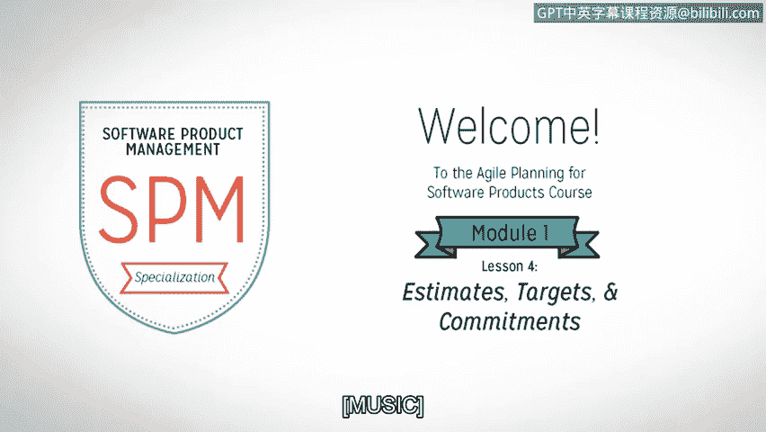
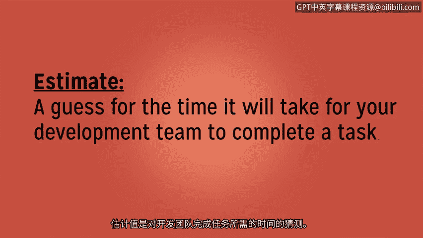
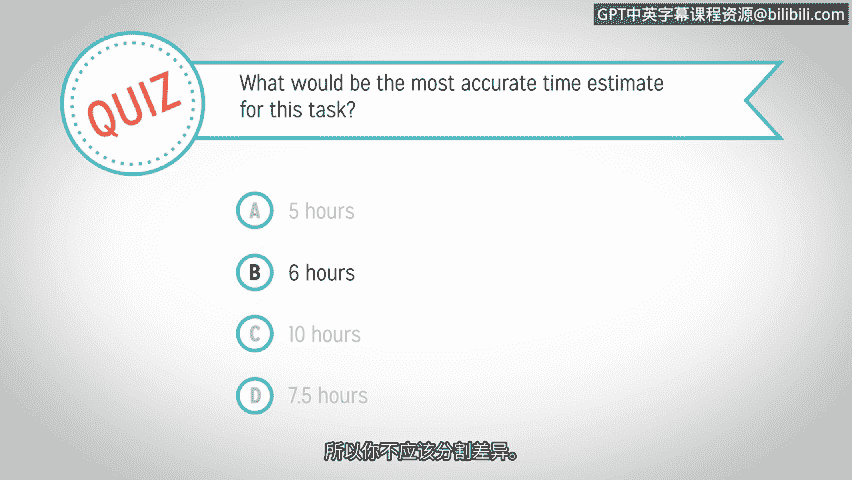
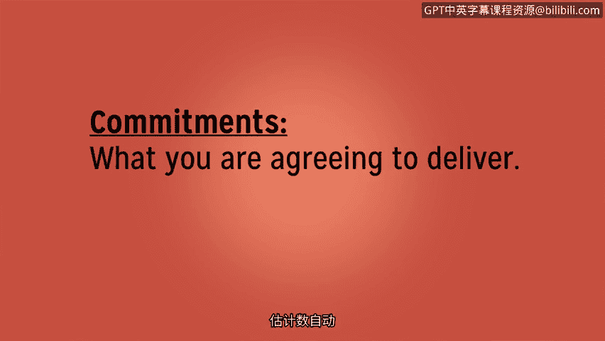
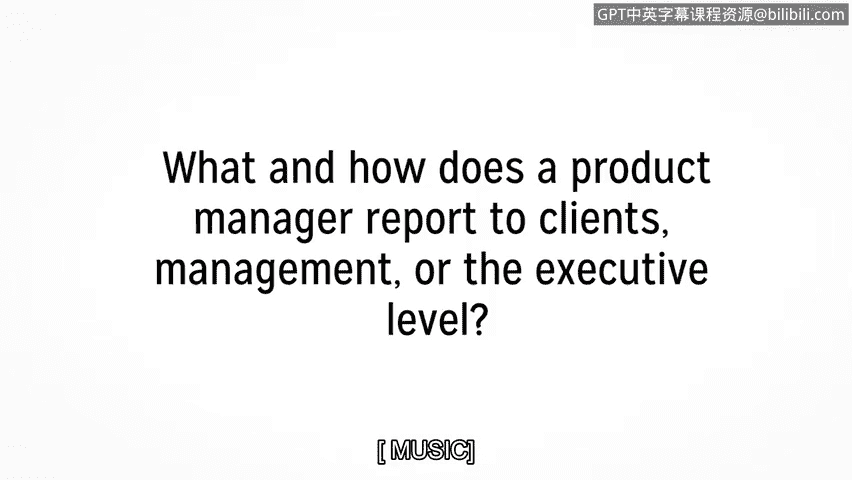
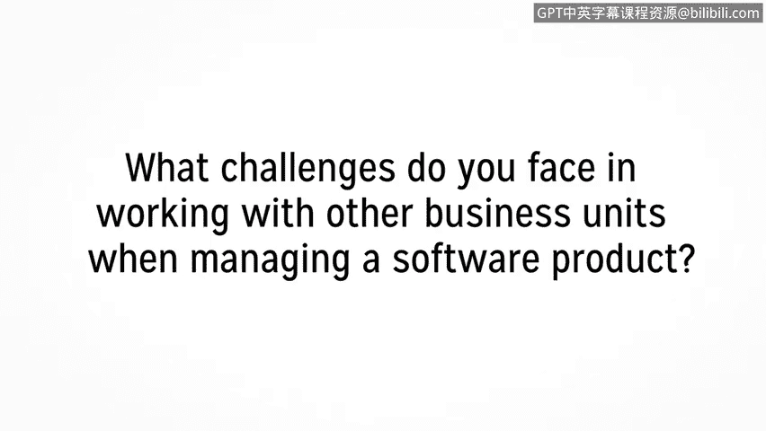

# 艾伯塔大学软件产品管理课程4：《面向软件产品的敏捷规划》｜agile-planning-for-software-products｜ - P7：6_第4.1.4节 估计、目标和承诺.zh - GPT中英字幕课程资源 - BV14w411a7jH

🎼。😊。

I want to start off this lesson by having you consider the sentence。

 I estimate that we can commit to a certain target date。It seems like it makes sense。

 and it's actually quite common in software development。The terms estimate。

 target and commitment are often thrown around loosely and sometimes used interchangeably。

But these terms are actually very different， and it's important for the sake of you and your development team that you differentiate the terms。

Let's go through these terms individually。An estimate is a guess for the time it will take for your development team to complete a task。

These should be based on some sort of data， like previous times of similar tasks。

Estimates should also generally be arranged because realistically a precise hour or number of days is not going to be accurate。

Estimates should also not be negotiable， so it's important that they are as accurate as they can be。

They are what they are。Let's look at an example。Kirk is a product manager。

He approaches one of his developers that he works with Liz。He asks Liz。

 how long it'll take her to develop a certain feature。Kirk has worked with Liz in the past。

 and he thinks it should take her about three hours if she works hard。

Liz thinks to herself and decides to pad her estimate a bit so that she can relax at work。

She tells Kirk it'll take her nine hours to develop that feature。

Kerk tells Liz that he thought it would take her only three hours and ask her to split the difference。

Liz agrees and Kirk records six hours as the estimate。This is not how it should occur。

Estimates should be realistic， that's why it's important to base estimates on prior work。

You could accurately estimate that it would take Liz between three and nine hours to complete the task。

You are the product manager working with a small development team。

You are talking to the developers to gather time estimates to help in scoping a product。

You talk with one developer， Greg。You ask him how long it'll take him to write tests for a particular feature。

You guess that it'll take him5 hours。Greg has just written tests for a similar feature。

 and it took him six hours。He wants to give himself some cushion room。

 so he tells you it'll take him 10 hours。You think that maybe you could split the difference and write down seven and a half hours。

What would be the most accurate time estimate for this task？A 5 hours， B，6 hours， C，10 hours or D。

7 and a half hours。As we've said before， you want to base your time estimates on previous similar work。

It's the most accurate way to get estimates， especially if done by the same person。Therefore。

 answer B is correct。When estimates are based upon how long a developer wants to complete their task or based on how long a manager wants the developer to complete the task。

 you risk over or underestimating the time it'll actually take， answers A and C are incorrect。

And again， estimates should not be a negotiation。So you should not split the difference； therefore。

 answer D is also incorrect。

Let's now take a look at the term target。A target is a point in the schedule to meet。

This is almost an ideal deadline。A target should also not be negotiated。

Examples of a target could be the end of a sprint or the release date。These targets once decided。

 must be adhered to。Target dates are used in arranging product promotions and are usually contractual。

Adhering to these target dates is very important for client satisfaction， as well as product success。

😊，If estimates and targets are non negotiable， how do you negotiate what will get developed？

That's where commitments come into play。Commitments are where negotiations happen。

Based on your estimates and targets， you can negotiate what you can commit to。

You are going to have to constantly ask yourself， how do I compromise on what the development team will commit to doing？

Based on their estimates and the time constraints。A commitment is what you are agreeing to deliver。

It is very common that estimates are automatically converted into commitments and targets。

If you are asked how long it is going to take to make a product and you estimate seven months。

 then that seven months becomes your commitment。And the date seven months down the line becomes your target。

Again， this is not how it should work。 Let's look at this in an example。

Say I was babysitting for a family。I asked the parents when they will be home。

They say they should be back around midnight。 This is their estimate。

If I were to ask them for a commitment in the sense that if they are not home at that time。

 I'm going to triple my babysitting fees。They might say 1230 to give themselves some buffer time in case they want to stay longer or the commute takes longer than expected。

Ideally， you want to discuss estimates with your development team and come up with some accurate numbers。

You also want to talk to your client about target dates。Then， based on these items。

 create commitments with your development team and your client。

You are meeting with your client and development team。

You have already talked to your development team， and they have determined that based on their previous work。

 this product should take them about eight months to complete with all the features that the client wants。

The client wants the product to be completed before the holidays。

 so she suggests a release date that is seven months away。Together。

 you all agree on a scope that includes about five months of work。Six months later。

 your development team has completed all the features that were originally agreed upon。

Which amount of time would be the commitment？A 8 months， B，7 months， C，6 months， or D，5 months。

When your development team determined that it would take them eight months of work to complete all the features。

 that was an estimate。It was based on their previous work。Answer A is incorrect。

The release date that was scheduled for seven months in the future would be the target；

 therefore answer B is incorrect。The six months that it actually took your team to develop all the features is not an estimate target or commitment for this scenario。

 however， you could use this development time to create estimates for future projects answer C is also incorrect。

Your development team and client negotiated the scope that contained about five months of work。

That would be the commitment。 It was what your team actually committed to developing。 Therefore。

 answer D is the correct answer。Remember that estimates and targets once set are non negotiable。

What you can negotiate is what you can commit to for the scope of the project。

Be careful not to let your estimates become commitments or targets。

Keep these items separate and make sure that your team and your client does as well。

It will keep your scope from getting too large， as well as it will make sure that you can actually meet target dates。

Let's see how those in the industry deal with large projects involving many people。🎼不嘟。😊，🎼呜。🎼不。

One of the techniques that our project managers use to manage multiple projects is the use of what we call streams。

 so we might create streams of activities or streams of projects where we would assign a project coordinator or project manager underneath that program manager。

 really understanding what is required within each of those projects。

 what the deliverables are so that we can roll those up and understand the interdependencies at a program level。

 typically multiple projects are related to one another， when they are related to one another。

 understanding how they actually are interdependent in terms of predecessors and successors in terms of what needs to be done first and what needs to be done next。

 so rolling that up into an overall schedule helps our project managers better understand how they interrelate。

 as well we might use work breakdown structures to understand all the work packages that are required that might interrelate。

🎼We use a few different mediums to report to our clients， our managers， our executives。

 amongst our projects， so different communication methods including status reports。

 different meeting minutes， we use actions logs， we use risk registers as well one of the key pieces that we advise our project managers and product managers is to ensure that we also use informal communication making sure that we are not providing any surprises in any of our documentation and so sort of having that ad hoc kind of drive by communication making sure we're socializing different things。

 risks perhaps or issues that may arise to our stakeholders especially the executive team that executive team may or may not always have the time to actually read some of the documentation and read status reports and risk registers and things that have a lot of detail so how are you going to create new communication mediums to actually tailor to some of those more busy audiences and stakeholders so for us we use a no surprise philosophy and we ensure that we have some of those drive bias to socialize different ideas verbally or over the phone。

🎼。🎼，In terms of agile practices and some of the challenges that we face。

 you know we're a virtual community across several branches across North America and so one of the challenges that we face is really understanding and managing virtual teams。

 so how do we collaborate， how do we do things like scrum meetings when not everybody is physically present and so that collaboration and that unification across the teams across different locations is a little bit of a challenge for us。

🎼The。

🎼不不。🎼，🎼呼呼呼呼。😊，🎼Todd Bser who's a consultant with KeyV product management。

 has a great way of defining this， he looks at four different areas that product managers are responsible for so the four are market intelligence。

 product strategy， product development and life cyclee management so briefly with market intelligence you are researching what's going on in the market。

 what's popular， what are the solutions that people are using。

 what type of monetization models are being used， what are our customers or potential customers doing and what technology is available for us to use out there that'll help solve problems with product strategy we're looking at monetization models and。

A fit between the context of where we're doing development and the technology capabilities and then mostly most importantly is defining a differentiator。

 how are we different from other people and how do we solve a problem for real people who are out wandering around in the world we need our help with technology and then from there when we have that nailed down we look at starting to road map so coming out with a plan of how we're going to build something and what that should look like。

🎼うん。🎼，Well， there's a classic agency problem which means different people are awarded differently。

 they're looking for different things out of a product and in software development it's incredibly resource intensive and it doesn't。

Go as quickly as these groups would like。That's incredibly difficult。

 it's a lot of time spent talking to people finding out what their needs are。

 finding out what their perspective is and finding common ground。

 so it can be reasonably straightforward with a new venture where people have a lot of the ideas are fresh and there's a lot of a shared experience。

 but typically the different groups have very different goals and different personalities and working styles and they require different environments and context to do their work。

🎼So they may use different language so technical people will use technical jargon and so that can be offputting or misunderstood by other groups so there's often a lot of what and the surface feels like conflict so a lot of the work that I do is I try to find common ground So on some projects I interview people and I do affinity maps。

 I'll take out different colored markers and get out the thesaurus and I'll look at nouns and verbs and adjectives and highlight them and then say okay。

 you're actually saying the same thing and finding that common ground。

 that commonality the other thing that's important there is when there's a focus and a differentiator and reminding people why we're in business。

 what's the problem that we're solving for a particular user if we can bring that sort of 40。

000 foot view into our conversations to set the context that really helps keep people focused。

In the next module， Bradley is going to teach you how to create accurate estimates and how you can use these estimates to organize tasks for a project release。

