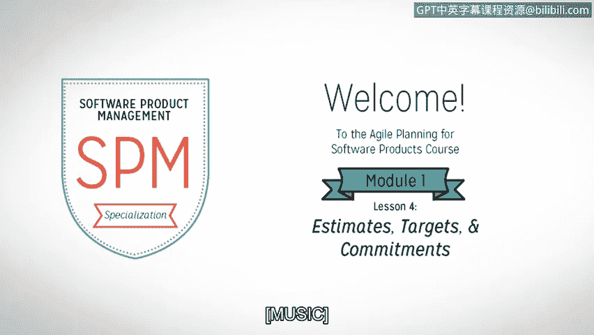
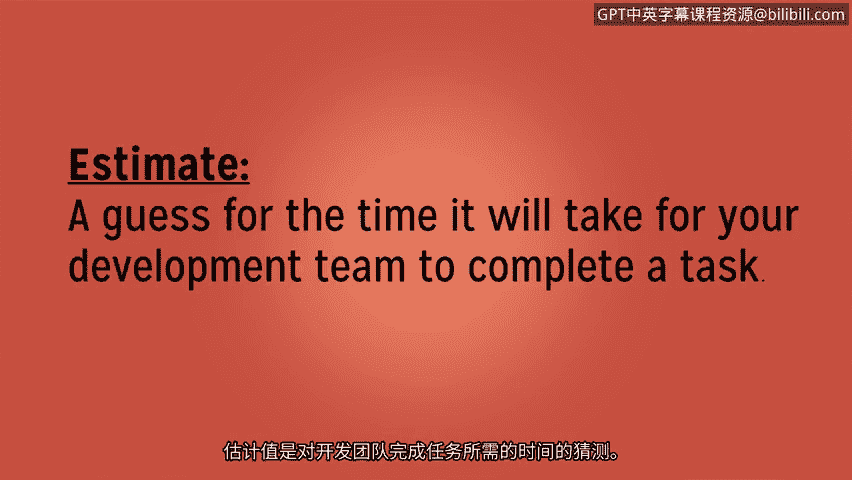
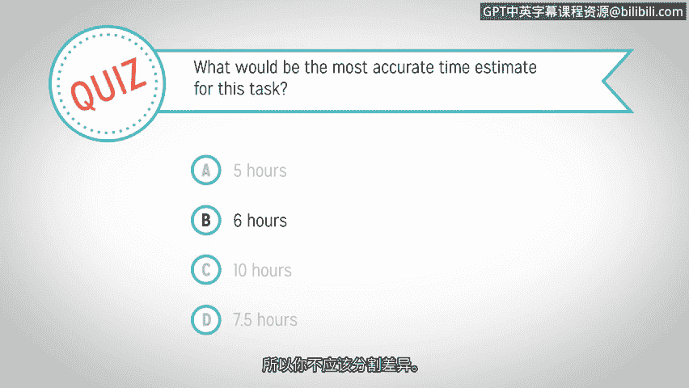
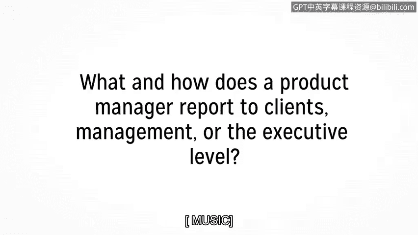

# 艾伯塔大学软件产品管理课程4：《面向软件产品的敏捷规划》：4.1.4：估计、目标和承诺

在本节课中，我们将要学习软件项目管理中的三个核心概念：估计、目标和承诺。理解并区分这些概念对于产品经理和开发团队的成功协作至关重要。

首先，请思考这句话：“我估计我们可以承诺在某个目标日期前完成。” 这句话听起来合理，在软件开发中也十分常见。然而，“估计”、“目标”和“承诺”这些术语经常被随意使用，有时甚至相互混淆。实际上，这些术语的含义截然不同。为了你和你的开发团队，清晰地区分它们非常重要。

接下来，让我们逐一审视这些术语。

## 估计：基于数据的合理猜测

一个**估计**是对开发团队完成任务所需时间的猜测。

估计应基于某些数据，例如完成类似任务的历史时间。估计通常应是一个范围，因为精确到小时或天数的预测往往不准确。此外，估计不应被讨价还价，重要的是尽可能准确。估计就是估计，它是什么就是什么。

让我们看一个例子。柯克是一名产品经理。他找到与他合作的开发人员莉兹，询问她开发某个功能需要多长时间。柯克过去与莉兹合作过，他认为如果莉兹努力工作，大约需要三小时。莉兹想了想，决定将她的估计延长一些，以便在工作中更轻松。她告诉柯克需要九小时。柯克告诉莉兹他认为只需要三小时，并提议折中一下。莉兹同意了，于是柯克记录六小时作为估计。**这不应该发生**。估计应该是现实的，这就是为什么基于先前工作来估计很重要。你可以准确地估计莉兹完成任务需要**三到九小时**。

为了巩固理解，请看以下场景：

你是一名与小型开发团队合作的产品经理。你正在与开发人员交谈，收集时间估计以帮助确定产品范围。你与一位名叫格雷格的开发人员交谈，问他为某个特定功能编写测试需要多长时间。你猜测需要5小时。格雷格刚刚为一个类似功能编写了测试，花了六小时。他想给自己一些缓冲空间，所以他告诉你需要10小时。你认为也许可以折中一下，写下七个半小时。

以下哪个是此任务最准确的时间估计？
A. 5小时
B. 6小时
C. 10小时
D. 7.5小时

正如我们之前所说，时间估计应基于先前类似的工作。这是获得估计最准确的方法，尤其是由同一人完成时。因此，**答案B是正确的**。当估计基于开发人员希望完成任务的时间，或基于经理希望开发人员完成任务的时间时，你就有可能高估或低估实际所需时间，因此答案A和C不正确。同样，估计不应是谈判。所以你不应该折中；因此，答案D也不正确。

## 目标：需要达成的理想时间点

现在让我们看看**目标**这个术语。一个**目标**是时间表中需要达成的一个点。这几乎是一个理想的截止日期。目标同样不应被谈判。目标的例子可以是冲刺的结束日期或产品发布日期。这些目标一旦确定，就必须遵守。目标日期用于安排产品推广活动，并且通常是合同性的。遵守这些目标日期对于客户满意度和产品成功至关重要。

## 承诺：基于协商的可交付范围

如果估计和目标都是不可协商的，那么你如何协商要开发什么内容呢？这就是**承诺**发挥作用的地方。承诺是进行谈判的地方。基于你的估计和目标，你可以协商你能承诺交付什么。你将不得不不断问自己：基于开发团队的估计和时间限制，我如何在团队承诺完成的内容上做出妥协？**承诺**是你同意交付的内容。

一个非常普遍的现象是，估计被自动转化为承诺和目标。

如果你被问及制作一个产品需要多长时间，你估计需要七个月，那么这个七个月就变成了你的承诺。而七个月后的日期就变成了你的目标。再次强调，**这不应该发生**。

让我们通过一个例子来看。假设我正在为一个家庭照看孩子。我问父母他们什么时候回家。他们说应该会在午夜左右回来。这是他们的**估计**。如果我要求他们做出一个**承诺**，即如果他们在那个时间没有回家，我将收取三倍的保姆费。他们可能会说12点30分，以便给自己一些缓冲时间，以防他们想多待一会儿或通勤时间比预期长。

理想情况下，你应该与你的开发团队讨论估计，得出一些准确的数字。你也应该与你的客户讨论目标日期。然后，基于这些项目，与你的开发团队和客户共同制定**承诺**。

请看以下场景：

你正在与你的客户和开发团队开会。你已经与你的开发团队谈过，他们根据以往的工作确定，要完成客户想要的所有功能，这个产品大约需要八个月。客户希望产品在假期前完成，因此她建议一个七个月后的发布日期。你们共同商定了一个包含大约五个月工作量的范围。六个月后，你的开发团队完成了最初商定的所有功能。

以下哪个时间是**承诺**？
A. 8个月
B. 7个月
C. 6个月
D. 5个月

当你的开发团队确定完成所有功能需要八个月的工作量时，那是一个**估计**。它基于他们先前的工作。因此答案A不正确。计划在未来七个月的发布日期将是**目标**；因此答案B不正确。你的团队实际开发所有功能所花的六个月，在这个场景中不是估计、目标或承诺；然而，你可以利用这个开发时间为未来的项目创建估计，所以答案C也不正确。你的开发团队和客户协商了包含大约五个月工作量的范围。那才是**承诺**。它是你的团队实际承诺要开发的内容。因此，**答案D是正确的**。

请记住，估计和目标一旦设定就是不可协商的。你可以协商的是你为项目范围所能做出的承诺。注意不要让你的估计变成承诺或目标。将这些项目分开，并确保你的团队和客户也这样做。这将防止你的范围变得过大，同时确保你能够真正满足目标日期。

## 行业实践：管理大型项目

现在，让我们看看行业人士如何处理涉及许多人的大型项目。

我们项目经理用来管理多个项目的技术之一是使用我们称之为“流”的概念。我们可能会创建活动流或项目流，并在项目集经理之下指派项目协调员或项目经理，真正理解每个项目内部的需求和可交付成果，以便我们可以汇总这些信息，并在项目集层面理解相互依赖性。通常，多个项目是相互关联的。当它们相互关联时，理解它们在先后顺序、什么需要先做、什么需要后做方面的相互依赖性，将所有这些汇总到一个总体时间表中，有助于我们的项目经理更好地理解它们如何相互关联。同样，我们可能会使用工作分解结构来理解所有可能需要相互关联的工作包。

我们使用几种不同的媒介向客户、经理和高管汇报项目情况。这些沟通方法包括状态报告、不同的会议纪要、行动日志、风险登记册等。我们给项目经理和产品经理的一个关键建议是，确保我们也使用非正式沟通，确保我们的文档中不会出现任何意外。因此，进行那种临时的、即兴的沟通，确保我们向利益相关者，特别是高管团队，传达不同的想法、可能出现的风险或问题，这一点很重要。高管团队可能并不总是有时间阅读所有包含大量细节的文档、状态报告和风险登记册。因此，你需要创建新的沟通媒介，以适应那些更繁忙的受众和利益相关者。对我们来说，我们采用“无意外”理念，并确保我们有一些即兴的沟通，通过口头或电话方式交流不同的想法。

在敏捷实践和我们面临的一些挑战方面，我们是一个横跨北美多个分支机构的虚拟社区，因此我们面临的一个挑战是真正理解和管理虚拟团队。我们如何协作？当并非所有人都在物理上在场时，我们如何进行诸如 Scrum 会议这样的活动？因此，跨不同地点的团队之间的协作和统一对我们来说是一个挑战。

## 产品经理的职责范围

Todd Bser 是 KeyV 产品管理公司的顾问，他对产品经理的职责有一个很好的定义。他着眼于产品经理负责的四个不同领域：市场情报、产品战略、产品开发和生命周期管理。简而言之，市场情报是指研究市场动态、流行趋势、人们使用的解决方案、使用的货币化模型类型、我们的客户或潜在客户在做什么，以及市场上可供我们使用的技术，以帮助解决问题。产品战略方面，我们关注货币化模型、开发环境与技术能力之间的契合度，最重要的是定义差异化优势——我们与其他人有何不同，以及我们如何为世界上需要技术帮助的真实人群解决问题。当这些确定下来后，我们开始制定路线图，即制定如何构建某物以及它应该是什么样子的计划。

## 协调不同利益相关者

存在一个经典的代理问题，这意味着不同的人有不同的奖励机制，他们对产品有不同的期望。在软件开发中，资源消耗极大，进展速度也不如这些群体所希望的那样快。这非常困难，需要花费大量时间与人交谈，了解他们的需求、观点，并找到共同点。对于一个新项目，如果人们的想法都很新颖，并且有很多共同经验，这可能相对简单。但通常情况下，不同的群体有着非常不同的目标、个性、工作风格，并且需要不同的环境和背景来完成工作。

他们可能使用不同的语言，例如技术人员会使用技术术语，这可能会让其他群体感到不快或误解。因此，表面上常常存在很多冲突。我所做的很多工作是尝试找到共同点。在一些项目中，我会采访人们并制作亲和图。我会拿出不同颜色的记号笔和同义词词典，查看名词、动词和形容词并突出显示它们，然后说：“看，你们实际上说的是同一件事。” 找到那个共同点、那个共同性。另一个重要的事情是，当存在一个焦点和差异化优势时，提醒人们我们为什么从事这项业务，我们正在为特定用户解决什么问题。如果我们能把这种宏观视角带入我们的对话中，设定背景，那将真正有助于让人们保持专注。

## 总结

在本节课中，我们一起学习了软件项目管理中三个关键概念：估计、目标和承诺。我们明确了估计是基于数据的合理猜测，目标是必须遵守的理想时间点，而承诺则是基于协商确定的可交付范围。区分这三者对于有效管理项目范围、确保团队交付能力和满足客户期望至关重要。记住，估计和目标不可协商，而承诺是谈判的焦点。保持这些概念的独立性将帮助你更好地规划和管理软件产品。

在下一个模块中，布拉德利将教你如何创建准确的估计，以及如何利用这些估计来组织项目发布的任务。