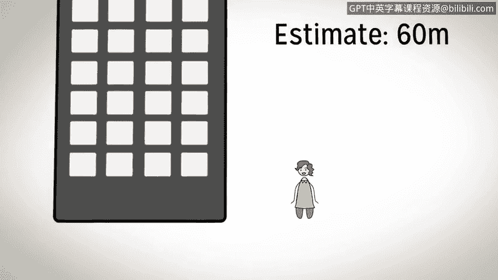
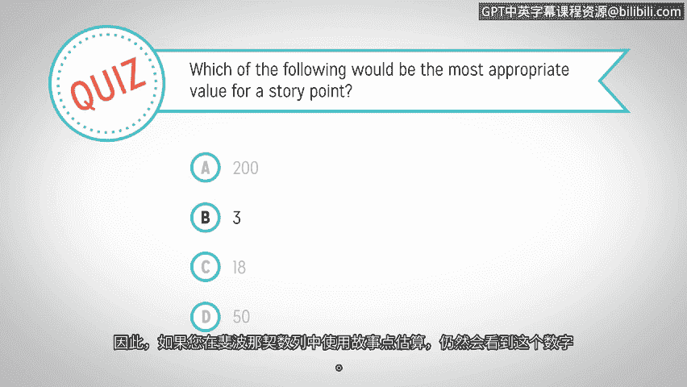

# 艾伯塔大学软件产品管理课程4：《面向软件产品的敏捷规划》：4.2.1a：故事点 📊

## 概述
在本节课程中，我们将学习敏捷规划中的一个核心概念：**故事点**。我们将探讨为何要使用故事点来替代传统的时间估算，了解其工作原理、优势以及潜在的风险。

---

## 故事点的起源与目的
故事点的诞生源于保护开发者心智健康的需要，因为估算常常被误认为是承诺。这在软件项目管理中是一个普遍存在的巨大问题。

因此，开发者对于为特定任务给出确切的时间估算感到抗拒。开发者可能被迫向管理者提供任务完成时间的估算，而管理者最终会将这个估算视为承诺。管理者又会将这个“承诺”传达给他们的上级，突然间，产品的内部截止日期就建立在某位开发者粗略估算的基础上了。

更糟糕的是，如果开发者的工作最终花费的时间超过了他们的估算（这种情况经常发生），那么这位开发者就会感受到压力。这并非因为开发者表现不佳，而仅仅是因为他们没能做出准确的估算。一个不准确的估算也未必反映了开发者缺乏经验或能力。

正如你将在本节关于任务时间估算的课程中看到的，做出可靠且准确的估算非常困难，尤其是当你对未来很远的事情进行估算时。

---

## 故事点如何解决问题
故事点试图解决这个问题的方法是：**消除时间作为估算工作的度量单位**。相反，在估算所需完成的工作量时，使用故事点。

故事点是**无量纲**且**相对**的。关键在于，它让开发者不再试图估算某项工作将花费的确切时间，而是转向估算这项工作相对于其他工作所需的时间长短。

---

## 故事点的工作原理
以下是它的工作方式。你的开发者从产品待办事项列表中选择一个相对容易估算的产品需求，即一个用户故事。

然后，开发者为其分配一个任意的整数值，我们称之为故事点。一旦有了这个基准值，你就可以基于它为其余的用户故事分配故事点。

因此，如果下一个用户故事规模大致相同，它将获得相同数量的点数。如果随后的故事规模大约是两倍大，那么你就分配两倍的点数，依此类推。

最终你得到的是一个用户故事列表，其工作量估算都是相互比较得出的，而不是开发者在估算每个用户故事所需时间时，无意中承诺了某个具体的时间量。他们是在确定每个用户故事的**规模大小**。而这正是估算应有的样子。

请记住，估算不应该是承诺，因此将时间因素从中剔除有助于防止它们变成承诺。

这种方法之所以有效，是因为人类实际上非常不擅长精确地估算事物。我们更擅长基于相对大小进行估算。

---

## 现实世界示例
让我们看一个现实世界的例子来演示这个概念。假设你想估算一栋建筑的大小。你试图凭直觉估算它的大小，并说它大约有60米高。

另一种方法是将其大小与另一栋建筑进行比较。

选择附近一栋较小的建筑，用它作为比例尺。那么那栋较高的建筑可能相当于三栋小建筑的高度。

在软件领域，这种方法还有一个额外的好处，即有助于保持开发者的心智健康。估算故事点时不必追求精确，因为一切都是相对的。

如果开发者的时间估算超时，即使只是几分钟，也可能对他们造成心理压力。他们可能会因为未能按时完成估算而对自己感到不满。而使用故事点，则不容易“超时”，因为估算与时间无关。

---

## 知识检查
你刚刚学习了一些关于故事点的知识。它们是一种避免在使用小时估算时意外做出承诺的方法。

故事点的哪些特性使其适合用于估算而不至于变成承诺？你可以选择多个答案。
A. 故事点是无量纲的。
B. 故事点的数值可能因项目而异。
C. 故事点更难理解。
D. 故事点不直接映射到一个时间值。
E. 故事点完全不映射时间。

**答案：A、B 和 D。**
故事点是无量纲的，并且它们的数值因项目而异。由于它们因项目而异，其时间价值也可能因项目而异，但这并不意味着故事点完全不映射时间。

---

## 使用斐波那契序列
故事点常常被误解，因为它们经常被赋予像小时一样被对待的数值。例如，如果你将第一个用户故事设为100个故事点，那么你的开发者就很容易基于此为其他用户故事分配非常精确的点数。因此，你可能会看到其他用户故事被分配了诸如42点这样的值。

如果使用用户故事的整个要点在于相对性，那么使用如此精确的数字就没有太大意义。为你的故事点设置正确的数值非常重要，这样才能保持点数的相对性。

帮助支持这种相对性的一种方法是使用固定的故事点数值。一个好的做法是基于**斐波那契序列**来分配故事点。

斐波那契序列是一个数字序列，其中任何一个数字都是前两个数字之和。因此，一个斐波那契序列可能看起来像这样：1, 2, 3, 5, 8, 13 等等。

斐波那契数列使得使用故事点进行估算变得非常简单。你不是使用任何你认为可行的数字，而是限制自己只使用斐波那契数列中的数字进行估算。如果你的估算落在两个可用数字之间，你会向上取整到最接近的可用数字。

这使你的估算保持整洁，并且由于存在不确定性，避免了不必要地使大估算过于精确。

因此，如果你的第一个任务估算被分配了3点，而你的下一个任务看起来大约是它的两倍大，你不会分配6点（因为你受限于斐波那契序列），而是会将你的估算向上取整到8点。通过这种方式，你可以控制你的估算，并在处理不确定性的同时避免做出无意的承诺。

---

## 另一个知识检查
以下哪个值最适合作为故事点？
A. 200
B. 3
C. 18
D. 50

**正确答案是 B，3。**
因为3这个数值既小又好，很容易围绕它估算其他值，而不会陷入点数的百分比计算。3也是最常见的斐波那契序列中的一个数字。因此，如果你在斐波那契序列中使用故事点估算，它仍然是一个你会看到的数字。

---

## 故事点的争议与风险
故事点是替代按可能花费的小时数来估算工作的一个很好的选择。然而，故事点并不是业界广泛接受的实践，即使在敏捷软件开发和Scrum最坚定的支持者中也是如此。如果故事点效果这么好，为什么还会存在争议呢？

故事点可能有些棘手。首先，实施它需要一种非常特殊的思维方式。对于开发者来说，突然将思维从时间估算转向点数估算可能是一个令人困惑的要求。

最终经常发生的情况是，开发者会将预测的若干小时数转换为特定数量的故事点，因为这对他们来说最合理。然而，这完全违背了故事点的初衷。你可能会认为这只是个教育问题。确实，经过一些练习后，开发者确实能更好地使用故事点来估算他们的工作。

然而，估算本身存在一些固有的限制，这使得故事点成为一个敏感话题。其中一个限制是，估算行为本身就是一项有风险的工作。你永远无法100%确定任何给定的估算都是准确的，这就是为什么它们被称为“估算”。虽然相对大小的估算比精确的数字估算要准确得多，但相对大小估算仍然不完美。

一个很好的例子是垂直-水平感知错觉，它展示了我们在这方面有多不擅长。本质上，当一条垂直线段放在一条等长的水平线段上方时，人们往往会高估垂直线段的长度。所以，即使只是几条线段，也很容易看出我们并不擅长精确估算某物的大小，即使你有直接的比较对象。

另一个问题是，故事点在大型团队中可能会失控。它们本意是可扩展的，但有些开发者可能会为非常小的任务给自己虚高的故事点，以制造高生产力的假象。如果整个项目中每个点的估算基准是一致的，这倒没问题。但有可能管理者会要求团队在项目中期加倍努力以提高生产力。如果此时开发者通过改变故事点的参考基准人为地虚报数字，准确的估算就变得更具挑战性。

基本上，故事点容易受到“玩弄系统”或作弊的影响，这对管理者来说是一个潜在的担忧。这并不是说故事点一定不好，但使用它们确实存在风险，如果你打算将它们整合到你的项目中，你应该了解这些风险以及如何减轻它们。

---

## 总结
本节课我们一起学习了**故事点**。它是一种基于相对概念来估算工作量的方法，旨在避免将估算误认为承诺。我们探讨了其工作原理、使用斐波那契序列的好处，以及在实际应用中可能遇到的争议和风险。

在下一节课中，我将介绍**速率**的概念，这是一种衡量团队长期生产率的方法。下次见。😊