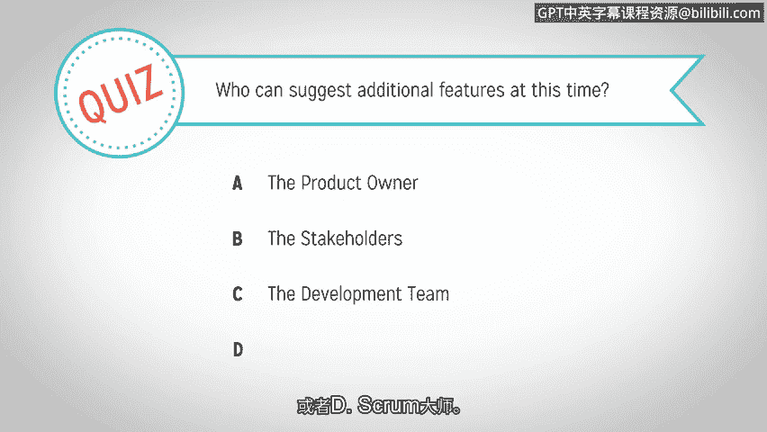

**软件产品管理课程5：第5.1.2节：冲刺评审会议** 🎯

## 概述
在本节中，我们将学习冲刺评审会议。这是敏捷开发中一个关键的活动，用于展示产品成果、获取反馈并确保团队正在构建正确的产品。

---

## 敏捷术语回顾
在深入细节之前，我们先回顾一下本课将用到的敏捷术语。

*   **冲刺评审会议**：一种常见的Scrum活动。
*   **Scrum主管**：负责推动Scrum实践的角色。
*   **产品负责人**：负责管理产品待办事项列表的角色。
*   **冲刺**：指代迭代周期。

在冲刺结束时，会发生两个不同的Scrum活动：**冲刺评审会议**和**冲刺回顾会议**。简单来说，冲刺评审会议是**展示产品**的地方，而冲刺回顾会议是**重新评估和讨论团队流程**的地方。

> 你将在本课程的最后一个模块中学习冲刺回顾会议。冲刺评审会议在冲刺回顾会议之前举行。

---

## 冲刺评审会议详情
现在，让我们深入了解细节。我们在“软件过程与敏捷实践”课程中关于Scrum的课程里介绍过Scrum活动。

### Scrum活动与时间盒
Scrum活动贯穿整个开发过程。冲刺、每日站会、冲刺评审会议和冲刺回顾会议都是Scrum活动的例子。除了冲刺本身，其他Scrum活动都是获取反馈和评估进展的正式机会。

所有Scrum活动都是**时间盒化**的，这意味着它们不能超过预定的时间。

为冲刺评审会议建议分配的时间是：**冲刺的每一周对应一小时**。
因此，如果你的冲刺为期两周，你应该将评审会议时间盒设定为两小时。如果你的冲刺为期一个月，评审会议应分配四小时。

**小测验**
你正在为你的开发团队安排冲刺评审会议。你的团队刚刚完成了一个为期三周的冲刺，他们渴望展示进展。这个会议最长应该持续多久？
A. 一小时
B. 每周结束时各一小时
C. 三小时
D. 需要多久就多久

**答案：C**
你应该将冲刺评审会议时间盒设定为冲刺每周对应一小时。由于你的团队采用三周长的冲刺，你应该为此会议安排三小时。会议不应超过三小时，因此C是正确答案。

---

## 会议参与者
接下来，我们谈谈谁应该被邀请参加冲刺评审会议。答案很简单：**任何对产品感兴趣的人都被邀请**。或者用本专业的术语来说，**所有利益相关者**都应被邀请。

通常，会议包括Scrum主管、产品负责人、Scrum团队、管理层、一些客户和用户，可能还有其他项目的开发人员。

会议旨在保持**非正式**。这意味着不需要幻灯片演示，只需最少的准备。由于会议的核心是展示产品，唯一需要的准备就是将产品开发成可工作的软件——这正是开发团队在冲刺期间应该做的事情。这些会议几乎不需要额外准备，因为冲刺评审会议不应分散开发团队的注意力。

---

## 会议中的角色
我们来谈谈冲刺评审会议中的一些角色。

*   **Scrum主管**：负责**引导会议**。他们确保会议保持在时间盒内，确保对话不偏离主题，人们提出相关意见，并以适当的方式提问和提供反馈。
*   **开发团队**：虽然Scrum主管引导会议，但通常由**开发团队来主持会议**。团队中的每个人都应在会议中有所贡献，因为他们都参与了工作。
*   **产品负责人**：负责**批准功能**，并确保Scrum团队遵循整体的产品愿景。
*   **其他利益相关者**：在会议结束时有机会提出反馈和改进建议。

**小测验**
你是冲刺评审会议上的Scrum主管。当开发团队演示产品时，一位利益相关者提出了一个新功能的建议。开发团队、产品负责人和该利益相关者开始讨论这个新功能。作为Scrum主管，你应该怎么做？
A. 加入讨论
B. 将该功能添加到待办事项列表中
C. 让他们完成讨论
D. 要求他们将功能建议留到会议结束时再提

**答案：D**
作为Scrum主管，你负责引导会议，这意味着要确保会议按计划进行。你希望将功能建议留到会议结束时再提，这样可以让开发团队完整地演示他们的产品而不受干扰。如果对话开始偏离主题，你应该引导他们回到正轨，否则你可能会超出时间盒。因此，D是正确答案。

---

## 会议流程
现在，我们来谈谈会议中具体会发生什么。

Scrum主管应以介绍会议准则开始。这些准则可能包括人们何时可以发言或提出建议等。

随后，Scrum团队应**回顾冲刺目标**。重申冲刺目标后，冲刺评审会议会发生三个主要事件：

以下是会议的核心环节：

1.  **产品演示**
2.  **产品负责人批准**
3.  **利益相关者反馈**

### 1. 产品演示
首先，Scrum团队演示产品。演示应尽可能真实，使用合适的平台。例如，如果团队正在创建移动应用，他们应该使用移动设备进行演示。

演示也应该是**真实的**。这意味着功能不应仅为演示而进行硬编码。它应该是已完成功能的现场演示。

**功能只有在满足团队的“完成定义”时才能被演示。** 未完成的功能应留待未来的冲刺评审会议，当它们完成时再展示。

例如，产品演示只包括那些已编码、已测试、已文档化、可用且准备发布的功能。

**小测验**
在当前冲刺中，开发团队计划构建四个功能（我们称之为用户故事A、B、C和D）。用户故事A和B满足了团队的“完成定义”。用户故事C已完成且能工作，但尚未经过充分测试。用户故事D离完成还很远，但开发人员可以对其进行硬编码，使其在演示中看起来能工作。开发团队应该在冲刺评审会议上演示哪些用户故事？
A. 用户故事A、B
B. 用户故事B、C
C. 用户故事C、D
D. 用户故事D

**答案：A**
你的开发团队应该只演示那些满足Scrum团队“完成定义”的用户故事。这通常意味着它们已编码、可测试且可用。只有用户故事A和B符合这个标准。用户故事C在演示前仍需测试，这对于确保产品按预期工作很重要。你绝不应为演示而硬编码功能，因此A是正确答案。

### 2. 产品负责人批准
产品演示之后，产品负责人从产品待办事项列表中**批准已完成的功能**。一旦产品负责人批准了一个功能，它就会从产品待办事项列表中移除。团队可以选择在会议上完成批准，或者产品负责人可以在花额外时间评估产品后再批准。

### 3. 利益相关者反馈
批准之后，Scrum主管向利益相关者开放发言权。这是利益相关者提问、建议功能和提供反馈的机会。

通常，反馈采取以下三种形式之一：
*   可以是**赞扬**，表示产品或功能方向正确。
*   也可以**建议需要更改或改进的领域**。
*   或者，反馈可能**指出引发新问题或需要重新审视假设的领域**。

由于待办事项列表由产品负责人维护和确定优先级，利益相关者可以自由提出任意多的功能建议。由产品负责人决定是否以及何时开发这些功能。这也是产品负责人可以建议将功能加入待办事项列表的时机。

我们之前提到过，不应在冲刺中途将建议添加到冲刺待办事项列表中。现在（评审会议结束时）是添加建议的适当时机。

**小测验**
在冲刺评审会议上，你已经进入了第三个阶段，即开放会议以征求建议和反馈。此时，谁可以提出额外的功能建议？
A. 产品负责人
B. 利益相关者
C. 开发团队
D. Scrum主管

**答案：A, B, C, D**
在会议的这个阶段，**任何人都可以**建议将功能添加到待办事项列表中。产品负责人负责确定待办事项的优先级，并选择何时以及是否构建功能。让任何人提出建议并无害处，因此A、B、C、D都是正确答案。

---

## 总结
本节课我们一起学习了**冲刺评审会议**。冲刺评审会议是展示Scrum团队辛勤工作、提高透明度并获取宝贵反馈的绝佳机会。它们也为Scrum团队提供了明确的工作目标，并鼓励他们产出可工作的软件。

在下一课中，我们将继续讨论如何交付正确的产品，重点介绍用户研究及其在软件开发中的应用。