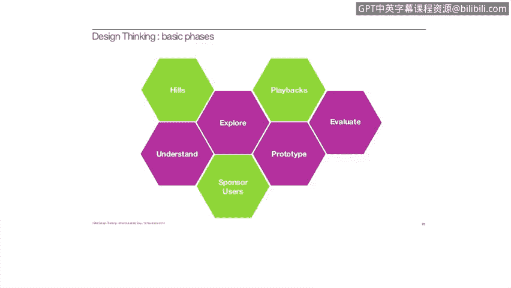

# 006：行业范例 🏢

在本节课中，我们将探讨几家主要公司如何打造正确产品的行业范例。之后，我们将了解一位高效产品经理需要关注的其他领域。

## 苹果公司的设计流程 🍎

首先，我们从一个以持续交付正确产品而闻名的公司开始：苹果公司。苹果以其优雅的产品著称。他们是如何做到持续交付正确产品的呢？

当一个想法形成后，苹果会从原型设计开始。苹果的原型设计通常被称为“像素完美”原型或“10-3-1”原型设计法。

他们最终的、接近成品的原型之所以被称为“像素完美”，是因为其设计精细到了每一个单独的像素。这意味着他们不仅设计界面，更是以最高级别的细节——像素级——进行设计。可以想象，这种做法成本高昂且不够敏捷，但它似乎行之有效。

“10-3-1”原型设计法得名于设计师开发原型的方式。设计师们不受限制地构思出**10个不同的原型**。这非常类似于精益开发，即在做出决策前探索多个原型。然后，他们会选出**3个最佳设计**并进一步探索这些选项。最后，他们会选定**1个最优方案**，并将其原型设计到像素完美级别。

苹果公司还进行定期评审。他们每周举行一次高管团队评审会，审查生产过程。此外，他们还有同行设计会议，这是一个专注于改进设计的、由设计团队和工程师参与的会议。

苹果的设计流程非常详尽，因此成本也很高。但正如市场所见，它是成功的。苹果产品多年来主导市场，因此精心设计工作的投入似乎是值得的。

> **问题**：为什么苹果的原型设计方法被称为“像素完美”？
> A. 因为苹果产品中的像素总是完美的。
> B. 因为原型设计确保产品中的所有像素都是完美的。
> C. 因为原型设计精细到了单个像素的级别。
> D. 因为这听起来很酷。
>
> **答案**：C。苹果将其一种原型设计方法称为“像素完美”，是因为原型设计达到了最高级别的细节——像素级。

## 谷歌的设计冲刺流程 ⚡

现在，我们来谈谈软件产品与服务领域的另一个巨头：谷歌。谷歌创建了他们的“设计冲刺”流程。这一流程也被其他公司采用，如爱彼迎和蓝瓶咖啡。

这个过程快速且迭代，将过去需要数周或数月的工作压缩到一周，有时甚至更短。谷歌眼镜的原型就是使用这个过程在不到两小时内完成的。这类似于“尽可能快地交付”的精益原则。

设计冲刺包含五个阶段：

以下是设计冲刺的五个阶段：
1.  **理解**：工程师和设计师评估当前问题，并确定设计对象。
2.  **发散**：鼓励参与者为问题想出尽可能多的解决方案，无论它们看起来多么不切实际。
3.  **决定**：参与者投票并讨论哪些想法值得进一步详细探索。
4.  **原型**：参与者快速绘制草图并构建原型，重点关注用户界面和用户体验。
5.  **验证**：将产品交给用户，鼓励设计师和工程师进行演示，并收集用户反馈。

这个流程的每个阶段都计划在一天内完成。

> **问题**：设计冲刺的五个阶段是什么？
> A. 理解、发散、决定、原型、验证。
> B. 评估、头脑风暴、投票、创建、测试。
> C. 理解、头脑风暴、决定、原型、测试。
> D. 评估、头脑风暴、决定、原型、测试。
>
> **答案**：A。设计冲刺的五个阶段是：理解、发散、决定、原型、验证。

## Intuit的“跟我回家”验证法 🏠

我们已经讨论了一些大公司如何设计正确的产品，现在来看看另一家大公司如何验证其产品确实是正确的产品。Intuit采用了一种名为“跟我回家”的方法。

Intuit是一家制作会计软件的公司。其创始人斯科特·库克在公司早期就开始了这项实践。库克会待在当地的办公用品商店，等待有人购买他的软件。然后，他会询问顾客是否可以跟随他们回家，观察他们安装和使用软件的过程。这种做法听起来有点令人不安，但非常有效。它让Intuit能够打造出真正适应用户环境并完全满足其需求的产品。

Intuit现在仍以更可控的方式继续使用这种方法。他们平均每年进行约20次访问，每次访问大约一小时。在访问期间，他们观察客户使用软件的情况，并记录客户的工作环境、办公室的工作方式以及软件如何融入业务。

> **问题**：“跟我回家”方法提供的是什么？
> A. 验证
> B. 确认
>
> **答案**：B。“跟我回家”方法提供的是对产品的**确认**。它测试的是用户的满意度，而不是测试特定功能是否按预期工作。

## IBM的设计思维实践 💡

IBM实施了一项名为“设计思维”的实践，它结合了原型设计、用户观察和敏捷开发。设计思维是斯坦福大学开发的一个概念，后来被IBM采用并调整以适应其需求。

设计思维专注于识别人们的需求，并提出满足这些需求的解决方案。传统的设计思维有四个主要阶段：理解、探索、原型、评估。IBM对此进行了调整，增加了三个阶段：赞助用户、山丘和回放。

这个过程始于最终用户。你需要找出用户需求未被满足的原因。为了理解用户需求，你需要找出实际的用户是谁，并发现他们如何思考、看到什么、如何使用产品以及用产品做什么。

然后，他们寻找对产品感兴趣的候选人，并最终确定一位具备典型用户许多特征并面临许多相同问题的候选人，这就是**赞助用户**。随着产品的成长，他们被用来提供见解。团队与赞助用户合作以获得见解和信息，并以此识别产品的问题。这个挑战就是**山丘陈述**。

接着，团队将这个问题带给更大的团队以寻求解决方案。团队探索针对该挑战的各种解决方案，剔除糟糕或不切实际的想法。一旦解决方案范围缩小，他们就开始为这些解决方案绘制草图，然后更正式地将想法原型化。可能需要几次迭代才能确定最佳方案，这些迭代被称为**回放**。

最终，创建一个工作模型并与最终用户一起评估。根据赞助用户的反馈对想法进行迭代改进。改进后，产品发布，但会根据新的用户需求持续测试和改进。

---

**本节课总结**：在本节课中，我们一起学习了四家领先科技公司（苹果、谷歌、Intuit、IBM）用于确保产品正确性的核心方法论。从苹果的“像素完美”精细设计，到谷歌的快速“设计冲刺”，再到Intuit深入用户环境的“跟我回家”验证，以及IBM结合用户洞察与敏捷迭代的“设计思维”，这些范例展示了产品开发中理解用户、快速迭代和持续验证的重要性。