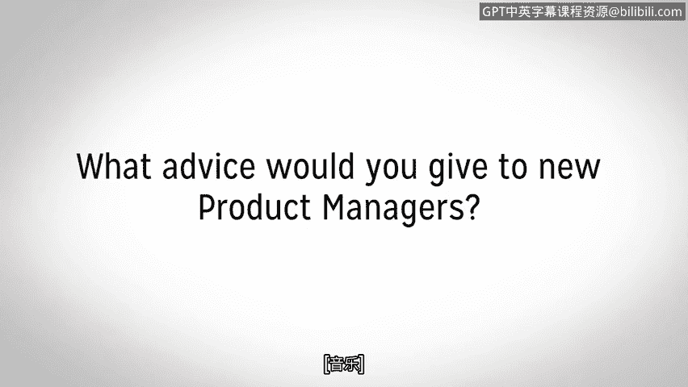

# 007：行业范例访谈

在本节课中，我们将通过一位视频游戏行业产品经理的访谈，学习产品经理如何运用产品战略、生命周期管理和市场情报来识别并实现正确的产品。我们将了解产品经理的核心职责、所需技能以及衡量产品成功的关键方法。

---

上一节我们探讨了行业巨头如何交付正确的产品。本节中，我们来看看产品经理如何运用产品战略、生命周期管理和市场情报来识别并实现正确的产品。

我的名字是Clon Costa，我是一名制作人，相当于视频游戏行业的产品经理。

作为一名产品经理，我需要负责产品的三大支柱：一是产品战略，我需要深刻理解产品的愿景，并确保团队也理解它；二是产品本身的开发；三是产品如何触达消费者，即产品的分发。

---

软件产品经理需要具备出色的沟通能力。他们还需要深刻理解市场趋势和竞争对手的优势。你必须擅长了解市场现状，并且非常精通如何创造软件。你对软件开发理解得越深，就越能帮助团队实现之前设定的产品愿景。最后，同样重要的是，你需要理解产品的商业层面，包括你将采用何种商业模式、如何最终触达消费者（是通过数字分发还是零售）。所有这些能力的结合，才能造就一名优秀的软件产品经理。

---

市场情报是理解市场现状的能力：你的消费者是谁？你的受众是谁？你和消费者之间是否有零售商（他们可能也是你的客户）？当前市场在技术、分销或商业模式等方面有何趋势？它也是你理解市场需求的能力：当前市场是否存在尚未被满足的空白？你能否触及这个空白并比其他人做得更好？这就是我所说的市场情报。

我认为这需要大量的研究。你必须投入精力去理解市场，所以你需要大量阅读。在软件开发领域，你还需要去玩、去使用其他软件，以便理解竞争对手的优势。你还需要阅读与你领域（比如我所在的视频游戏领域）相关的杂志、博客或网站。同时，你需要理解如何触达消费者。如今，你可以通过社交媒体直接联系消费者，询问他们在特定产品中寻找什么，或者他们认为某个竞争对手好在哪里、不好在哪里，从而去填补市场空白。

你必须大量使用市场上现有的软件。你需要非常了解自己的软件，需要非常注重细节，深刻理解你的软件为市场提供了什么。同时，你也需要对所有竞争对手做同样的事情。此外，你需要找到一种方式与消费者直接对话，可能是焦点小组，也可能是利用社交媒体。你需要理解是否存在市场空白，是否存在新出现的不同需求，或者市场领导者是否存在你可以做得更好的弱点。

---

对于用户画像，我们通常的做法是考虑原型和人物角色。你需要尝试理解，以视频游戏开发为例，我们拥有非常广泛的受众，需要理解其中的细分群体，然后为每个细分群体创建人物角色。例如，这可能是一个20岁、21岁的医学生，他想玩电子游戏，因为这对他是一种逃避。另一个角色可能是一位艺人或一位有空闲时间的母亲。你需要创建这些人物角色，一旦有了这些角色，你就要看看你软件的功能如何与这些角色对齐，是否真正满足了这些角色的需求。

产品战略首先是理解你需要构建什么的能力。你的软件必须具备什么才能击败市场上的竞争对手？这是产品战略需要做的事情之一。另一件你需要理解的事情是，你需要为你的产品制定商业模式：你将如何销售你的软件？是订阅制、一次性付费，还是某种免费软件（30天后销售软件的另一部分）？商业模式多种多样，这真的取决于你的市场、你的竞争对手以及你正在做的事情。所以你需要理解你需要构建什么、如何销售它以及如何实际触达消费者、如何分发它。

产品经理需要创造愿景。他需要成为消费者和开发团队之间的桥梁。他需要创造这个愿景，并以非常简洁、简单的方式告诉团队他们需要构建什么、为什么这很重要，以及为什么这足以击败市场上所有的竞争对手。

你的产品愿景可以包含我们所谓的独特卖点。如果你有，比如说五个独特卖点，希望你的产品也会有与这些支柱相关的强大功能。一旦你有了软件的原型，或者已经有了测试版或Alpha版，你就可以创建焦点小组，接触特定的用户群体，实际测试他们如何接受你的软件：他们喜欢这个新功能吗？它足够有吸引力吗？它比市场上的现有产品更好吗？这是一种方法。你可以获得反馈，如果存在摩擦点，你可以减少摩擦点，改进功能，然后再次推向市场。如果你在整个开发周期中持续这样做，那么在发布时，你应该会有一个强大得多的产品。

我认为将你的产品与市场上其他产品区分开来的第一步，是理解你自己的优势和劣势。以我们公司为例，我们在某些领域拥有其他竞争对手所没有的优势，我们努力强调这些优势，确保我们的产品带有我们的标志，让消费者知道这是我们公司的产品。

所以，首先要理解你的优势和劣势，并理解它们如何与市场需求相关联。因为如果你在一个市场并不真正需要的领域很强，那对你没有帮助。但如果这里存在市场空白或需求，而你恰好擅长于此，那么你就能真正做出改变。

---

产品的货币化模型，对于软件产品来说，现在有很多不同的模式，而且市场变化很快。你可以采用传统的零售模式，在商店销售实体盒装产品；可以采用数字分发，用户只需下载你的软件；可以采用订阅制，就像现在很多软件做的那样；也可以混合模式，比如提供某种免费游玩的软件版本，消费者可以免费下载，但如果想要高级功能，则需要订阅、支付全价或为产品的部分功能支付不同类型的费用。所以，现在桌面上有很多不同的商业模式，这真的取决于你试图进入的市场，取决于你特定市场的消费者。

在初创公司，产品经理拥有更大的灵活性，他必须身兼多职。通常他没有很多资金，但他有一个小团队，可以非常灵活和迭代。我认为这些对于初创公司的产品经理来说是积极的方面。但你需要非常执着和有韧性，因为事情不会容易，因为你的团队很小，资源通常也很有限。在大公司，你拥有更多可用资源的优势，可以进行更好或更广泛的研究、不同类型的调查，甚至可以专门前往世界上有消费者的特定地点与他们交谈。但同时，你可能需要经历更冗长的流程来完成事情，有时需要协调组织内的许多不同团队。因此，对于产品经理来说可能更困难，因为他需要说服更多的人才能完成某件事。

---

一个软件产品常见的生命周期是：首先有一个预生产阶段，在这个阶段你需要理解你的产品需要是什么（不同行业可能称之为构思阶段）。你需要理解你需要构建什么，以及为什么这个产品比市场上的现有产品更好。这是你设定愿景、让团队围绕一个足以击败市场上所有人的愿景达成一致的阶段。你还需要确保在预生产阶段有足够的资金，并尝试迭代和创建原型，以尽快验证你设想的功能是否真的如你预期那样强大。

预生产阶段之后是生产阶段。这时你已经知道需要构建什么，现在就是关于构建它、扩大规模，并确保在预算或时间等约束下完成一切。你将在生产阶段工作并开发产品。

开发产品之后，我们会进入所谓的最终阶段。在这个阶段，我们尽可能地对产品进行打磨，尝试消除所有错误。我们甚至可能发布一个测试版软件给成千上万的消费者，让他们使用我们的软件，然后反馈给我们哪些地方运行良好，哪些地方不行，他们喜欢什么，不喜欢什么，以便我们在软件正式发布前进行修复。

发布软件之后，我们进入发布阶段。在这个阶段，你需要分发你的软件，让软件实际触达你的消费者。如果你有数字分发和零售商，确保一切正常运转，消费者知道这个软件，并且有办法购买它。

发布阶段之后，在我们特定的案例中，有一个我们称之为实时服务的阶段。这意味着我们必须为软件发布后的所有工作制定路线图，可能包括修复软件的错误补丁，也可能是基于从消费者和游戏记者那里收到的反馈，推出带有新功能的软件扩展。

一旦我们获得反馈，我们会根据现有团队对需要做的事情进行优先级排序，然后制定路线图，产品经理领导这个路线图的制定。

---

产品发布后，你需要理解的第一件事是你的产品如何被消费者接受。你必须快速分析从消费者角度看，哪些方面做得很好，哪些方面做得很糟。对于一些做得不好的地方，你可能能够通过补丁来修复，或者可能需要快速添加一个功能，从而为你的产品创建一个扩展和更新。另一件你需要做的事情取决于你的产品是否也变成一项服务。如果是一项服务，你需要与消费者保持持续的沟通，了解哪些方面进展顺利，他们不喜欢什么，这样他们可以帮助你为产品制定更好的长期路线图。

衡量软件产品成功的方法有很多种，这真的取决于你的行业。你可能以销售数量、收入、利润率来衡量，也可能以产品质量来衡量（这可以根据行业通过某种评分来测量和比较你的软件与其他软件）。但通常，最终都会回到消费者满意度上。你需要理解消费者如何接受你的软件。一个好的产品经理需要非常精通分析，知道如何利用软件的遥测数据来获取关于需要更改事项的重要数据。

通常，一个好的产品经理会首先尝试创建关键绩效指标。一旦你有了你的KPI（这真的取决于你所在的行业），你就可以开始衡量你的软件是否成功。在内部，你可能有一些KPI，比如对于开发团队，你可能关注每小时崩溃次数或服务器正常运行/停机时间。另一方面，你可能有一些其他指标，比如同时访问服务器的实际人数，即你当前的最高同时在线用户数。有很多不同的指标可以帮助开发团队理解他们的服务或产品是否运行良好。

在外部，你衡量其他一些因素。通常我们有一个我们称之为AOE-M的漏斗：A代表获取，O代表引导，E代表参与，M代表变现。对于获取，我们有诸如实际下载或购买你软件的人数、每日活跃用户数等指标。对于参与度，我们有用户每天使用你软件的会话次数、每次使用时长等指标。我们还有其他参与度指标，比如他们是否可能向朋友推荐你的软件（我们称之为净推荐值）。对于变现，我们有关于他们每天或终身在软件上花费总金额的指标，比如用户终身价值。例如，如果用户最初在产品上花费了60美元，终身又花费了20美元，那么他就值80美元。你还需要关注付费用户的平均收入、每用户的平均收入、付费用户的比例等。有很多不同的KPI来衡量变现。

我跳过了引导阶段。对于一些软件，你可能需要教用户如何使用你的软件，这就是我们所说的引导。对于引导，你可能也有指标，比如他们是否完成了整个教程流程，还是中途停止了。在分析方面，你可以利用这些信息来查看那些完成了完整引导漏斗的用户是否更成功。例如，如果他们完全跳过了教程，他们是否遇到了更多问题，是否更频繁地联系客服？你可能会注意到，那些完成了教程的用户实际上掌握了软件的关键基础，因此需要更少的帮助。

---

我认为一个成功的产品背后需要一位成功的产品经理。这意味着你需要一个人来充当所有消费者（你拥有的数百万消费者）和开发团队之间的重要桥梁。这个人不仅要做这个桥梁，还要从商业角度理解你将采用何种商业模式、如何分发你的软件、如何触达你所有的消费者。你需要在三大支柱上做得很好：商业模式方面、对市场的深刻理解以及对开发过程的深刻理解。如果一个好的产品经理能在这三大支柱上都做得很好，他很可能会成功。

---

我认为对于新产品经理来说，他们需要做的第一件事是对软件、对你试图从事的产品充满热情。如果你热爱你所做的事情，你成功的几率会高得多。第二是保持非常好奇的心态。你需要非常好奇，需要努力理解市场现状，需要尽可能多地玩或使用竞争对手的软件，内心需要保持这种好奇心，并且要不断提问：他们为什么那样做？为什么我们不能这样做？或者为什么我们不能做得更好？我认为这是一点。另一点当然是，你需要大量学习。无论你在哪个市场，你都需要大量研究你的市场，深刻理解它的运作方式。最后，我认为对于产品经理来说，知道如何与人相处也极其重要。你不是独自制造软件或产品，你有一个团队，你需要知道如何与团队以及团队内的不同小组良好沟通。你如何确保每个人都在同一个愿景、同一个目标下保持一致？

---

在本节课中，我们一起学习了产品经理的核心职责，包括管理产品战略、生命周期和市场情报三大支柱。我们探讨了如何通过研究、创建用户画像和设定愿景来制定产品战略，以及产品从预生产到发布后服务的完整生命周期。我们还了解了衡量产品成功的关键指标，如AOE-M漏斗和各类KPI。最后，我们认识到，一名成功的产品经理需要兼具对产品的热情、好奇心、持续学习的能力以及出色的沟通协作技巧。

在下一个模块中，你将学习如何确保你的产品被正确地完成。Bradley将带你了解一些监控技术和指标，帮助你确保产品正确无误。