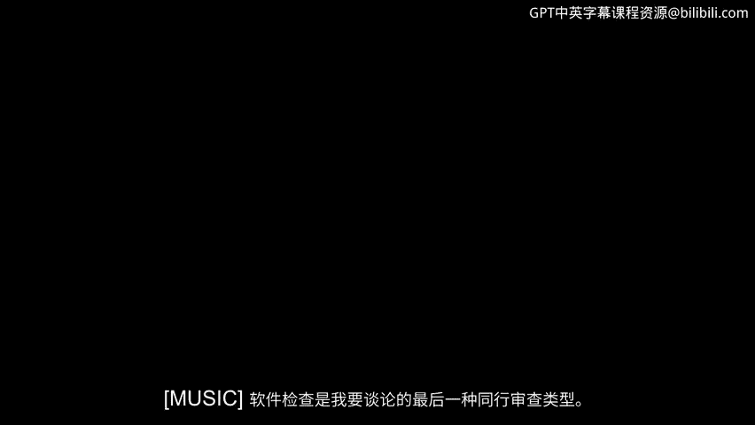
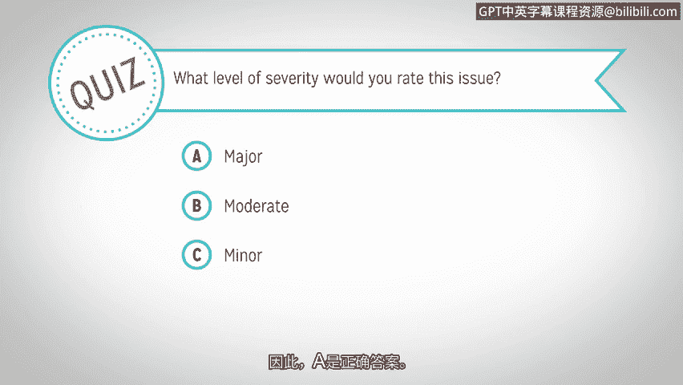

# 009：评审技术

在本节课中，我们将要学习软件同行评审的最后一种类型——软件审查，并深入了解两种具体的评审技术：需求技术评审和需求审查。我们将探讨它们的结构、角色、流程以及如何应用它们来提升软件产品的质量。

## 软件审查概述

上一节我们介绍了软件走查和技术评审，本节中我们来看看最正式的同行评审类型：软件审查。软件审查，也称为正式技术评审，其核心目的是发现并修复工作产品中的缺陷。

软件审查比前两种评审类型更为正式，它包含多个明确的角色并遵循严格的结构。其主要目的是发现并修复工作产品中的缺陷，例如一份需求文档或一段代码。

## 审查中的角色

以下是软件审查中涉及的关键角色：

*   **作者**：创建被审查软件产品的人。
*   **主持人**：类似于技术评审中的评审负责人，负责监督整个审查过程，确保一切顺利进行。
*   **读者**：负责向审查员朗读文档，审查员随后指出文档中的缺陷。
*   **审查员**：负责审查产品并找出缺陷的人员。
*   **记录员**：负责记录会议笔记的人。

与软件技术评审类似，多个角色可以分配给同一个人。

## 审查的阶段

软件审查包含多个阶段，其中一些阶段可以重复，直到产品达到适当的标准。

1.  **规划阶段**：在此阶段，主持人熟悉被审查的产品以及作者主要关注的领域。
2.  **概述会议**：所有角色人员聚集在一起，由主持人对产品进行简要介绍。通常在此阶段结束时，审查员会拿到待审查的产品，从而启动准备阶段。
3.  **准备阶段**：审查员审查产品以寻找缺陷并做笔记。完成此阶段可能需要几分钟到几天，具体取决于被审查的工作产品。
4.  **审查会议**：在此会议上，读者将文档分成小块进行朗读。审查员随后对他们发现的每个块中的缺陷发表评论，记录员确保记录所有内容。作者可以提问和寻求澄清，但由于审查更为严格，不鼓励讨论。
5.  **返工阶段**：审查会议后，作者根据从审查员那里收到的反馈进行必要的修改。
6.  **跟进阶段**：完成修改后，进行跟进以确保更改已完成、恰当，并解决了审查会议中发现的缺陷。

我之前提到，一些审查阶段可以重复。通常被重复的阶段是返工和跟进阶段。这是因为有时在返工阶段完成的工作不足以解决审查会议中提出的缺陷。当在跟进阶段指出这一点时，作者必须返回并完成工作。

## 严格的完成标准

软件审查还执行严格的程序来确定每个阶段何时完成以及何时准备好进入下一阶段。例如，为了开始审查过程，可能有一个需要完成的事项清单。

这个清单可以包括：
*   软件走查已完成。
*   代码已通过所有测试用例。
*   每个函数都包含足够的文档。

这样做是为了帮助主持人和审查员在讨论之前妥善审查工作产品。

## 需求技术评审

现在，让我们讨论一种非常流行的软件审查技术：需求技术评审。需求技术评审是一个两阶段过程。第一阶段是评审，第二阶段是讨论会议。这个过程可以与多个审查员进行或进行多次。

### 评审阶段

在评审阶段，评审员检查由作者编写的一组需求。作者可能需要向每位评审员提供术语表和其他相关信息源。

每位评审员检查需求文档，以定位尽可能多的缺陷。这可能包括错误或遗漏，这些错误或遗漏会阻止产品执行其一项或多项任务。

每位评审员还应识别需求标准方面的高风险区域。例如，需求看起来不完整、过于僵化或过于浅薄而无法处理所有可能发生的情况。

每位评审员还应突出显示任何疑虑。例如，他们可能突出显示一种情况，即需求正确且完整，但在复杂性或可重用性方面可以改进。

### 问题严重性分级

然后，每位评审员应将其发现分类为**严重**、**中等**或**轻微**级别。

*   **严重发现**：意味着问题的修复方案不明显，需要非常仔细的进一步探索。
*   **中等发现**：意味着问题的修复方案是直接的，但需要进一步审查。
*   **轻微发现**：表明修复要么不必要，要么很明显，无需进一步审查。

### 讨论会议阶段

评审阶段完成后，进入过程的第二阶段：讨论会议。在这个会议中，应有评审员、作者、主持人和记录员。

主持人负责确保会议不偏离主题，并且批评以建设性的方式提出。他们确保评审不会让作者感觉受到攻击。类似 Scrum Master 主持其他会议的方式，他们也可以主持此会议。

还应有会议记录员。这个人可以与项目无关，他们只负责记录会议笔记。作者将参考这些笔记来修复已识别的问题。为会议设定时间盒是一个好主意，以使其保持在正轨上，并且不会占用评审员或作者太多时间。

在此会议中，将讨论收集到的发现并可能重新分类。尽可能减少对轻微问题的讨论是一个好主意。不期望作者回应提出的每一个问题或评论，但记录员应记下所有问题。作者在场主要是为了更好地理解发现并在需要时寻求澄清，这将有助于将会议控制在既定的时间盒内。

### 修复过程

遵循需求技术评审过程之后是修复过程。在修复过程中，需求作者将根据评审的反馈对需求进行调整。他们不需要解决所有建议的更改，因为提出的一些问题可能无效或已经解决。

## 需求审查

在我们结束之前，让我们谈谈需求审查。需求审查是一个正式过程，其中审查用户故事列表的**模糊性**、**一致性**和**完整性**。

模糊性是软件需求的一个大问题，通常让第三方审查你的需求以确保一切清晰是很有用的。当需求的所有问题都被识别出来后，就由作者来修复它们。

通常作者是产品负责人或软件产品经理，也可能包括开发团队的成员。有时作者是客户。在所有这些情况下，在审查会议中提出的缺陷随后得到解决，并在跟进中再次呈现。

需求审查是确保你的需求清晰、一致和完整的有用方法。审查过程使任务直接且易于理解，这可能是它在行业中流行的原因。

## 总结

本节课中我们一起学习了软件审查的正式流程、角色和阶段，并深入探讨了两种具体的评审技术：需求技术评审和需求审查。我们了解到，无论上下文如何，软件同行评审都是有用的。无论是非正式的走查、技术评审还是正式的审查，评审在几乎所有软件项目中都有一席之地。

现在我已经介绍了一些如何评审软件的技术，接下来让我们谈谈软件评审过程中一些常见的问题。这就是我将在下一课中要讲的内容。