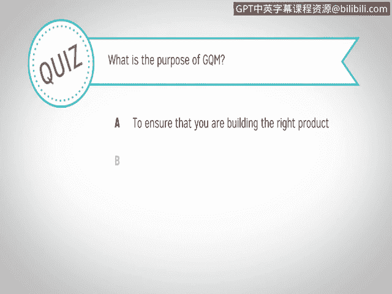

**软件产品管理课程5：5.2.3：目标问题度量GQM** 🎯

## 概述
在本节中，我们将学习一种名为“目标问题度量”的方法，它能帮助我们为软件项目制定有效的度量指标，确保这些指标能准确衡量对项目和团队有价值的方面。

---

在上一节中，我们讨论了监控软件项目时可能遇到的一些问题，这些问题主要围绕度量指标的有效性及其可能被误用的情况。本节中，我们将探讨一种制定度量指标的方法，以确保它们能衡量对您和团队有价值的项目方面。这种方法被称为“目标问题度量”。

目标问题度量，简称GQM，是一种为软件项目选择度量指标的方法，由马里兰大学的维克多·巴希利于1994年提出。根据巴希利本人的观点，GQM背后的核心理念是：一个组织要有目的地进行度量，必须首先为其自身及其项目设定目标，然后将这些目标追溯到用于操作性定义这些目标的数据，最后提供一个框架，根据既定目标来解释这些数据。

简单来说，为了确保为项目使用了正确的度量指标，您必须首先明确想要衡量的概念，即您的**目标**。明确目标后，您需要找出定义该目标的内容，即您的**问题**。接着，您需要找到一种方法来计算这个定义，以便解释数据并了解实现目标的进展，这就是您的**度量**指标。

首先，如何设定目标？根据巴希利的观点，目标应用于对象，这些对象包括**产品**、**过程**和**资源**。本质上，您可以选择改进这三者之一作为目标。例如，改进您的产品（如代码或文档），改进您的流程（如测试或需求获取流程），或者改进您的资源（如办公空间、开发团队使用的计算机或开发人员的投入与薪酬）。核心思想是您可以度量任何事物，但将项目目标分解为这三个类别有助于您思考如何度量它们。

> **小测验：GQM的目的是什么？**
> A. 确保您正在构建正确的产品。
> B. 确保您有效地使用度量指标。
> C. 确保度量指标使用正确的数据。
> D. 确保您向客户提出正确的问题。
>
> **答案：B**。GQM是一个使用度量指标的框架，其重点是确保您使用最佳度量指标来回答关于项目的关键问题。

设定每个目标后，接下来需要考虑的是针对这些目标提出的问题。本质上，您需要提出哪些问题才能判断每个目标是否正在实现？这取决于具体目标，但总体思路是您的问题应足够具体，以便问题的答案能够直接对应目标。

那么，如何找到答案呢？这就是**度量**部分的作用。度量是一种定量方式，用于收集数据以回答您提出的问题。这与我们在之前课程中讨论的其他度量指标完全相同。GQM中度量指标的特殊之处在于，它们通过事先的规划过程而变得更有意义。因为度量指标旨在回答的问题已经过事先深思熟虑，所以它们在GQM中变得更有价值。

度量指标可以是**主观的**或**客观的**。客观度量基于不依赖任何个人观点或解释的数据，例如产品下载次数、销售数字、处理时间或完成的用户故事。主观度量则依赖于解释，例如用户的产品评分、开发人员的士气或代码质量。

如果将度量比作软件，这很像我们在“客户需求与软件需求”课程中讨论的“收集需求”与“引导需求”的区别。您不希望盲目地开始收集度量指标。就像从客户那里引导需求很重要一样，事先明确度量指标的目标也同样重要。当然，一旦有了用户故事，您也不会直接开始构建它们，而是首先创建开发任务——那些可以在几小时内完成的小型、可操作项。GQM中的问题也是如此：您创建小的项目，当它们组合在一起时，就能解决整个目标。只有在您通过发布和迭代计划提前规划好工作后，才会进入代码开发阶段。同样，只有在您通过具体问题提前定义了度量指标的目标后，才会真正开始实施度量并收集数据。

> **小测验：GQM代表什么？**
> A. 目标问题测量
> B. 收益问题测量
> C. 目标问题度量
> D. 收益问题度量
>
> **答案：C**，目标问题度量。

让我们看一个GQM的示例。假设您正在开发一个软件产品，并且想知道您的产品是否“做得正确”。那么，产品质量就是您的**目标**。以下是一些可以帮助您解决这个目标的问题：
*   我的产品代码有多少被单元测试覆盖？
*   我的产品中存在多少缺陷？

提出这些问题后，下一步就是确定您的**度量**指标。如果我们以“我的产品中存在多少缺陷？”这个问题为例，我们可以通过几种方式来处理。一种度量指标可以是：在最终被接受之前，用户故事在验收测试中被拒绝的次数。这可以表示为整个项目中拒绝次数与接受次数的百分比。您可以认为，较高的拒绝与接受比率表明您的流程中某些环节需要改变以减少缺陷。要知道什么是“高比率”，您可能需要比较在成功项目与不成功项目中这个数字的差异。

另一个解决此问题的度量指标是：在任何给定时间，产品待办事项列表中存在的错误数量。如果您发现待办事项列表中的错误激增，这可能表明您需要审查技术，以便更早地发现缺陷。当然，您可以制定比这复杂得多的度量方案。这里的想法只是让您了解度量指标如何在GQM范式中应用。

---

## 总结
本节课我们一起学习了目标问题度量方法。我们了解到，GQM通过引导我们首先明确**目标**，然后提出具体的**问题**，最后制定可量化的**度量**指标，从而确保我们为软件项目选择和使用的度量是有效且有目的的。这种方法有助于将度量与项目的实际改进目标紧密结合起来，避免度量的盲目性和误用。