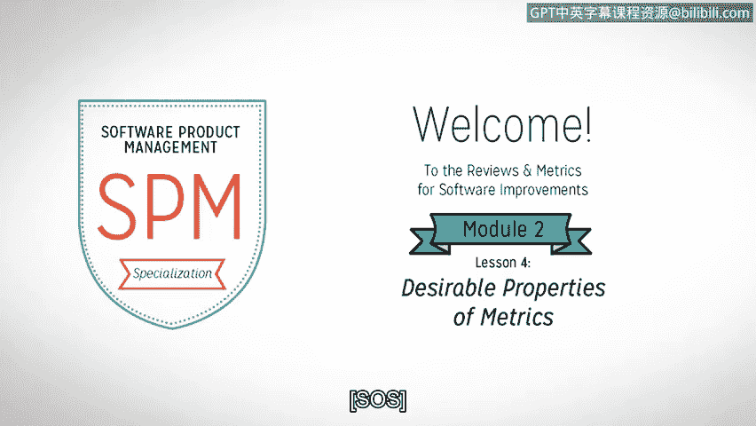
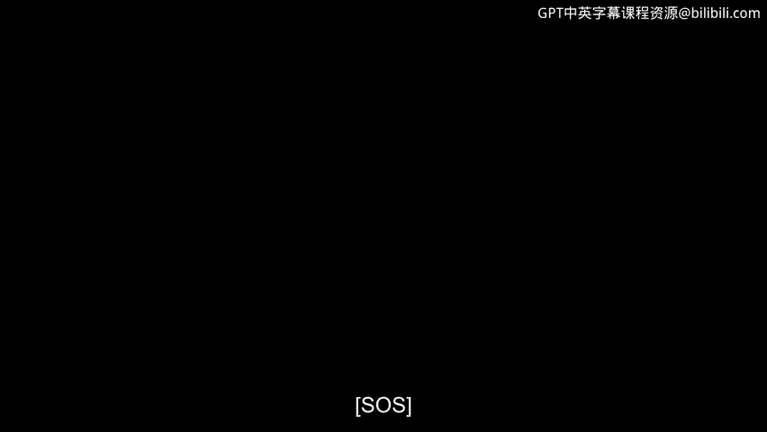
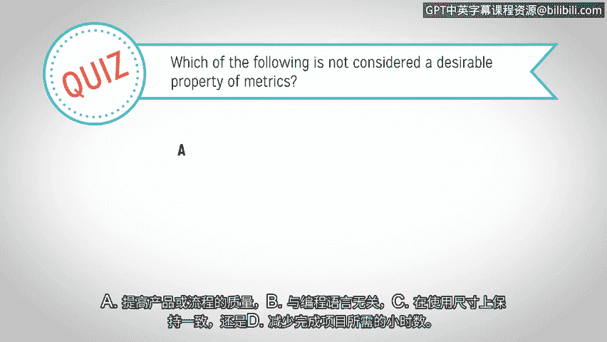

# 012：好的度量属性 📊

在本节课中，我们将学习软件度量的核心概念，并探讨一个好的度量应具备哪些关键属性。我们将从定义基本术语开始，然后分析一个“坏”度量与一个“好”度量的例子，帮助你理解如何选择和使用有价值的度量。

## 关键术语定义

为了整体理解软件度量，首先必须掌握三个关键术语：**度量项**、**度量**和**指标**。

*   **度量项**：一个测量标准或单位。它本质上是测量的一个实例。例如，“英寸”就是一个度量项，因为英寸是一个标准的测量单位。这意味着将一英寸与另一英寸进行比较时，它们是完全相同的。确保测量的一致性对于获得有意义的度量至关重要。
*   **度量**：两个或更多度量项的组合，能产生有意义的结果。一个例子是“公里每小时”。公里是你的第一个度量项，小时是第二个。当它们结合时，就创造了有意义的东西。然而，并非所有度量都有意义。
*   **指标**：能引起测量者注意的度量。一个好的例子是测量某人的口腔温度。一个人健康状况良好的指标是其口腔温度在36.5至37摄氏度之间。如果你测量某人的口腔温度读数为38度，这就是他们发烧的指标。没有这些值作为指标，仅凭温度你无法判断某人是否发烧。指标让你更容易知道你的度量项或度量何时在告诉你一些需要注意的事情。

**小测验**：39摄氏度每小时，是度量项、度量还是指标？
*   A. 度量项
*   B. 度量
*   C. 指标

**答案**：B，它是一个度量。39摄氏度和小时都是度量项，但当它们结合时，就创造了一个度量。

现在你知道了度量项、度量和指标之间的区别。收集和分析数据以洞察你的产品是一项常见任务。正如在上节关于GQM的课程中所说，你不应该在没有明确目标的情况下使用度量。同样重要的是，你要使用一个你知道能提供可信结果的度量。这就是为什么了解度量的理想品质很重要。

## 什么是“坏”的度量？

让我们回到测量开发人员每小时击键次数的例子。是什么让这个度量在软件项目中如此糟糕？

首先，击键次数与软件创建有什么关系？有人可能会争辩说，跟踪开发人员的击键次数可以让他们跟踪在任何一天写了多少代码。然而，就像代码行数度量会因编程语言和开发人员而有很大差异一样，这种击键方法也是如此。这本身就是一个问题。

再考虑如何记录击键。例如，如果你在电脑上使用击键记录程序，你怎么知道记录的击键实际上是在写代码？你的开发人员可能在做其他事情，比如在在线聊天论坛上打字，或者写他们过去两年一直试图完成的小说。

重要的是选择正确的度量，而其中一部分意味着选择一个能真正回答你想问的问题的度量。

## 度量的理想属性

那么，度量应具备哪些理想属性呢？一个好的度量应该：**简单易计算、直观有说服力、客观、单位使用一致、与编程语言无关，并能提供改进软件质量的有效机制**。

以下是每个属性的详细说明：

*   **简单易计算**：主要原因在于，度量越复杂，使用它的人犯错误的可能性就越大。如果你使用的度量过于复杂，一个在简单公式中很容易识别的小错误，当你意识到有问题时，可能会变成追踪的噩梦。
*   **直观有说服力**：如果你计算了一个度量，把它拿给你团队中的某个人看，并让他们告诉你它意味着什么，它应该对他们有意义。这并不是说你只应该使用简单的度量，但它应该具有直观意义。每小时击键次数度量就是一个很好的反面例子，你可以计算它并向任何人说明，但归根结底，跟踪开发人员的击键次数并没有多少直观意义。
*   **客观**：这意味着它们不依赖于任何人的意见，而是基于经验数据。这对任何科学都至关重要，监控项目的科学也不例外。一个反面例子是使用开发人员对自己生产力的估计来跟踪开发人员生产力。很难从中获得准确的客观度量，因为你的数据来源本身就有偏见。一个更好的方法是测量他们在给定时间内完成了多少工作，例如使用故事点。
*   **单位使用一致**：如果你使用故事点作为项目速度的度量，那么你需要对故事点的定义保持一致。如果你在项目中途将某些用户故事的故事点估计值翻倍，你将无法从速度度量中获得太多信息。保持你所测量事物的定义稳定一致非常重要。否则，你处理的度量可能难以解释，甚至完全无法使用。此外，你还要确保比较的单位是一致的。例如，你不会在度量中将故事点与小时相加。

**小测验**：以下哪项是度量的理想属性？
*   A. 基于主观数据
*   B. 适用于人力资源问题
*   C. 对任何数据给出相同的数字
*   D. 直观

**正确答案是D**，一个度量应该是直观的。如果它不直观，你使用的度量可能不会对改进有多大帮助。

*   **与编程语言无关**：正如前面以及前一课所说，代码行数度量是一个很好的反面例子。虽然它似乎是衡量软件项目完成工作量的直观度量，但实际上这个度量相当具有误导性。更重要的是，不同的编程语言实现特定功能所需的代码行数差异很大。为了保持一致性，你的度量应该能够提供一个可靠的测量，可以在不同编程语言之间进行比较。
*   **提供改进能力**：你不是为了跟踪数字而跟踪数字。你需要做的是为了改进项目而跟踪数字。如果你改进了你的项目，你的度量能够显示这些改进吗？以开发人员每小时击键次数为例，如果你试图通过让开发人员击键更多来改进项目，你认为会发生什么？更糟糕的是，如果你的开发人员实际上是更高效的程序员，他们击键的次数可能会减少，因为编写代码所需的字符远少于用自然语言写东西。最好使用一个能在取得进展时显示进展的度量。重要的是，一个好的度量也应该能够显示你所测量事物的质量是否在下降。

## 一个“好”度量的例子

一个好的度量例子是**每周在产品中发现的缺陷数量**。

为了计算这个度量，你只需要跟踪以错误报告或记录问题形式报告的新缺陷数量，并在每周结束时制成表格。

*   **计算简单易行**：`每周缺陷数 = 本周新报告的缺陷总数`
*   **直观有说服力**：缺陷在任何软件项目中显然都是坏事，减少产品中的缺陷数量是人们公认的理想目标。
*   **客观**：如果记录了一个新缺陷，那就是一个新缺陷。除非开发人员完全忽略问题，否则无法伪造。
*   **单位一致且与语言无关**：假设你的开发人员编写不同编程语言的技能相当，每周发现的缺陷数量在不同编程语言之间将保持相当一致，并且缺陷的定义不会改变。
*   **提供改进能力**：如果你随时间跟踪这个度量，并实施允许你增加修复缺陷数量或提高代码质量的流程，你每周观察到的缺陷数量应该会随着时间的推移而减少。通过跟踪这个度量，你的代码质量会得到改善。

**小测验**：以下哪项不被认为是度量的理想属性？
*   A. 提高你的产品或流程的质量
*   B. 与编程语言无关
*   C. 维度使用一致
*   D. 减少完成项目所需的小时数

**答案是D**。虽然如果你的度量能帮助你减少完成项目所需的小时数会很棒，但这并不是所有度量普遍具备的理想属性。提高产品或流程的质量是度量的目标，但这本身不是度量的属性。

跟踪每周发现的缺陷数量的另一个优点是，它不必只应用于整个产品。你可以分解这个度量来分析产品的不同部分。通过这样做，你可以识别项目中的任何问题区域并专注于它们。

另外需要提到的是，度量并不总是绝对的。有时你最终会得到只对你的项目有用的度量，因为它们所基于的值是相对的。基于故事点的速度就是一个很好的例子。故事点的定义因项目而异。使用基于相对值的度量是可以的，重要的是要认识到你的度量项何时是相对的，这样你就不会犯错误去尝试比较两个基于略有不同度量项的度量。

## 总结

本节课我们一起学习了软件度量的理想属性。最重要的收获是**有意识地使用度量**。确保你使用的度量是恰当且有意义的，这样你就不会出错。

在下一节课中，我将介绍一些用于评估产品和流程的度量。你将学习一些可靠的现实世界度量，请不要错过。