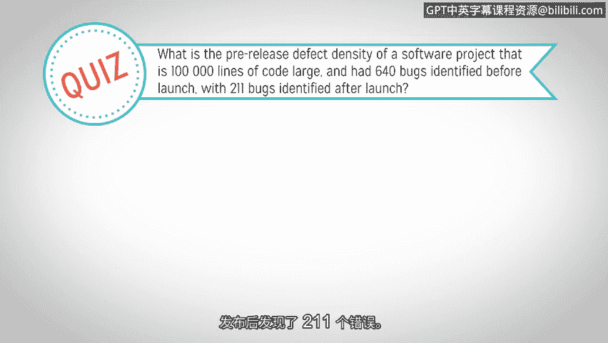

# 014：缺陷分析

在本节课中，我们将要学习一个在行业中非常有用且常用的工具：缺陷分析。这是一种评估产品质量的方法。

## 概述

缺陷分析，顾名思义，用于分析产品中的错误数量。错误是指产品中出现的故障。这通常可以追溯到源代码，但并非总是如此。

## 缺陷分析的基本方法

进行缺陷分析的一种方法是跟踪代码中的缺陷数量，并将其与已修复的缺陷数量进行比较。

正如前几节课所说，您可以通过统计系统中所有已报告的错误来找到代码中的缺陷数量。理想情况下，这可以来自一组特定的内部软件测试人员，以确保系统发布时不带太多错误。然而，这些数字也可能来自产品发布后的最终用户。

市面上有许多工具可以帮助您跟踪产品的漏洞、问题和错误。使用这些工具时，也容易跟踪这些问题的解决进度，例如是否已修复，以及对其所做的任何更新。您还可以随时间比较这些数字。

## 缺陷发现率与修复率

如果您跟踪每周发现的漏洞数量与每周修复的漏洞数量，并随时间绘制这个趋势，您可以看到在开发新功能之前，是否应该投入更多精力来修复当前的问题。这被称为**缺陷发现率与缺陷修复率**。

如果每周发现的漏洞数量远远超过每周修复的漏洞数量，那么投入时间修复这些问题可能是个好主意。

作为一个满足所有理想度量属性的指标，这个指标也允许您跟踪进度。如果您专注于修复缺陷，那么您最终会看到每周修复的缺陷数量上升。

通过随时间跟踪**缺陷发现率与缺陷修复率**，您可以了解产品内部质量的变化情况。希望随着项目的推进，您修复的缺陷会多于发现的缺陷，产品中遗留的缺陷会越来越少。

然而，如果您修复的缺陷数量与发现的缺陷数量相当，那么您就遇到了所谓的**软件障碍**。正如之前所说，这可能是时候做出改变了。遇到软件障碍表明您的产品尚未准备好发布，您应该在发布前投入更多时间修复漏洞。

以下是关于缺陷分析的一个小测试：
> 缺陷分析是评估您产品____的一种方式。
> A. 生产力 B. 规模 C. 用户满意度 D. 质量
> 答案是 **D，质量**。

缺陷分析主要是为了了解项目在质量方面的当前状态。

## 子系统缺陷分析

您还可以将已修复的缺陷按产品的不同组成部分（称为子系统）进行划分。本质上，要了解各子系统的缺陷，您只需跟踪与每个已修复缺陷相关联的子系统。

然后，您可以统计每个子系统的已修复缺陷数量，以查看产品中需要关注的区域。为了公平比较，这个数字应该除以每个子系统的规模。大的子系统自然会有更多缺陷，这就引出了缺陷密度的概念。

## 缺陷密度

缺陷密度是确定整个产品缺陷数量的标准方法。

要计算缺陷密度，只需取代码中发现的缺陷数量与代码规模的比率。规模可以用千行代码来衡量。对于结构化编程技术，行业平均水平大约是每千行代码15到50个缺陷。

您可以使用这个指标对项目的发布准备情况做出一些有趣的预测。

**示例**：假设您正在构建一个软件产品，并与团队一起进行第三次发布。
*   第一个版本在发布前发现了900个缺陷，发布后发现了100个缺陷。代码量为10万行。这使得您第一个发布版本的缺陷密度为 **每千行代码10个缺陷**。
*   在第二个发布中，您的团队增加了5万行代码，发布前发现了400个缺陷，发布后发现了45个缺陷。这使得第二个版本的增量代码缺陷密度为 **每千行代码8.9个缺陷**。
*   现在您计划发布第三个版本。您的团队新增了10万行代码，目前在这部分代码中发现了600个缺陷。这使得该增量代码的缺陷密度为 **每千行代码6个缺陷**。

考虑到前两个已发布版本的增量缺陷密度在每千行代码8.9到10个缺陷之间，这次您的产品准备好发布了吗？

答案是否定的。除非自第二个版本以来您的开发流程有所改进，否则您可以预期在第三个增量中，每千行代码会发现8.9到10个缺陷。对于10万行代码，大约是890到1000个缺陷。在之前的发布中，您在发布前发现并修复了90%的缺陷。这意味着您可以预期在这个发布中，每千行代码会发现801到900个缺陷。既然目前只发现了600个，您可以预期在发布前还会发现201到300个缺陷。在产品发布前发现缺陷总是更好的，因此您的产品可能还不适合发布。

以下是另一个小测试：
> 一个软件项目有10万行代码，发布前识别出640个漏洞，发布后识别出211个漏洞，其发布前缺陷密度是多少？
> A. 每千行代码2.1个缺陷
> B. 每千行代码6.4个缺陷
> C. 每千行代码7.51个缺陷
> D. 每行代码0.00751个缺陷
> 答案是 **B，每千行代码6.4个缺陷**。记住，这里我们只计算发布前的缺陷。

## 缺陷分析实战案例：航天飞机飞行软件

让我们看一个缺陷分析的实际案例。航天飞机飞行软件以其几乎无错误而享有最佳声誉之一——它必须如此，否则可能导致人员伤亡和数十亿美元的损失。

那么，编写该软件的机载航天飞机小组是如何实现这种完美水平的呢？对他们来说，仅仅发现一个缺陷、修复它，然后收工是不够的。当发现一个缺陷时，存在强制性的协议来分析该缺陷，识别该缺陷可能出现的其他类似区域，并调整流程以避免未来出现此类缺陷。

**示例**：航天飞机有一个著名的加拿大组件，称为Canadarm，这是一个在恶劣太空环境中协助完成复杂任务的机械臂。如果在Canadarm手腕旋转的方式中发现一个漏洞，那么也可以检查其他涉及硬件旋转的代码是否存在类似错误。因此，通过缺陷分析，可以在一个完全独立的、用于旋转通信天线的子系统上发现类似的漏洞，从而避免潜在的灾难。

事实上，这正是航天飞机软件发生过的真实场景，它帮助节省了大量的工作、时间和金钱。通过实施这种严格的测试和修订程序，机载航天飞机小组能够在其运行软件方面达到完美的状态。如果您想了解更多关于他们流程的信息，请查看课程笔记中的资源。

## 总结

以上就是缺陷分析。它是一种简单的技术，可以帮助您确保了解项目的质量，并就其测试和发布做出正确的决策。

这也是本模块的结尾。我们在本模块中涵盖了很多内容，让我们回顾一下：
*   首先，我们讨论了一些软件产品的评审技术，如代码走查和需求技术评审。
*   然后，我们讨论了监控软件项目时的一些常见问题，并指出了一些常用但价值不高的度量指标。
*   之后，我们介绍了目标-问题-度量（GQM）框架，以及实施它如何帮助您确保在项目中使用适当的度量指标。
*   接着，我们探讨了度量指标的理想属性，了解了什么构成了一个好的度量指标。
*   之后，我们讨论了当今行业中一些流行的度量指标。
*   最后，我们深入学习了缺陷分析。

这些活动有助于确保产品通过经过评审和度量的工作正确完成。在下一个模块中，Morgan将通过与您讨论每日站会、回顾速率以及向您展示燃尽图是什么，来告诉您如何确保项目得到正确管理。请继续学习。