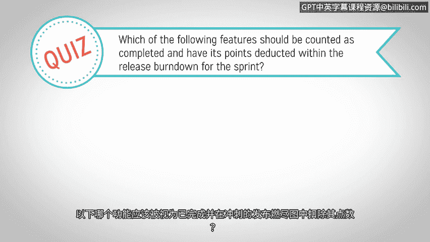

# 018：发布燃尽图 📉

## 概述
在本节中，我们将学习一种在Scrum方法中非常常见的可视化监控工具——发布燃尽图。我们将了解它的构成、如何解读它，以及如何利用它来跟踪项目进度和预测完成时间。

---

发布燃尽图是一种可视化监控工具，在Scrum方法论中非常常见。

发布燃尽图会向你展示开发团队已经完成了多少工作、还剩余多少工作、团队在每个冲刺中的速度，以及你预计何时能完成产品。可以想象，它是确保项目得到正确管理的绝佳工具。

既然发布燃尽图能展示所有这些信息，你可能会想象它是一张相当复杂的图表。但发布燃尽图的妙处在于，它的概念很简单。让我们来看一个基本的发布燃尽图。

如图所示，我们在水平轴上列出了冲刺。这个示例项目有六个冲刺。在垂直轴上，是总工作量。这可以用你的团队选择来衡量需求规模的任何单位来描述。

在我们的示例中，我们将使用故事点。图表中每个与冲刺对应的条形，代表了在该冲刺开始时仍然剩余的故事点总数。

自然地，在冲刺1开始时，我们拥有所有剩余的故事点，因为我们尚未开始完成它们。这代表了你的总工作量。你的总工作量是你计划在项目中完成的所有用户故事的故事点总和。

当你完成需求时，你将其故事点从燃尽图中移除。

---

## 解读燃尽图数据

上一节我们介绍了燃尽图的基本构成，本节中我们来看看如何从中提取关键信息。

你的开发团队即将开始第六个也是最后一个冲刺。这是该项目的发布燃尽图。你的团队已经完成了多少故事点，还剩余多少？

以下是选项：
A. 100个故事点已完成，15个故事点剩余。
B. 100个故事点已完成，0个故事点剩余。
C. 85个故事点已完成，15个故事点剩余。
D. 85个故事点已完成，0个故事点剩余。

在这个项目中，总共有100个故事点。我们知道这一点，因为在冲刺1开始时是100个故事点。在冲刺6（项目的最后一个冲刺）开始时，剩余15个故事点。由于我们以100个故事点开始，剩余15个，这意味着团队已经完成了85个故事点；因此，C是正确答案。

---

## 预测线与进度跟踪

了解了如何读取当前状态后，我们来看看如何利用燃尽图进行预测和进度管理。

假设我们的总工作量是90个故事点。我们在第一个冲刺中完成了15个故事点。从发布燃尽图中，我们可以看到该冲刺的速度是15点。我们还可以看到剩余工作是75点。我们也知道我们以75个剩余故事点开始冲刺2。

如果我们想预测完成这个产品需要多少个冲刺，我们可以画一条线穿过条形图来预测。我们称这条线为预测线。由于我们是基于一个冲刺的速度来预测，我们将以该值作为预测依据。根据我们的预测线，它表明应该需要六个冲刺。你可能认为这条线指向了第七个冲刺，但请记住，发布燃尽图是基于每个冲刺开始时剩余的故事点数量。这意味着在冲刺7开始时将没有故事点需要完成，也就是说你不需要那个冲刺。

你也可以使用预测线来查看开发是否按计划进行。

假设我们刚刚完成冲刺4，我们的发布燃尽图看起来是这样的。在第一个冲刺中，我们完成了15个故事点。我们想保持这个速度，所以那是预测线。然而，在冲刺2中，我们只完成了5个故事点。如图所示，我们冲刺3的条形现在位于预测线上方。在冲刺3中，我们完成了15个故事点。我们将速度恢复到了初始值，但由于冲刺2，我们仍然落后于计划。在冲刺4开始时，我们应该总共完成45个故事点，并且开发进行到一半。但如图所示，我们冲刺4的条形位于预测线上方。我们比预期进度落后了10个故事点。

现在假设在冲刺4开始时，因为我们看到项目落后于计划，我们又雇佣了两名开发人员。在冲刺4中，我们完成了25个故事点。这使我们的项目回到了正轨。在冲刺5中，我们又完成了25个故事点。这现在使我们的项目进度超前了。如图所示，我们冲刺6开始时的条形现在位于预测线下方。这意味着你的团队可能能够为产品完成更多需求。

实际上，你的发布燃尽图看起来像这样的可能性极小。更常见的情况是你的发布燃尽图看起来类似这样。

---

## 应用示例与“完成”的定义

通过预测线，我们可以评估进度。但这一切都基于一个前提：如何定义“完成”。本节我们来探讨“完成”的定义对燃尽图的影响。

考虑这个发布燃尽图。你已经完成了第一个冲刺。如果你保持从这个冲刺开始的初始速度，你预计需要多少个冲刺来完成工作？

以下是选项：
A. 5个冲刺
B. 6个冲刺
C. 7个冲刺
D. 8个冲刺
E. 你需要更多信息

如果你保持这个速度，你的预测线表明在冲刺6开始时你将没有故事点需要完成。这意味着你将在五个冲刺内完成项目。因此，A是正确答案。

由于发布燃尽图衡量的是已完成的故事点，你可以想象你团队对“完成”的定义非常重要。在敏捷开发中，我们通过可工作的软件来衡量进度，因此，为了将故事点标记为完成，该需求必须满足你团队的“完成”定义。

我曾在一个不专注于可工作软件的团队工作过。我们正在开发一个需要数据库连接的产品。我们一半的团队在开发数据库，另一半在开发产品用户界面。尽管许多功能已经为界面编程，数据库也在开发中，但我们不能将任何需求标记为完成，因为我们正在等待数据库开发完成并连接到应用程序。我们的燃尽图最终看起来像这样。从我们的燃尽图可以看出，看起来好像我们在三个冲刺中什么都没做，然后在冲刺4中非常努力地工作。我们知道情况并非如此，但燃尽图会显示你的团队是否在完全完成功能后才转向新的功能。否则，燃尽图就不能很好地代表产品的进度。

---

## 实战练习

理解了理论后，让我们通过一个具体场景来应用所学知识。

你正在一个开发移动应用程序的团队中工作。你刚刚完成了第三个冲刺。你团队的“完成”定义包括仅那些已编程、已文档化、已测试并准备好上市的功能。以下哪些功能应被计为已完成，并在该冲刺的发布燃尽图中扣除其点数？

以下是选项：
A. 一个在上个冲刺已开发并文档化但测试失败的功能，在当前冲刺中已收到小修复并通过了测试。
B. 一个你没有时间测试，但你确信它能工作的功能。
C. 一个已编程、文档化并测试的界面功能，但尚未连接到数据库。
D. 一个运行完美、在冲刺中通过了所有测试并已正确文档化的功能。

只有满足团队“完成”定义的功能才能为发布燃尽图标记为完成。答案B和C都是未满足“完成”定义的功能，因此绝不能为发布燃尽图标记为完成。答案A展示了一个在上个冲刺未满足“完成”定义但现在满足的功能，因此可以在本冲刺为发布燃尽图标记为完成。答案D也满足团队的“完成”定义，因此可以为发布燃尽图标记为已完成。A和D是正确答案。

---

## 总结
在本节课中，我们一起学习了发布燃尽图。我们了解了它作为Scrum中可视化监控工具的基本构成，学会了如何从中读取已完成和剩余的工作量。我们掌握了如何绘制和使用预测线来预估项目完成时间并跟踪进度偏差。最重要的是，我们认识到团队对“完成”的明确定义是燃尽图能够准确反映项目真实进展的基石。通过正确使用发布燃尽图，团队可以更有效地管理项目，确保按时交付可工作的软件。