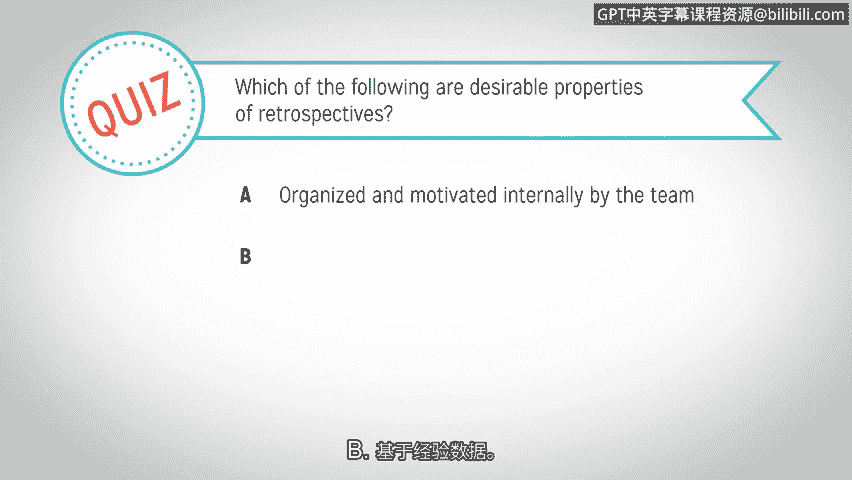

# 022：回顾问题

在本节课中，我们将探讨与回顾会议相关的常见问题，并学习如何克服这些问题，以确保回顾会议能成功地在项目中发挥作用。

上一节我们介绍了回顾会议的概念及其价值。本节中我们来看看在实施回顾会议时可能遇到的一些障碍。

## 为何有些团队不进行回顾会议？

以下是团队可能不进行回顾会议的一些原因。这些原因虽然常见，但并非无法克服。

*   **错误动机**：团队可能仅仅因为审计要求等外部压力而进行回顾。
*   **时间不足**：团队可能觉得没有足够的时间进行回顾。
*   **倾向向前看**：团队可能更愿意关注未来计划，而非反思过去。
*   **不愿讨论自身节奏**：团队成员可能不愿意讨论自己的工作模式或效率。
*   **职业倦怠**：团队可能因项目压力而感到疲惫，不愿再思考项目问题。

## 安全感：回顾会议的核心障碍

正确实施回顾会议的一个主要障碍是团队缺乏**安全感**。

安全感并非指物理安全，而是指团队成员在情感和职业上感到安全。这意味着他们能够以真实、坦诚的方式表达自己，而不必担心来自同事或管理层的负面反应。这是一种能够与队友开放沟通的能力，因为你知道自己的声音会被倾听，并且无论你说什么，都会得到支持。

这个概念可能有些抽象，我们来看一个例子。

皮埃尔是一名开发人员，正在与团队进行每日站会。他坦诚地告诉团队自己前几天效率低下，原因是工作过度导致倦怠。他之所以能这样做，是因为他知道不会因为效率低下而受到惩罚。皮埃尔感到足够安全，可以向团队公开表达自己的感受。

反之，如果皮埃尔感到不安全，他可能会倾向于夸大自己前一天的工作量，使自己看起来更高效。例如，他可能会过分详细地描述对某个软件工具集的研究，而不是坦言自己遇到了倦怠问题。这表明皮埃尔在工作环境中感到不安全，无法完全表达自己。

## 如何营造安全感？

营造一个让团队感到安全的环境至关重要。以下是一些关键方法。

首先，明确告知团队你希望营造一个鼓励开放沟通、欢迎新想法和新观点的文化环境。确保团队中的每个人都有权表达自己的意见，只要这些意见不伤害其他成员或破坏健康的团队文化。

其次，对成员的贡献表示赞赏。在团队环境中表达自己并不总是容易的。没有反馈，人们很难知道自己的意见是否被重视。更糟的是，没有反馈，许多人会默认自己的意见不被重视。因此，对贡献表示赞赏非常重要。这并不意味着你必须同意每个人说的每句话，而是让人们知道他们的贡献是有价值的。

一种方法是直接告诉每个人他们的意见受到重视。然而，如果处理不当，这可能显得不够真诚。更有效的方法是鼓励他人对你的观点和想法给予反馈，同时也对他人的想法提供反馈。展示对他人想法赞赏的一个好方法是，在此基础上进一步构建想法，并将原始想法的功劳归于提出者。这不仅验证了该想法，也肯定了提出者。

最后，积极的领导力是营造安全环境的关键。作为产品经理，领导力通常从你开始。通过赞赏他人和保持积极态度，成为团队内的榜样。不要让小问题影响大局，更不要让个人偏见妨碍你对每位团队成员给予同等高度的尊重。领导团队的能力是优秀管理者的重要特质，而这很大程度上来自于以身作则。

## 回顾会议中的安全环境

让我们看看如何将安全感应用于回顾会议中，以确保其促进开放协作。

首先，你需要建立一个**功能性团队文化**，而非功能失调的文化。在功能性文化中，团队中的每个人都努力让其他人看起来更好。没有秘密或戒备性的语言，没有信息隐藏，也没有争夺团队明星位置的竞争。在一个功能性团队中，每个人共享工作的所有权，因此也共享荣誉。每个人看起来都很好。

在功能性团队中，是团队成员个体驱动会议的效率，而不是经理。因为团队知道他们的行为会影响项目，并且他们对项目拥有所有权，所以他们有动力采取措施进行改进。因此，功能性团队的会议是建设性的，决策来自团队。

另一个重要的注意事项是：人们参与项目并非为了破坏它。他们是在自身技能和所处环境的限制下，尽力做到最好。思考这个问题的一个好方法是参考航空事故调查。航空公司和管理机构不会简单地指责飞行员失职，而是会调查导致失败的所有因素，即使失败是由于人为错误。他们会调查飞行员是否遵循了程序，如果没有，是否是因为缺乏培训、注意力不集中，或者睡眠不足。通过这种客观、可衡量的方式反思事件，更容易做出未来的改进。

总而言之，回顾会议不应是一场指责游戏。它不是人们互相指责和争吵的时候。事实上，它可以是一个修复感情、建立信任关系的机会。如果操作得当，回顾会议将成为软件产品经理工具箱中强大的工具，几乎可用于每个项目。

## 总结

本节课中我们一起学习了阻碍团队有效进行回顾会议的常见问题，特别是**安全感**的缺失。我们探讨了如何通过建立开放沟通的文化、赞赏贡献以及积极的领导力来营造安全的环境。我们还了解了功能性团队文化的重要性，并强调回顾会议应基于实证数据，而非指责。现在你已经了解了回顾会议可能遇到的问题，下一节我们将深入探讨如何成功地进行一次回顾会议。