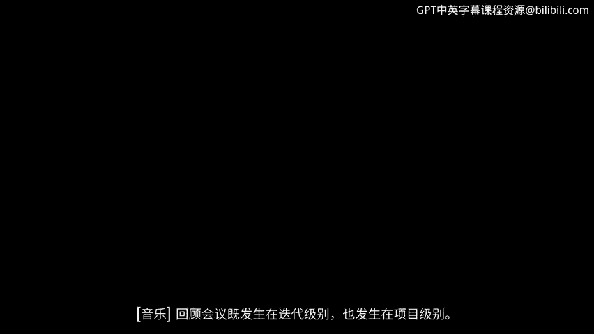
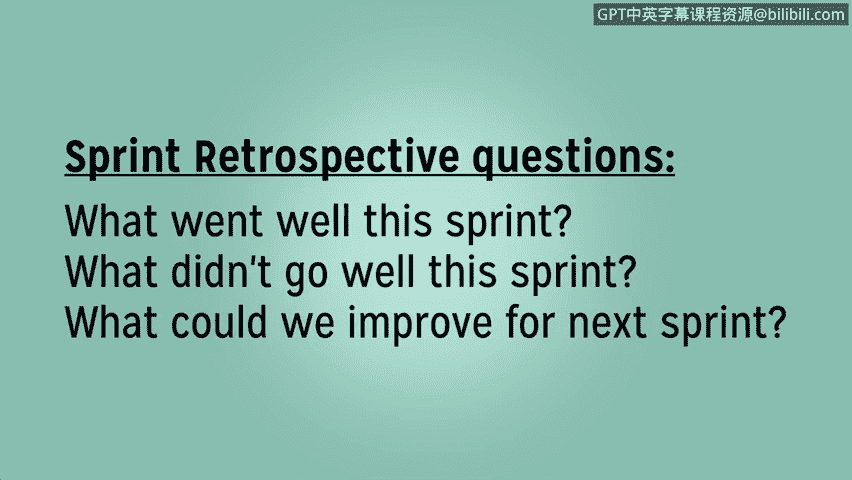

# 023：冲刺回顾会议 🧐

在本节课中，我们将要学习敏捷开发中的一个关键会议——冲刺回顾会议。我们将了解它的目的、流程以及如何有效地进行，以确保团队能够持续改进其工作方式。

---

回顾会议既发生在迭代层面，也发生在项目层面。本节中，我们来看看冲刺层面的回顾会议。

冲刺回顾会议应该是一个冲刺中最后进行的事项。它通常在冲刺评审会议之后举行。冲刺评审会议用于向客户或产品负责人演示产品成果。而冲刺回顾会议则用于评估开发过程本身。

敏捷开发要求你不仅要评审和调整产品，也要评审和调整开发过程。这是一个回顾产品构建得如何、哪些方面运作良好以及哪些方面可以改进的机会。

确保冲刺回顾会议的氛围安全，允许开放对话，这一点至关重要。参与者需要能够自由地表达他们对冲刺的真实感受。如果团队不能诚实地指出问题所在，就无法产生有效的解决方案。

冲刺回顾会议的时间盒通常设定为一小时。然而，它不像其他Scrum事件那样严格。你希望会议简短高效，但如果出现重大问题，不应为了遵守预定时间而掩盖问题。

---

你正在主持团队的冲刺回顾会议。以下哪些是会议中合适的讨论话题？

以下是选项列表：

*   A. 一名开发人员表示对产品的用户界面不满意。
*   B. 一名开发人员指出团队在上个冲刺中低估了任务量。
*   C. 你强调了团队在上个冲刺中完成的出色工作。
*   D. 一名开发人员建议在下个冲刺中实施迭代燃尽图。
*   E. 产品负责人建议在下个冲刺中实现某个功能。

你需要确保冲刺回顾会议的重点是**过程**，而非**产品**。因此，答案A和E是不正确的。冲刺回顾会议是讨论开发过程中哪些做得好、哪些做得不好以及哪些可以改进的绝佳场合。因此，答案B、C和D是正确的。

---

在冲刺回顾会议中，通常会提出三个主要问题。上一节我们介绍了会议的核心目的，本节中我们来看看这些具体问题。

以下是三个核心问题：

1.  这个冲刺中，**哪些方面做得好**？
2.  这个冲刺中，**哪些方面做得不好**？
3.  为了下一个冲刺，**我们可以改进什么**？

我建议按照这个顺序提出问题。Scrum Master应该以积极的基调开始会议，对团队完成的工作表示赞赏和认可。通常，批评不容易被接受。Scrum Master应引导会议，确保人们不感到被攻击。对话应该开放、诚实，同时保持尊重。

最后，要以建设性的方式结束会议。这也能让会议圆满收尾，避免人们带着负面情绪离开。以需要改进的方面来结束会议，能给团队带来期待，并为下一个冲刺开个好头。如果一个冲刺没有按预期进行，这一点尤其重要。你不希望下一个冲刺受到前一个冲刺失败感的影响。

有时，为了前进，我们必须回顾过去。在下一课中，我们将通过探讨项目回顾会议的内容，来扩展对回顾会议的理解。

---

本节课中，我们一起学习了冲刺回顾会议。我们明确了它的目的是评估和改进开发过程，而非产品功能。我们了解了会议应营造安全、开放的氛围，并遵循“做得好”、“做得不好”、“可改进”三个问题的结构来引导讨论，从而帮助团队持续进步，并为下一个冲刺做好准备。