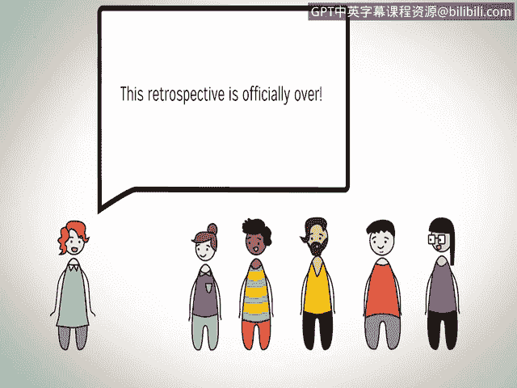

# 027：展望未来 🚀

在本节中，我们将学习项目回顾会议的最后阶段——展望未来。我们将重点介绍两个核心练习，旨在引导团队讨论敏感话题并圆满结束会议，从而为下一个项目制定切实可行的改进计划。

上一节我们介绍了回顾会议中分析过去的练习，本节中我们来看看如何引导团队面向未来，特别是处理那些棘手的、未被提及的问题。

## 启动“创造奇迹”练习

在回顾会议的这个阶段，通常会出现一些团队成员回避讨论的话题。“创造奇迹”练习旨在主动引发关于这些敏感议题的讨论。此时，团队已更适应分享感受，对项目有了更深入的集体理解，并且意识到会议即将结束。如果此时不提出敏感话题，可能就永远没有机会讨论了。作为引导者，你需要邀请大家进行这场艰难的对话，然后退后一步，让对话自然发生。

以下是启动此讨论的几种方式：
*   你可以说：“这次回顾即将结束。现在是提出任何你希望讨论但尚未提及的事情的好时机。”
*   或者，你可以提及在整个回顾会议中察觉到的一些暗示。
*   如果以上方法都不奏效，你可以直接提出：“我们已经花了好几天时间讨论所有事情，除了一个非常重要的问题……”

让团队讨论该问题或这些问题，并尝试共同找出解决方案。你的角色是观察对话的展开，并确保其朝着正确的方向进行。

## 引导敏感讨论

假设团队正在进行“创造奇迹”练习，讨论一个敏感话题。一名开发人员感到自己工作过度且被利用，讨论开始变得充满攻击性和伤害性。

你应该如何将讨论带回相互尊重的轨道？
A. 完全停止讨论。
B. 回顾之前共同制定的会议准则。
C. 让其继续，他们会自己解决。
D. 开始提问，询问某些行为让他们感受如何，或他们为何采取某种行动方式。

**答案分析**：让讨论继续下去很重要，但必须以尊重的方式进行。如果有人公然违反已制定的准则，应提醒他们这些规则及其设立的原因。如果这不起作用，你可以通过提问来引导讨论，例如询问某些行为让当事人感受如何，或他们为何采取某种行动方式。在大多数情况下，人们并非心怀恶意，而是存在某些误解。引导讨论以揭示这些误解。因此，**B和D是正确答案**。

## 进行“结束回顾”练习

“结束回顾”练习旨在为回顾会议画上句号，并收拢所有未尽的议题。这个活动能积极、团结地结束会议。

以下是进行此练习的步骤：
1.  给团队每位成员分发纸和笔。
2.  请他们写下希望在回顾会议结束后能看到实现的一个“希望”或“愿望”。告诉他们可以匿名写下愿意与团队分享的内容。
3.  收集所有卡片并打乱顺序。
4.  给每人发一张卡片，让他们阅读。
5.  在小组内传递卡片，直到每个人都阅读了所有卡片。
6.  在每个人都阅读完毕后，用一句积极的话结束会议，例如：“我认为我们在过去几天里取得了很大进展。我相信很多这些希望和愿望都会实现。现在，就看你们的了，去让它发生吧！”
7.  最后正式宣布：“本次回顾会议到此正式结束。”

本节课中我们一起学习了如何通过“创造奇迹”练习引导团队讨论敏感但关键的改进点，并通过“结束回顾”练习以积极、富有凝聚力的方式结束会议。这些练习能帮助团队将回顾的见解转化为未来的具体行动。若想了解更多回顾练习或更详细的指导，可以参考Norman L. Kerth的著作《Project Retrospectives: A Handbook for Team Reviews》。