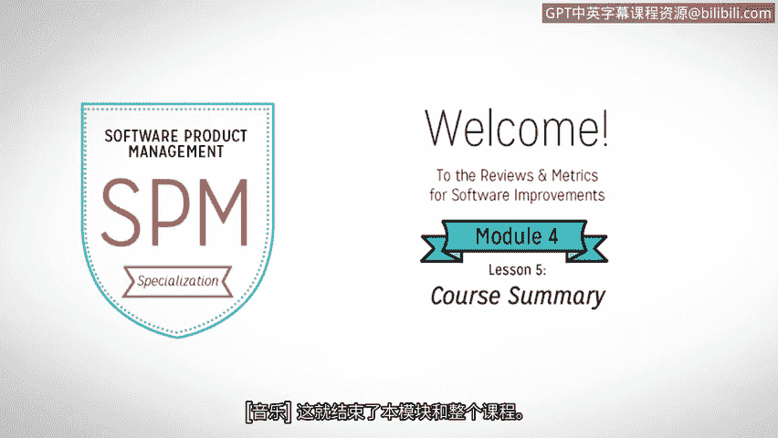

# 028：《软件改进的评审与度量》课程总结

在本节课中，我们将回顾整个课程的核心内容，总结我们在确保构建正确产品、正确执行流程以及正确管理项目方面所学的各种方法。

---

上一节我们回顾了课程各模块的主要内容，现在我们来对整个课程进行总结。

本课程涵盖了多种旨在改进产品、流程和项目的方法。其核心目标是实现 **构建正确的产品**、**正确地完成** 以及 **正确地管理**。

以下是本课程四个模块所学关键方法的总结：

*   **模块一（Morgan主讲）**：确保构建正确的产品。方法包括：迭代评审会议、用户研究、衡量产品成功，以及业界用于创建成功产品的流程实例。
*   **模块二（Bradley主讲）**：确保开发流程正确执行以获得高质量产品。方法包括：同行评审技术（如走查、技术评审和审查），引入了度量的目的、一个指导其使用的目标导向框架，以及一些优秀和不良度量的例子。
*   **模块三（Bo主讲）**：确保项目得到正确管理。方法包括：每日站会、优先级排序、发布迭代、燃尽图以及用于监控进行中和已完成工作状态的任务板。
*   **模块四（Brad主讲）**：回顾与改进。讲解了两种回顾会议：迭代回顾和项目回顾。两者都旨在发现问题、认可贡献，并总结经验教训以改进未来的工作。

---

由于这是专项课程中的第五门课，接下来将是顶点课程。

如果将本专项课程的结构比作一个身体，那么顶点课程就相当于至关重要的头部，它建立在代表之前课程的双腿、躯干和手臂之上。

顶点课程将整合你目前所学的大部分知识。在那里，你将在一个模拟环境中应用敏捷方法论，与用户和利益相关者互动，定义产品的用户故事，对产品待办列表进行优先级排序，规划发布，获取反馈，处理变更，跟踪进度，应对风险等等。

我们顶点课程再见。

---

本节课中，我们一起学习了如何通过评审、度量和敏捷实践来持续改进软件产品、开发流程和项目管理，最终达成“正确构建、正确执行、正确管理”的目标。