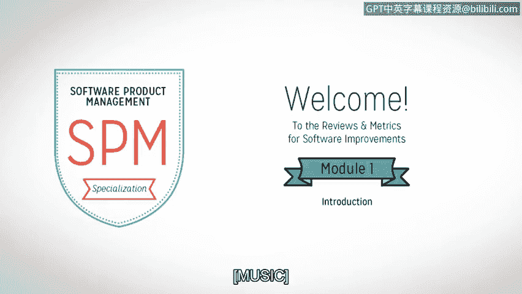

# 030：引言与概述

在本节课中，我们将学习软件产品管理专项课程中的《软件改进的评审与度量》课程。本课程旨在介绍如何通过评审和度量来持续改进软件产品、开发过程及项目管理，以确保我们构建出“正确的产品”，并以“正确的方式”完成和管理它。

我是 Ken Wang。

欢迎来到软件产品管理专项课程中的《软件改进的评审与度量》课程。

本课程建议在您完成《软件产品的敏捷规划》课程后学习。在我们的专项课程结构中，本课程如同橡树的枝干，建立在已学习的基础知识之上。

假设你正在开发一个软件产品。你已经识别了产品机会，与潜在用户进行了沟通，定义了出色的需求，规划了整体发布计划，并且开发团队正在设计和实现产品。

那么，一切都在正轨上吗？在敏捷开发中，什么需要改变？

我之前概述过，更好的软件涉及三个目标：**正确的产品**、**正确地完成**以及**正确地管理**。但你如何知道自己是否与这些目标保持一致？又如何提高自己构建正确产品、并以正确方式完成和管理它的能力呢？

对于每一个目标，你都需要从特定类型的评审和度量所获得的持续反馈中，汲取改进的见解。在考虑改进产品本身、底层过程和整体项目时，你需要分析主观和客观数据的混合信息。

## 实现三个目标的评审与度量

上一节我们提出了软件改进的三个核心目标，本节中我们来看看为每个目标所需的具体实践。

以下是针对“正确的产品”所需的实践：

*   **产品演示**：获取早期反馈。
*   **用户研究**：观察用户如何使用产品，评估其有效性和效率。
*   **用户满意度数据收集**：收集关于用户满意度的数据。
*   **市场成功指标监测**：关注产品在市场上初步成功的迹象。

你可以利用所有这些信息来确定项目中需要改进的功能。

现在，针对“正确地完成”（过程），开发人员需要：

*   **工作产品评审与检查**：审查他们创建的工作产品，以便及早发现和修复问题。
*   **质量因素监控**：监测与重要质量因素（如以缺陷率衡量的正确性）相关的数据。

开发团队利用这些信息来确定在项目实现过程中需要改进什么，以及为了达到期望的质量需要对流程进行哪些调整。

最后，针对“正确地管理”（项目），开发团队需要：

*   **每日站会**：每天进行简短会议，同步更新彼此进展。
*   **速率跟踪**：跟踪如**速率（Velocity）** 这样的度量指标。
*   **进度监控与沟通**：监控并沟通计划内用户故事和任务的完成情况，让每个人都知道项目状态。

团队应用这些信息来协调工作，并确定如何改进才能更有效地、无浪费地完成工作。

## 课程结构与内容

本课程涵盖了一系列实践，旨在及早、定期且持续地揭示潜在的产品、过程和项目问题。随着问题的解决，软件会随着每次迭代变得更好。

本课程包含四个模块。

在第一个模块中，Morgan Patriz 将聚焦于“正确的产品”这一目标。她会深入讨论**冲刺评审会议**，在会上演示和评审产品以获取反馈。然后，她会描述用于观察用户使用产品有效性和效率的**用户研究**。她还将概述产品成功的示例度量指标，并讨论行业中用于创建成功、设计精良产品的流程。

在第二个模块中，Brad Poette 将聚焦于“正确地完成”（过程）这一目标。他将描述开发人员用于检查和改进其工作的**同行评审技术**。他将解释度量的目的，以及它们如何解决与产品或过程固有目标相一致的具体问题。他会概述有用软件度量应具备的理想属性，介绍流行的度量指标，并以缺陷相关度量的讨论作为结束。

在第三个模块中，Morgan 将回来聚焦于我们“正确地管理”（项目）的目标。她将描述一种常见的敏捷实践——**每日站会**，并回顾**速率**的概念。她会详细说明用于跟踪连续冲刺中已完成用户故事的**发布燃尽图**。她还将描述**任务板**和**迭代燃尽图**，用于跟踪冲刺内任务的完成情况。这些实践有助于发现工作是否半途而废，未能有效完成。

在第四个模块中，Brad 将回来讨论**回顾会议**。这是一种用于总结经验教训的实践，可以在每次冲刺后或整个项目结束后进行。他将描述项目回顾会议中的各项活动，以识别成功、揭示不足、回顾发生的事件、认可所有贡献者，并产生建设性的经验教训，应用到未来的项目中。

## 总结

本节课中，我们一起学习了《软件改进的评审与度量》课程的概述。到本课程结束时，你将学会一套有效的反思性实践，用以改进你的产品、过程和项目。这些知识将帮助你创造出优秀的软件产品——即正确的产品，以正确的方式完成和管理。😊