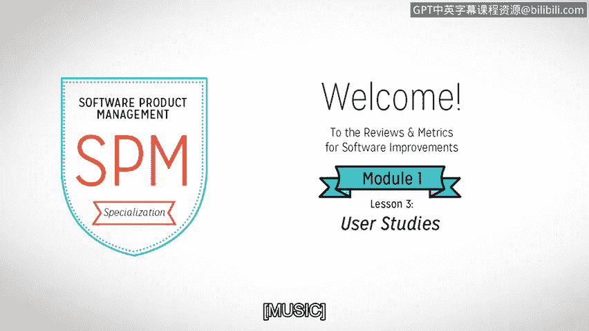
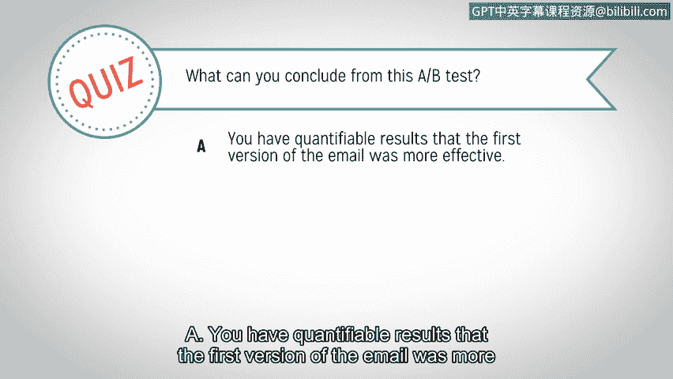
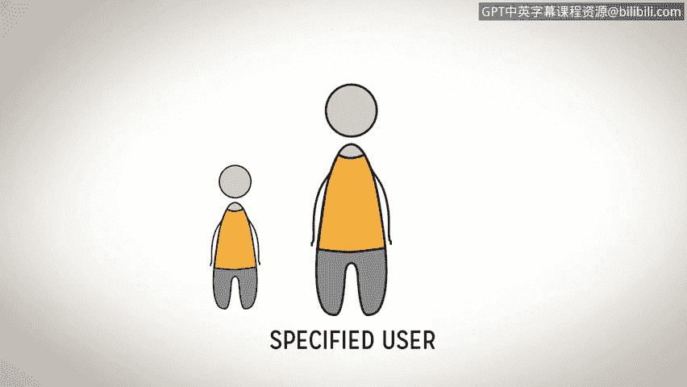

# 033：用户研究 🧑‍💻

在本节课中，我们将学习如何通过用户研究来验证你的软件产品是否真正适合目标用户。

上一节我们讨论了客户需求，本节中我们来看看如何确保产品对用户而言是易用的。为用户打造正确的产品至关重要。如果用户无法使用或不喜欢你的产品，他们就不会使用它。进行用户研究是验证这一点的有效方法。

## 什么是可用性？

用户研究可以衡量产品的可用性。关于可用性，一个最佳定义来自哥本哈根大学一项关于可用性研究挑战的报告。该报告很好地概述了当今常见的各类可用性研究。

他们将可用性定义为：**特定用户在特定环境中达成目标时所表现出的有效性、效率和满意度**。

这个定义指出了用户研究的几个关键方面：
*   首先，它明确了用户研究可以衡量**有效性**、**效率**和/或**满意度**。
*   其次，它强调研究涉及在**特定环境**中达成**目标**。

使用软件产品就是为了达成目标。即使不像游戏产品那样目标明显，每个产品也有其预期用途或目标。

## 用户研究能发现什么？

以下是用户研究可能揭示的几类问题：

*   用户是否以预期方式达成了指定目标？
*   用户是否以非预期方式使用产品来达成目标，或达成了全新的目标？
*   如果用户未按预期方式使用产品或达成预期目标，原因是什么？是用户界面的问题，还是产品能解决一个全新的、可能更好的问题？

定义还强调了“特定用户”和“特定环境”。为研究选择正确的用户，并控制环境和测试方法，这两点都非常重要。

## 互动思考

你正在为你的产品进行一项用户研究。在研究中，你给受试者一个要达成的目标。然后你观察用户如何与产品交互，同时记录他们达成目标所需的时间和点击次数。

这项用户研究衡量了哪些因素？
A. 有效性
B. 效率
C. 满意度

这项研究只衡量了有效性和效率。因此，**A和B是正确答案**。有效性通过受试者是否达成目标来衡量。效率通过达成目标所需的时间和点击次数来衡量。

如果你想衡量满意度，可以在用户使用产品后进行访谈，询问他们是否喜欢该产品，或者对正确达成目标的自信程度。

## 如何进行用户研究？

用户研究有几种常见的进行方式：

*   **目标导向测试**：一种常见方式是让测试参与者在专家观察和记录下使用产品。有时会为用户提供他们试图达成的目标。当用户有特定目标时，用户研究可以验证产品是否允许用户达成该目标，并揭示应用中可能阻碍用户达成目标的部分。
*   **自由探索测试**：另一种类型是要求用户按自己的感觉使用产品。在这种研究中，用户通常被要求“边做边想”。通过这种研究，你可以确定产品自然鼓励用户做什么。这与产品的预期目标不同吗？你甚至可能发现产品如何被用于不同的目的。
*   **情境访谈/观察**：另一种用户研究是观察你的用户，看看他们的典型一天是怎样的。他们完成什么任务？是否有产品能让这变得更容易？这类研究可能引导你开发出真正适合用户的创新产品。
*   **A/B测试**：测试产品的另一种方法是A/B测试。在A/B测试中，你将产品的两个版本相互比较。通常，这是通过发布两个非常相似、仅一个功能有变化的产品来实现的。然后，你将获得关于新功能产品与旧产品相比表现如何的可量化结果。

## 关于A/B测试的思考

你正在为一家在线购物公司进行A/B测试。该公司的在线邮件列表有1000名订阅者。你向其中500名订阅者发送一个版本的电子邮件，向另外500名订阅者发送另一个版本的电子邮件。每个版本的电子邮件都有不同的优惠券代码。一周后，你检查网站统计数据，查看每张优惠券被使用了多少次。

第一个版本的电子邮件对应有10人使用了优惠券代码。
第二个版本的电子邮件带来了15次优惠券代码使用。

你能从这次A/B测试中得出什么结论？
A. 你有可量化的结果表明第一个版本的电子邮件更有效。
B. 你有定性的结果表明第一个版本的电子邮件更有效。
C. 你有可量化的结果表明第二个版本的电子邮件更有效。
D. 你有定性的结果表明第二个版本的电子邮件更有效。

这次A/B测试提供了可量化的结果，因为我们有可以用统计分析的数字。结果显示，第二个版本的电子邮件比第一个版本带来了更多的优惠券销售。因此，**C是正确答案**。

## 可用性指标与参与者选择

用户研究也可以选择应用可量化的可用性指标。例如，这类指标可以衡量用户完成任务所需的时间、页面点击次数以及被点击最多的按钮和元素。这类指标比产品满意度更少主观性。但这是否意味着它们不那么重要？正如之前提到的，满意度通常不是有效和高效产品的直接结果，尽管那会有所帮助。

在用户研究中，你应该仔细选择研究中的参与者，即你的“特定用户”。你需要确保选择的人能代表你的目标受众。你希望你的特定用户与你实际期望使用产品的人具有相似的特征，例如他们的背景或计算机技能水平。

例如，你不希望让开发人员作为针对幼儿产品研究的参与者。同样，尽管让朋友和家人试用你的产品很容易，但你需要确保他们给你的是无偏见的反馈，而不是仅仅告诉你你想听的话。

## 实践建议

如果你想亲眼看看用户研究是如何进行的，可以报名参加一个。大多数科技公司都会进行用户研究并且需要参与者。找一家当地的科技公司，看看你是否能成为用户研究的一部分。你不仅能获得第一手经验，也在帮助当地的科技生态。

测试产品可用性的方法还有很多，我们将在课程讨论中探讨其他方式。

## 总结

在本节课中，我们一起学习了用户研究的概念及其在验证产品对用户适用性中的核心作用。我们了解了可用性的定义（有效性、效率、满意度），探讨了不同类型的用户研究（如目标测试、自由探索、A/B测试），并强调了选择正确研究参与者的重要性。下一模块，我们将通过一些行业案例，看看他们如何验证自己是否为用户打造了正确的产品。