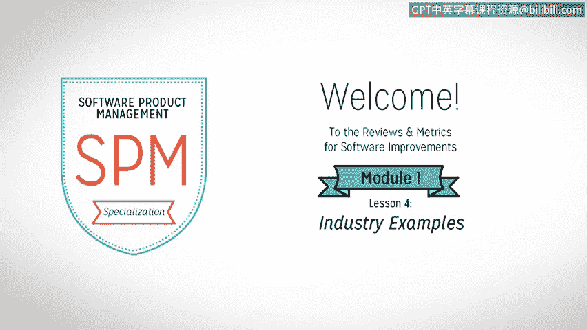
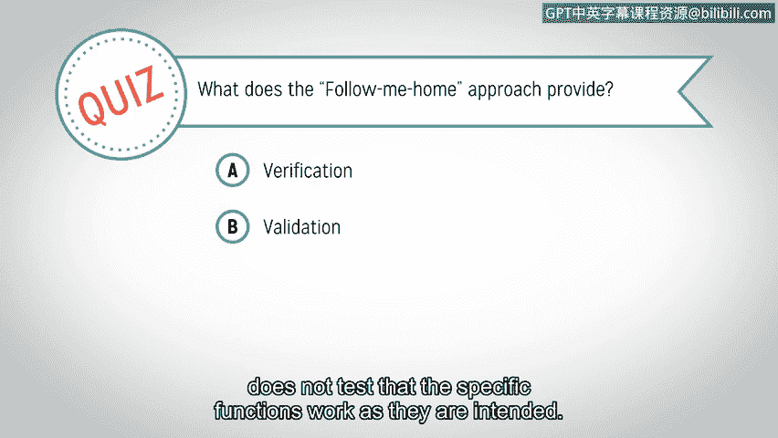
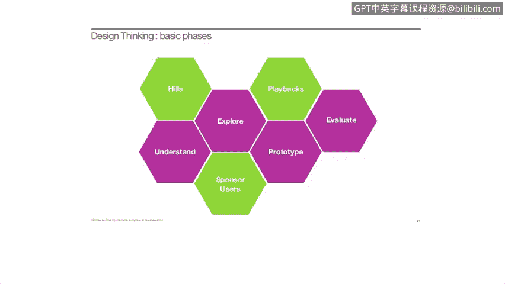

# 034：行业案例

在本节课中，我们将学习几家主要公司如何生产正确产品的行业案例。之后，我们将了解高效产品经理需要关注的其他领域。

## 🍎 苹果公司的原型设计方法

首先，我们从一个以持续交付正确产品而闻名的公司开始：苹果公司。苹果以其优雅的产品而闻名。他们是如何持续交付正确产品的呢？

当一个想法形成后，苹果从原型设计开始。苹果的原型设计通常被称为“像素完美”原型设计，或“10到3到1”原型设计。

他们最终的、接近成品的原型是像素完美的，因为设计精确到了每一个单独的像素。这意味着他们不仅设计界面，而且设计到了最高级别的细节——像素。可以想象，这种做法成本相当高，并且不太敏捷。但它似乎很有效。

“10到3到1”原型设计之所以得名，是因为设计师开发原型的方式。设计师不受限制地工作，提出10个不同的原型。这非常类似于精益开发，即在做出决定前探索多个原型。然后，他们会选择三个最佳设计并进一步探索这些选项。最后，他们会选择最有力的竞争者，并将该原型设计到像素完美的级别。

苹果还进行定期评审。他们每周举行一次高管团队评审会，审查生产过程。他们还有同行设计会议。这是设计团队和工程师之间的会议，专注于改进设计。

苹果的设计过程非常广泛，因此成本也很高。但正如你在市场上所见，它是有效的。苹果产品多年来主导市场，因此精心设计工作的花费似乎是值得的。

**问题：为什么苹果的原型设计方法被称为“像素完美”？**
A. 因为苹果产品中的像素总是完美的。
B. 因为原型设计确保产品中的所有像素都是完美的。
C. 因为原型设计精确到了单个像素的级别。
D. 因为这听起来很酷。

**答案：** 苹果将其一种原型设计方法称为“像素完美”，是因为原型设计达到了最高级别的细节——像素。因此，C是正确答案。

## 🔍 谷歌的设计冲刺流程

现在，我们来谈谈软件产品和服务领域的另一个巨头：谷歌。谷歌创建了他们的“设计冲刺”流程。这个流程也被其他公司使用，如爱彼迎和蓝瓶咖啡。

这个过程快速且迭代，将过去需要数周或数月的时间压缩到一周，有时甚至更短。谷歌眼镜就是使用这个过程在不到两小时内完成原型设计的。这类似于“尽可能快地交付”的精益原则。

设计冲刺包含五个阶段：
1.  **理解**：工程师和设计师评估当前问题，并确定为谁设计。
2.  **发散**：鼓励参与者为问题想出尽可能多的解决方案，无论它们看起来多么不现实或牵强。
3.  **决定**：参与者投票并讨论要更详细地追求哪个或哪些想法。
4.  **原型**：参与者快速绘制草图并构建原型。这些原型侧重于用户界面和用户体验。
5.  **验证**：将产品交给用户，鼓励设计师和工程师进行演示，然后接收用户的反馈。

这个过程的每个阶段都旨在各用一天完成。

**问题：设计冲刺的五个阶段是什么？**
A. 理解、发散、决定、原型、验证。
B. 评估、头脑风暴、投票、创建、测试。
C. 理解、头脑风暴、决定、原型、测试。
D. 评估、头脑风暴、决定、原型、测试。

**答案：** 设计冲刺的五个阶段是理解、发散、决定、原型和验证。因此，A是正确答案。

## 🏠 Intuit的“跟我回家”方法

既然我们已经讨论了一些大公司如何设计正确的产品，现在让我们看看另一家大公司如何验证其产品确实是正确的产品。Intuit使用一种名为“跟我回家”的方法。

Intuit是一家制作会计软件的公司。其创始人斯科特·库克在公司早期就开始了“跟我回家”的实践。库克会去当地的办公用品商店闲逛，等待有人购买他的软件。然后，他会询问顾客是否可以跟随他们回家，观察他们安装和使用软件的过程。这种做法听起来有点令人不安，但很有效。它让Intuit能够构建真正适应用户环境并完全满足其需求的产品。

Intuit现在继续以更可控的方式使用这种做法。平均每年大约进行20次访问。每次访问大约持续一小时。在访问期间，他们观察客户使用软件的情况。他们还会记录客户的工作环境、办公室的工作方式以及软件如何融入业务。

**问题：“跟我回家”方法提供什么？**
A. 验证（Verification）
B. 确认（Validation）

**答案：** “跟我回家”方法提供的是对产品的确认（Validation）。它测试用户的满意度，而不是测试特定功能是否按预期工作。因此，B是正确答案。

## 💡 IBM的设计思维实践

IBM实施了一种名为“设计思维”的实践，它结合了原型设计、用户观察和敏捷开发。设计思维是斯坦福大学开发的一个概念，后来被IBM采用并调整以适应其需求。设计思维专注于识别人们的需求并提出满足这些需求的解决方案。

传统设计思维有四个主要阶段：理解、探索、原型和评估。IBM对此进行了调整，增加了三个阶段：赞助用户、山丘和回放。

这个过程从最终用户开始。你需要找出用户需求未得到满足的原因。为了理解用户需求，你需要找出实际的用户是谁，并发现他们如何思考、看到什么、如何使用产品以及用产品做什么。

然后，他们寻找对产品感兴趣的候选人。他们将其缩小到一个候选人，该候选人具备典型用户的许多特征并面临许多相同的问题。这就是赞助用户。随着产品的发展，他们被用来提供见解。

团队与赞助用户合作以获得见解和信息。他们利用这些来识别产品的一个问题。这个挑战就是“山丘陈述”。然后，他们将这个问题带给更大的团队以提出解决方案。团队随后探索针对该挑战的各种解决方案。剔除糟糕或不切实际的想法。

一旦解决方案范围缩小，他们就开始为这些解决方案绘制草图。然后，他们更正式地对想法进行原型设计。可能需要几次迭代才能确定要追求的最佳想法。这些被称为“回放”。

最终，创建一个工作模型，并与最终用户一起进行评估。这个想法会根据赞助用户的反馈进行迭代完善。完善后，产品发布，但会根据新的用户需求持续测试和完善。

## 📝 总结

本节课中，我们一起学习了四家主要公司用于确保产品正确性的不同方法：
1.  苹果公司采用**像素完美**和**10到3到1**的详细原型设计流程，并通过定期评审确保质量。
2.  谷歌公司使用快速迭代的**设计冲刺**流程，在短时间内完成从理解问题到验证解决方案的全过程。
3.  Intuit通过**“跟我回家”** 方法进行产品确认，深入用户环境获取真实反馈。
4.  IBM将**设计思维**与敏捷开发结合，通过赞助用户、山丘陈述和回放等阶段，系统地识别需求并迭代解决方案。

这些案例展示了在产品管理中，结合深入的用户理解、快速迭代的原型设计和持续的验证反馈，是交付成功产品的关键。