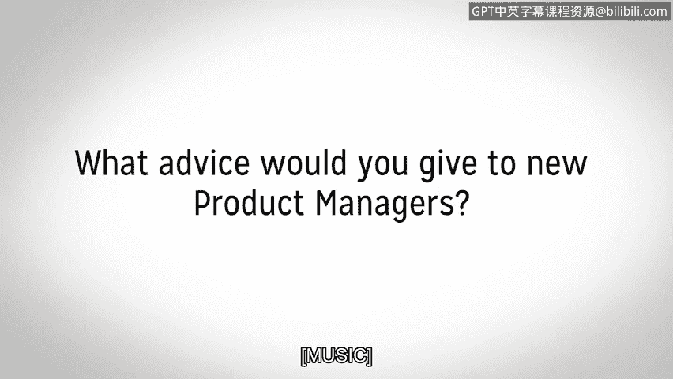

# 035：行业案例访谈

在本节课中，我们将通过一位行业专家的访谈，学习产品经理如何运用产品战略、生命周期管理和市场情报来打造成功的产品。我们将了解产品经理的核心职责、所需技能以及衡量产品成功的关键方法。

---

## 产品经理的核心职责

产品经理需要深入理解软件开发生命周期。其核心职责围绕三大支柱展开：产品战略、产品开发以及产品如何触达消费者（即产品分发）。

上一节我们介绍了行业巨头如何交付正确的产品，本节中我们来看看产品经理如何运用这些支柱来识别并实现正确的产品。

我的名字是Clon Costa，我是视频游戏行业的制作人，其角色等同于产品经理。

作为产品经理，我需要负责产品的三大支柱：
*   一是产品战略。我需要真正理解产品的愿景应该是什么，并确保团队理解它。
*   二是产品本身的开发。
*   三是产品如何触达消费者，即产品的分发。

---

## 产品经理的关键技能

软件产品经理需要具备出色的沟通能力。他们还需要深刻理解市场趋势和竞争对手的优势。因此，你需要非常擅长了解市场现状，同时也需要非常精通如何创造软件。你对如何创造软件理解得越深，就越能帮助团队实现之前设定的产品愿景。最后但同样重要的是，你还需要理解产品的商业层面，例如你将采用何种商业模式，以及最终如何触达消费者——是通过数字分发还是零售。所有这些能力的结合，造就了一名优秀的软件产品经理。

---

## 市场情报

市场情报是指理解市场现状的能力：你的消费者是谁？你的受众是谁？你和消费者之间是否有零售商（他们也可能成为你的客户）？当前市场在技术、分销或商业模式等方面有何趋势？同时，它也是你理解市场需求的能力：当前市场是否存在空白，尚未有人满足？你能否触及那个空白并比其他人做得更好？这就是我所说的市场情报。

我认为这需要大量的研究。你必须投入精力去理解市场，所以你需要大量阅读。在软件开发领域，你还需要去玩或使用其他软件，以便理解竞争对手的优势。你还需要阅读与你领域（对我来说是电子游戏）相关的杂志、博客或网站。此外，你还需要理解如何触达消费者。如今，你可以通过社交媒体直接联系消费者，询问他们在特定产品中寻找什么，或者他们认为某个竞争对手好在哪里、不好在哪里，从而让你可以去填补市场空白。

你必须大量使用市场上现有的软件。你需要非常了解自己的软件，需要非常注重细节，深刻理解你的软件为市场提供了什么。但同时，你也需要对所有竞争对手做同样的事情。此外，你还需要与消费者直接沟通。这可能是焦点小组，也可能是使用社交媒体。你需要理解是否存在市场空白，是否出现了不同的需求，或者市场领导者是否存在你可以弥补并做得更好的弱点。

---

## 用户画像与产品战略

在人口统计方面，我们通常的做法是考虑原型和用户画像。你会尝试理解特定细分受众，并为每个细分创建用户画像。以视频游戏开发为例，我们拥有非常广泛的受众，需要理解我们拥有的细分市场，然后为每个细分市场创建用户画像。例如，这可能是一个20岁、21岁的医学生，他想玩电子游戏，因为这对他是一种逃避。另一个可能是娱乐人士或有空闲时间的妈妈。你需要创建这些用户画像，一旦有了这些画像，你就能看到你软件的功能如何与这些画像对齐，是否真正满足了这些画像的需求。

产品战略首先是理解你需要构建什么的能力。你的软件必须具备什么才能击败市场上的竞争对手？这是产品战略需要做的事情之一。另一件你需要理解的事情是，你需要为你的产品设计商业模式。你将如何销售你的软件？是订阅制、一次性付费，还是某种免费软件（30天后销售软件的另一部分）？商业模式多种多样，这真的取决于你的市场、你的竞争对手以及你正在做的事情。所以你需要理解你需要构建什么、你将如何销售它，以及你将如何实际触达消费者、如何进行分发。

产品经理需要创造愿景。他需要成为消费者和开发团队之间的桥梁。他需要创造那个愿景，以一种非常简洁、简单的方式告诉团队他们需要构建什么，以及为什么这很重要，为什么这足以击败市场上所有的竞争对手。

你的产品愿景可以包含我们所说的独特卖点。假设你有五个独特卖点，希望你的产品能有强大的功能来支撑这些支柱。一旦你有了软件的原型，或者已经有了测试版或Alpha版，你就可以创建焦点小组。你可以触达特定的用户群体，实际测试他们如何接受你的软件：他们喜欢这个新功能吗？它足够有吸引力吗？它比市场上的产品更好吗？这是一种方法。你可以获得反馈，如果存在摩擦点，例如，你可以减少摩擦点，改进功能，然后再次推向市场。如果你在整个开发周期中持续这样做，那么在周期结束时，你应该会有一个更强大的产品发布。

我认为将你的产品与市场上其他产品区分开来的第一步，是理解你自己的优势和劣势。以我们公司为例，我们在某些领域拥有其他竞争对手没有的优势，我们努力强调这些优势。我们努力确保我们的产品带有我们公司的印记，让消费者知道这是我们公司的产品。

基本上，首先要理解你的优势和劣势，同时也要理解它们如何与市场需求相关联。因为如果你在某个市场并不真正需要的领域非常强大，那对你没有帮助。但如果这里存在市场空白，存在市场需求，而你恰好在这方面很强，那么这就是你可以有所作为的地方。

---

## 商业模式与生命周期

软件产品的盈利模式现在有很多种，而且市场变化相当快。你可以采用传统的零售模式，在商店销售盒装产品；可以采用数字分发，用户只需下载你的软件；可以采用订阅制，就像现在很多软件做的那样；也可以采用混合模式，比如提供某种免费版本，消费者可以免费下载，但如果想要高级功能，则需要订阅、支付全价或为产品的部分功能支付不同的价格。所以现在桌面上有很多不同的商业模式，这真的取决于你试图进入的市场，取决于你特定市场的消费者。

在初创公司，产品经理拥有更大的灵活性，他必须身兼多职。通常他没有很多资金，但他有一个小而精悍、可以快速迭代的团队。我认为这对初创公司的产品经理来说是积极的一面。但你需要非常执着和有韧性，因为事情不会容易，因为你的团队很小，资源通常也很有限。在大公司，你拥有更多可用资源的优势，可以进行更好或更广泛的研究、不同类型的调查，甚至可以专门前往世界上有消费者的特定地点与他们交谈。但同时，你可能需要通过更冗长的流程来完成事情，有时需要协调组织内的许多不同团队。因此，对产品经理来说可能更困难，因为他需要说服更多的人才能完成某件事。

一个常见的软件产品生命周期会包括：
*   **预生产阶段**：在这个阶段，你需要理解你的产品需要成为什么样子（不同行业可能称之为构思阶段）。你需要理解你需要构建什么，以及为什么这个产品比市场上的更好。这是你设定愿景、让团队围绕一个足以击败市场上所有人的愿景达成一致的阶段。你还需要确保在预生产阶段有足够的资金，并尝试迭代和创建原型，以尽快验证你设想的功能是否真的如你预期的那样强大。
*   **生产阶段**：在预生产阶段之后，进入生产阶段。这时你已经知道需要构建什么，现在就是关于构建它、扩大规模，并确保在预算或时间等约束下完成一切。
*   **最终阶段**：开发出产品后，进入我们所谓的最终阶段。在这个阶段，我们尽可能地对产品进行打磨。我们会尝试修复所有漏洞，甚至可能发布一个测试版软件给成千上万的消费者，让他们使用我们的软件，然后反馈给我们哪些地方运行良好，哪些地方有问题，他们喜欢什么，不喜欢什么，以便我们在软件正式发布前进行修复。
*   **发布阶段**：最终阶段之后是发布阶段。在这个阶段，你需要分发你的软件，让软件实际触达你的消费者。如果你有数字分发和零售商，要确保一切正常运作，消费者知道这个软件，并且有办法购买它。
*   **运营服务阶段**：发布阶段之后，在我们特定的案例中，有一个我们称之为“运营服务”的阶段。这意味着我们必须为软件发布后的所有工作制定路线图，可能包括修复漏洞的补丁，也可能包括带有新功能的软件扩展，因为我们从消费者和游戏记者那里收到了反馈。一旦获得反馈，我们会根据现有团队对需要做的事情进行优先级排序，然后制定路线图，产品经理领导这个路线图的制定。

---

## 发布后的工作与成功度量

产品发布后，你需要理解的第一件事是你的产品如何被消费者接受。你必须快速分析从消费者角度看，哪些方面做得很好，哪些方面出了问题。有些问题，你可能能够通过软件补丁来修复，或者可能需要快速添加一个功能，从而为你的产品创建一个扩展和更新。另一件你需要做的事情取决于你的产品是否也变成一项服务。如果是一项服务，你需要与消费者保持持续沟通，了解哪些方面进展顺利，他们不喜欢什么，以便他们能帮助你为产品制定更好的长期路线图。

衡量软件产品成功的方法有很多种，这真的取决于你的行业。你可能关注销售数量、收入、利润率，也可能是产品质量（根据行业不同，可能有某种评分来衡量和比较你的软件与其他软件）。但通常，最终都会回到消费者满意度上。我的意思是，你需要理解消费者如何接受你的软件。一个好的产品经理需要非常精通分析，知道如何利用软件的遥测数据来获取关于需要更改事项的重要数据。通常，一个好的产品经理会首先尝试创建关键绩效指标（我们称之为KPI）。一旦你有了KPI（这真的取决于你所在的行业），你就可以开始衡量你的软件是否成功。

在内部，例如对于开发团队，你可能会有诸如每小时崩溃次数、服务器正常运行或停机时间等KPI。另一方面，你可能还有其他指标，比如同时访问服务器的实际人数，即你当前的最高同时在线用户数。有很多不同的指标可以帮助开发团队理解他们的服务或产品是否运行良好。

在外部，还有一些其他因素可以衡量。通常我们有一个称为A-O-E-M的漏斗模型：
*   **A（获客）**：我们有诸如实际下载或购买你软件的人数、每天有多少人在玩、你拥有的每日独立用户数等指标。
*   **O（引导）**：对于引导，你可能有一些指标，比如用户是否完成了整个教程流程，他们是否中途停止。
*   **E（参与）**：在参与度方面，你有用户每天使用你软件的会话次数、他们使用你软件的时长。我们还有其他参与度指标，比如他们是否可能向朋友推荐你的软件（我们称之为NPS净推荐值）。
*   **M（盈利）**：在盈利方面，我们有关于他们每天或生命周期内总共花费多少钱的指标，即用户生命周期价值。例如，如果用户最初在产品上花了60美元，在整个生命周期内又花了20美元，那么他就值80美元。还有每付费用户的平均收入、每用户的平均收入、付费用户的比例等。有很多不同的KPI来衡量盈利。

在分析方面，你可以利用这些信息来查看这些用户是否成功。例如，那些完成了完整引导流程的用户和那些跳过了教程的用户相比，是否遇到了更多问题？他们是否更频繁地联系客服，因为他们不知道如何使用软件？你可能会发现，那些完成了教程的用户实际上掌握了软件的关键基础知识，因此需要更少的帮助。

---

## 成功产品与产品经理的特质

我认为一个成功的产品背后需要一位成功的产品经理。这意味着你需要一个人来充当所有消费者（你拥有的数百万消费者）和开发团队之间的重要桥梁。这个人不仅要做这个桥梁，还要从商业角度理解你将采用何种商业模式、如何分发你的软件、如何触达你所有的消费者。你需要在三大支柱上做得非常好：商业模型方面、市场理解方面以及开发流程方面。如果一个好的产品经理能在这三大支柱上都做得很好，他很可能会成功。

我认为对于新产品经理来说，他们需要做的第一件事是对软件、对你试图开发的产品充满热情。如果你热爱你所做的事情，你成功的几率会高得多。这是第一点。第二点是保持非常好奇。你需要非常好奇，需要努力理解市场现状，需要尽可能多地使用竞争对手的软件，内心需要保持那种好奇心。同时，你需要问为什么：他们为什么那样做？为什么我们不能这样做？或者为什么我们不能做得更好？我认为这是一点。另一点当然是，你需要大量学习。无论你的市场是什么，你都需要大量研究你的市场，真正理解你的市场如何运作。最后，我认为对产品经理来说，知道如何与人相处也超级重要。你不是独自制造软件或产品，你有一个团队，你需要知道如何与团队以及团队内的不同小组良好沟通。你如何确保每个人都在同一个愿景、同一个目标下保持一致？

---

## 总结

在本节课中，我们一起学习了产品经理在打造成功产品中的核心作用。我们探讨了产品经理需要具备的三大支柱能力：产品战略、市场情报和生命周期管理。我们了解了如何通过用户画像理解受众，如何制定产品愿景和独特卖点，以及软件产品从预生产到运营服务的完整生命周期。最后，我们学习了如何通过A-O-E-M漏斗模型和KPI来度量产品的成功，并认识到好奇心、学习能力和人际沟通能力是优秀产品经理的关键特质。

在下一个模块中，你将学习如何确保你的产品“做得对”。Bradley将带你了解一些监控技术和指标，你可以用它们来确保你的产品是正确的。