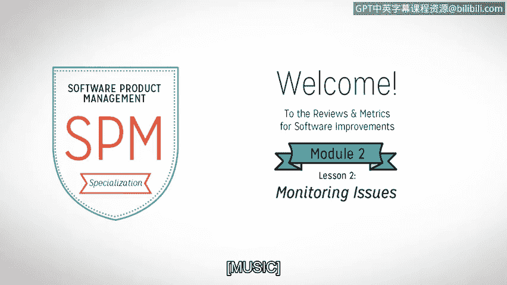
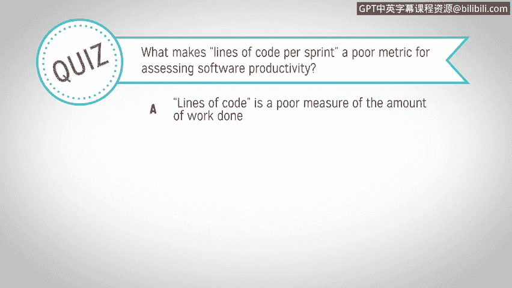

# 038：监控项目时需注意的问题

## 概述
在本节课中，我们将探讨在软件项目中监控进度时需要注意的问题。我们将了解为何某些度量指标可能不适用，以及如何避免使用不良指标。通过理解这些概念，你将能更明智地选择和使用度量指标来改进软件产品和流程。

---

在上一节课中，我们介绍了几种在软件开发中使用的同行评审技术。

现在，让我们退一步，讨论一些关于监控项目时可能遇到的问题。例如，为何应避免某些度量指标，以及哪些指标对软件项目不利？

你刚刚看到，监控可以通过同行评审（如代码走查）来实现。正如本课程标题所示，这并非监控的唯一方式。软件中有许多度量指标可用于跟踪进度、生产力和质量。**速度**（Velocity）就是其中之一。

我在上一门课程中简要介绍了如何估算速度，Morgan将在下一个模块中深入探讨如何计算和跟踪它。

实际上，存在很多度量指标，它们各自评估项目的不同方面。然而，在许多软件项目中，这些指标根本未被使用。这是为什么呢？大多数时候，问题在于找到合适的时间来正确编译这些指标。

正如我在关于反模式的课程以及软件项目的敏捷规划课程中所说，开发人员实际用于编码的时间是有限的。这意味着开发人员花在非编码任务（如编译指标）上的任何时间，都会占用他们用于编码的总时间。

为了最大化开发团队在创建产品方面取得的进展，通常首先被跳过的是度量指标。团队构建了一个可靠的产品，早期并迭代地交付给客户，每个人都很高兴。然而，除了那些希望退一步定量分析项目以便及时发现和妥善解决问题的人。

那么，他们为何不愿意这样做呢？为了跨项目比较，采用更行业标准的测量实践难道不合理吗？

这个问题并不容易解决，尤其是在一个专注于快速高效开发的敏捷框架中，很容易理解为何度量指标会被搁置一旁。在一个项目成功取决于当下能完成多少工作的范式中，很难看到计算指标的价值。

或许度量指标最大的问题之一是，开发人员和管理人员在这方面知识严重不足。市面上有很多例子，很难判断哪些真正值得你投入时间。这一点，加上缺乏行业标准，确实让决策变得困难。有些人说要跟踪这个，另一些人说要跟踪那个。该领域的研究往往没有定论或无法推广。它们可能只适用于特定环境或特定组织。最终，每个组织都必须确定什么适合他们的情况。

你能明白为何行业标准如此之少吗？

以下是我提到的软件项目中度量指标未被正确使用的主要原因之一：
A. 资金不足。
B. 可供选择的指标太多。
C. 开发人员或管理人员知识缺乏。
D. 开发人员或管理人员缺乏兴趣。

答案是 **C**，开发人员和管理人员知识缺乏。经常被指派管理软件项目任务的人，在衡量质量方面没有接受过实质性培训；因此，项目指标要么被误用，要么根本不被使用，这很常见。

行业中一个相对常见的度量指标是**代码行数**（Lines of Code，简称LOC）。基本上，代码行数跟踪为一段软件编写的代码行数，并使用该数字生成一些数据。这些数据可能包括每行代码的成本，通过将整个项目的成本除以编写的代码行数来计算。另一个可能是单位时间内编写的代码行数，这是一种技术速度测量。

虽然跟踪代码行数作为生产力的衡量标准似乎有道理，但事实并非如此。首先，这个指标不可靠。你在项目某一部分获得的代码行数指标，可能与另一部分获得的指标大相径庭，即使在同一团队内也是如此。这有几个原因。首先，开发人员编写的代码行数很大程度上取决于他们使用的编程语言。对于那些熟悉各种语言的人来说，你们会知道C是一种非常低级的语言，需要编写多得多的显式内容才能实现与Python这样的高级编程语言相同的高级功能。因此，粗略来说，实现相同功能的Python程序可能比C程序少五倍的代码行数。对于不同语言的不同程序，代码行数的度量之间没有真正的可比性。事实上，即使使用同一种语言，代码行数也几乎无法显示产品内部的生产力。这是因为不同的功能可能具有不同的复杂性。如果不考虑这一点，你会发现自己进行了本不应该进行的比较。

这个例子显示了了解为何要进行测量的重要性。代码行数的度量本身就是一个问题，但伴随这种测量常常会产生一个有趣的副作用：**开发人员的行为会改变**。每当有人得到一个可以用来衡量自己的分数时，他们的自然倾向将是最大化这个分数。考虑到这一点，你能想到代码行数指标的另一个问题吗？

如果开发人员根据他们编写的代码行数来衡量，他们的自然倾向很可能会比不编译该指标时编写更多的代码行数。这种非预期的后果起初可能不是坏事，但如果你的开发人员花更多时间编写这些代码行，生产力很容易下降。了解你在测量什么很重要；这不是关于收集所有你能收集的数据并进行分析。你必须能够评估你在所提供指标的价值与制表所需时间（以及这些指标的其他相关成本）之间所做的权衡。正如社会学家威廉·布鲁斯·卡梅伦所说：“**并非所有可计数的东西都重要，也并非所有重要的东西都可计数。**”

以下哪项使得每冲刺周期的代码行数成为评估软件生产力的不良指标？
A. 代码行数是衡量已完成工作量的不良指标。
B. 冲刺周期是衡量项目长度的不良指标。
C. 代码大小无法用代码行数衡量。
D. 每冲刺周期的代码行数是评估软件生产力的良好指标。
E. 所有语言中，不同功能的代码行数是相同的。

答案是 **A**，代码行数是衡量项目规模的不良指标。正如我之前所说，代码行数在不同项目之间可能差异巨大，并不能真正反映开发人员的努力。

评审和度量指标存在问题，但这并不降低它们的价值。事实上，行业中确实需要更多的评审和度量。问题的存在意味着有很大的研究空间。为了改进软件产品和流程，在决定实施任何度量时，保持明智和知情非常重要。

在下一节课中，我将讨论一个帮助你做出明智和知情决策的模型：**目标-问题-指标模型**（Goal Question Metric model）。我们下节课见。

---

## 总结
本节课我们一起学习了在软件项目监控中需要注意的问题。我们探讨了度量指标未被广泛使用的原因，特别是开发人员和管理人员相关知识缺乏的影响。我们重点分析了“代码行数”这一常见指标为何是衡量生产力的不良指标，原因包括其对编程语言的依赖性、无法反映功能复杂性以及可能引发开发人员追求数量而非质量的行为改变。最后，我们认识到，尽管存在挑战，明智地选择和使用度量指标对于改进软件流程至关重要。下一节我们将学习一个帮助进行这种明智选择的框架。