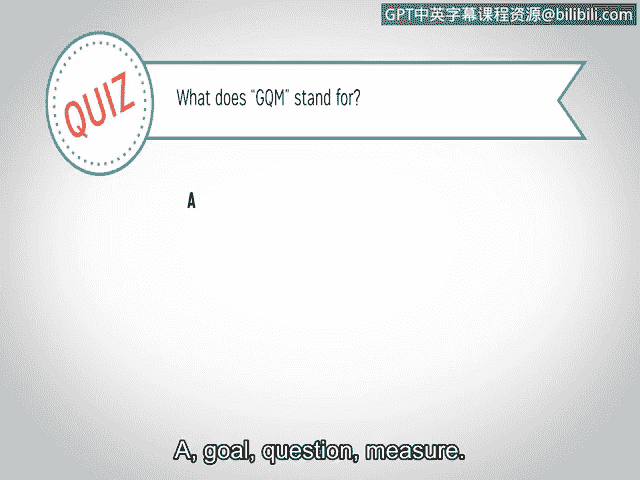

# 039：目标-问题-度量法 (GQM) 🎯

在本节课中，我们将要学习一种名为“目标-问题-度量法”的框架，它能帮助我们为软件项目选择和制定有效的度量指标，确保我们测量的内容对项目和团队真正有价值。

上一节我们介绍了监控软件项目时可能遇到的一些问题，这些问题主要与度量指标的有效性及其可能被误用有关。本节中，我们来看看如何系统地制定度量指标，以确保它们能衡量对您和团队有价值的项目方面。

## 什么是GQM？

目标-问题-度量法，简称GQM，是一种为软件项目选择度量指标的方法。它由马里兰大学的维克多·巴希利于1994年提出。

根据巴希利本人的观点，GQM背后的基本思想是：一个组织要有目的地进行度量，就必须首先为自己及其项目设定目标。然后，它必须将这些目标追溯到旨在从操作层面定义这些目标的数据，最后，提供一个框架来解释这些数据与既定目标的关系。

简单来说，为了确保为项目使用了正确的度量指标，您必须首先知道想要度量的概念，即您的**目标**。明确目标后，您必须找出定义该目标的因素，即您的**问题**。接着，您需要找到一种方法来计算这个定义，并以一种可以解释的方式，来了解您向目标迈进的进度，这就是您的**度量**。

**GQM的核心流程可以概括为：**
**目标 (Goal) -> 问题 (Question) -> 度量 (Metric)**

## 如何设定目标？

根据巴希利的理论，目标应用于对象，这些对象是**产品**、**过程**和**资源**。本质上，您可以选择改进这三者之一作为目标。

*   **产品**：例如您的代码或文档。
*   **过程**：例如您的测试或需求获取过程。
*   **资源**：例如您的办公空间、开发团队使用的计算机，或开发人员的投入与薪酬。

核心思想是您可以度量任何事物，但将项目目标分解为这三个类别有助于您思考如何度量它们。

> **小测验：GQM的目的是什么？**
> A. 确保您正在构建正确的产品。
> B. **确保您有效地使用度量指标。**
> C. 确保度量指标使用正确的数据。
> D. 确保您向客户提出正确的问题。
>
> **答案：B**

GQM是一个使用度量指标的框架，其重点是确保您使用最佳的度量指标来回答您想了解的关于项目的问题。

## 从目标到问题

在确定每个目标之后，下一步需要考虑的是您想针对这些目标提出的**问题**。基本上，您需要提出哪些问题才能告诉您每个目标是否正在实现？

这取决于具体的目标，但总体思路是，您的问题应该足够具体，以便问题的答案能够直接指向目标的达成情况。

## 从问题到度量

那么，如何找到这些问题的答案呢？这就是**度量**部分的作用。度量是一种收集数据的定量方式，用以回答您提出的问题。

这与我们在之前课程中讨论的其他度量指标完全相同。GQM中度量指标的特殊之处在于，它们因事先的规划过程而变得更有意义。GQM中的度量指标之所以更有价值，是因为度量指标旨在回答的问题已经过事先的深思熟虑。

度量指标可以是**主观的**或**客观的**。

*   **客观度量**：基于不依赖任何个人观点或解释的数据。例如：
    *   `产品下载次数`
    *   `销售数据`
    *   `处理时间`
    *   `完成的用户故事数量`
*   **主观度量**：依赖于解释。例如：
    *   `用户的产品评分`
    *   `开发人员的士气`
    *   `代码质量`

如果您将度量指标比作软件，这很像我们在“客户需求与软件需求”课程中讨论的“收集需求”与“获取需求”的区别。您不希望盲目地开始收集度量指标。就像从客户那里获取需求很重要一样，事先明确度量指标的目标也同样重要。

当然，一旦有了用户故事，您也不会直接开始构建它们，而是先创建**开发任务**——那些可以在几小时内完成的小型、可执行项。GQM中的**问题**也是如此，您创建小的项目，当它们组合在一起时，就能解决整个目标。

只有在您通过发布和迭代计划提前规划好工作后，才会进入代码开发阶段。同样，只有在您通过具体问题提前定义了度量指标的目标后，才会进入实际实施度量指标和收集数据的阶段。

> **小测验：GQM代表什么？**
> A. 目标-问题-测量
> B. 收益-问题-测量
> C. **目标-问题-度量**
> D. 收益-问题-度量
>
> **答案：C**

## GQM应用示例

让我们看一个GQM的例子。假设您正在开发一个软件产品，并且想知道您的产品是否“做得正确”。那么，**产品质量**就是您的目标。

以下是一些可以帮助您解决这个目标的问题：

*   我的产品代码有多少被单元测试覆盖？
*   我的产品中有多少缺陷？

提出问题后，下一步是确定您的度量指标。

以“我的产品中有多少缺陷？”这个问题为例，我们可以通过几种方式来处理。

**一种度量指标**可以是：在验收测试中，一个用户故事在被最终接受之前被拒绝的次数。这可以表示为整个项目中**拒绝次数与接受次数的百分比**。

您可以认为，较高的拒绝/接受比率表明您的流程中某些环节需要改变，以减少缺陷。要知道什么是“较高”的比率，您可能需要比较在成功项目与不成功项目中这个数字的差异。

**另一种解决此问题的度量指标**是：在任何给定时间，产品待办事项列表中存在的**缺陷数量**。如果您发现待办事项列表中的缺陷激增，这可能表明您需要审查技术，以便更早地发现缺陷。

当然，您可以制定比这复杂得多的度量指标。这里的例子只是为了让您了解度量指标如何在GQM范式中应用。

在本节课中，我们一起学习了目标-问题-度量法。我们了解到，GQM是一个系统的框架，通过首先定义清晰的**目标**，然后推导出具体的**问题**，最后设计可量化的**度量**指标，来确保我们为软件项目收集的数据是相关且有意义的。这种方法有助于避免盲目度量，使团队能够专注于对项目成功至关重要的方面。