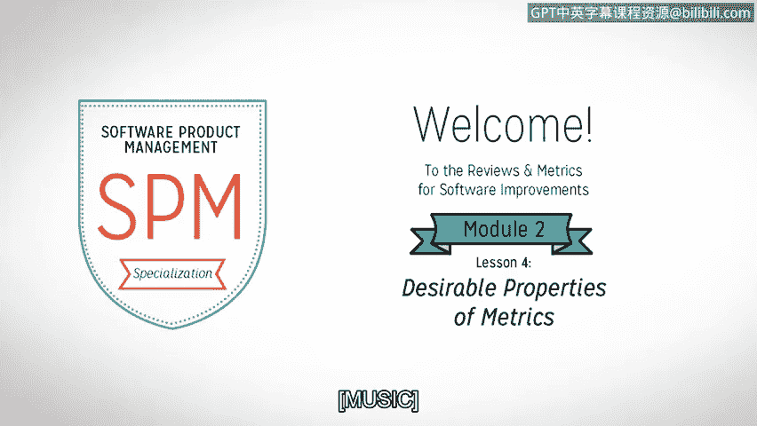
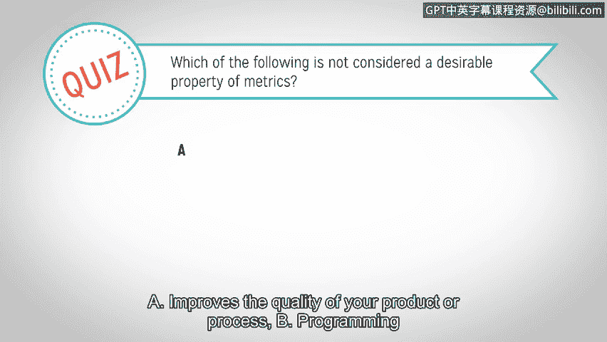

# 040：理想度量指标的特性 📊

## 概述
在本节课中，我们将学习软件度量中的关键术语，并探讨理想度量指标应具备的特性。我们将通过对比好坏度量指标的实例，帮助你理解如何选择和使用有效的度量指标来改进软件项目。

---

## 关键术语定义
上一节我们介绍了目标-问题-度量范式，本节中我们来看看软件度量中的几个基础概念。为了整体理解软件度量，你必须首先理解三个关键术语：**度量元**、**度量指标**和**指示器**。

**度量元** 是一个测量标准或单位。它本质上是测量的一个实例。例如，英寸是一个度量元，因为英寸是标准的测量单位。这意味着如果你比较一英寸与另一英寸，它们是完全相同的。这看似简单，但确保测量的一致性对于获得有意义的度量指标至关重要。

**度量指标** 是两个或更多度量元的组合，能产生有意义的结果。一个例子是公里每小时。公里是你的第一个度量元，小时是第二个。当它们结合时，就创造了有意义的东西。然而，并非所有度量指标都有意义。例如，你可以测量开发人员每小时击键次数，但这未必能告诉你关于项目的任何有意义信息。

**指示器** 是能引起测量者注意的度量元。一个很好的例子是测量某人的口腔温度。一个人健康状况良好的指示器是其口腔温度在36.5至37摄氏度之间。如果你测量某人的口腔温度读数为38度，这就是他们发烧的指示器。没有这些值作为指示器，你无法仅凭温度判断某人是否发烧。指示器让你更容易知道你的度量元或度量指标何时在告诉你需要注意的事情。

---

## 小测验
**问题**：39摄氏度每小时，是度量元、度量指标还是指示器？
A. 度量元
B. 度量指标
C. 指示器

**答案**：B，它是一个度量指标。39摄氏度和小时都是度量元，但当它们结合时，就创造了一个度量指标。

现在你知道了度量元、度量指标和指示器之间的区别。

---

## 度量指标的理想特性
收集和分析数据以洞察产品是常见任务。正如上一节关于GQM所说，你不应在没有明确目标的情况下使用度量指标。同样重要的是，你应使用你知道能提供可信结果的度量指标。这就是为什么了解度量指标的理想品质很重要。

让我们回到测量开发人员每小时击键次数的例子。是什么使这个度量指标在软件项目中如此糟糕？

首先，击键与软件创建有什么关系？有人可能认为跟踪开发人员的击键可以让他们跟踪在任何一天写了多少代码。然而，就像代码行数度量指标在不同编程语言和开发人员之间可能有很大差异一样，这种击键方法也是如此。这本身就是一个问题。

考虑如何记录击键。例如，如果你在电脑上使用击键记录程序，你怎么知道记录的击键实际上是正在编写的代码？你的开发人员可能在做其他事情，比如在在线聊天论坛打字，或者写他们过去两年一直试图完成的小说。

显然，选择正确的度量指标很重要，而其中一部分意味着选择一个能真正回答你想问问题的度量指标。

那么，度量指标应具备哪些理想特性呢？以下是理想度量指标的特性列表：

*   **简单且易于计算**：度量指标应简单且易于计算。主要原因在于，度量指标越复杂，使用它的人犯错误的可能性就越大。如果你使用的度量指标过于复杂，一个在简单公式中容易识别的小错误，当你意识到有问题时，可能会变成追踪的噩梦。
*   **直观且有说服力**：度量指标应具有直观说服力。如果你计算了度量指标，把它带给团队中的某个人，并请他们告诉你它的含义，它应该对他们有意义。这并不是说你只应使用简单的度量指标，但它应该具有直观的使用意义。每小时击键数就是一个很好的例子，你可以计算它并向任何人说明，但归根结底，跟踪开发人员的击键并没有太多直观意义。
*   **客观**：度量指标应该是客观的。这意味着它们不依赖于任何人的意见，而是基于经验数据。这对任何科学都至关重要，监控项目的科学也不例外。一个例子是使用开发人员对自己生产力的估计来跟踪开发人员生产力。很难从中获得准确的客观度量，因为你的数据来源本身就有偏见。一个更好的方法是测量他们在给定时间内完成了多少工作，例如使用故事点。
*   **单位和维度使用一致**：度量指标在单位和维度的使用上应保持一致。如果你使用故事点作为项目速度的度量指标，那么你需要对故事点的定义保持一致。如果你在项目中途将某些用户故事的故事点估计值翻倍，你将无法从速度度量中获得太多信息。保持你所测量事物的稳定、一致定义很重要。否则，你可能会处理一个难以解释甚至完全无法使用的度量指标。
*   **编程语言无关**：你希望使用的任何度量指标都与编程语言无关。正如之前所说，代码行数度量指标就是一个很好的反面例子。虽然它似乎是衡量软件项目完成工作量的直观度量，但实际上这个度量指标相当具有误导性。更重要的是，不同的编程语言在实现特定功能所需的代码行数上差异很大。为了保持一致性，你的度量指标应该能够提供可靠的度量，可以在不同编程语言之间进行比较。
*   **提供改进软件质量的有效机制**：度量指标应能让你有能力改进软件项目或过程的质量。你不是为了跟踪数字而跟踪数字。你需要做的是为了改进项目而跟踪数字。如果你改进了项目，你的度量指标能够显示这些改进吗？以每小时击键数为例，如果你试图通过让开发人员击键更多来改进项目，你认为会发生什么？更糟糕的是，如果你的开发人员实际上是更高效的程序员，他们击键的次数实际上可能会减少，因为代码所需的字符远少于用自然语言写东西。最好使用一个能在取得进展时显示进度的度量指标。重要的是，一个好的度量指标也能显示你所测量事物的质量是否在下降。

---

## 小测验
**问题**：以下哪项是度量指标的理想特性？
A. 基于主观数据
B. 适用于人力资源问题
C. 对任何数据给出相同的数字
D. 直观

**正确答案是 D**，度量指标应该是直观的。如果不直观，你使用的度量指标可能不会对改进有多大帮助。

---

## 好度量指标与坏度量指标示例
一个**好度量指标**的例子是每周在产品中发现的缺陷数量。

为了计算这个指标，你只需要跟踪以错误报告或记录问题形式报告的新缺陷数量，并在每周结束时制成表格。

计算这个度量指标简单易行。缺陷在任何软件项目中显然都是坏事，减少产品中的缺陷数量是人们公认的理想目标。这个度量指标也相当直观。假设你的开发人员编写一种编程语言与另一种同样熟练，那么每周发现的缺陷数量在不同编程语言之间将保持相当一致，并且缺陷的定义不会改变。这涵盖了跨编程语言和单位的一致性。缺陷也不基于任何人的意见；如果记录了一个新缺陷，那就是一个新缺陷。除非开发人员完全忽略问题，否则无法伪造。最后，如果你随时间跟踪这个度量指标，并实施允许你增加修复缺陷数量或提高代码质量的过程，你每周观察到的缺陷数量应该会随着时间的推移而减少。通过跟踪这个度量指标，你的代码质量会得到改进。

---

## 小测验
**问题**：以下哪项不被视为度量指标的理想特性？
A. 改进你的产品或过程的质量
B. 编程语言无关
C. 在维度使用上保持一致
D. 减少完成项目所需的小时数

**答案是 D**。虽然如果你的度量指标能帮助你减少完成项目所需的小时数会很棒，但这并非所有度量指标普遍具备的理想特性。改进产品或过程的质量是度量指标的目标，但这本身不是度量指标的特性。

---

## 度量指标的相对性
跟踪每周发现的缺陷数量的另一个优点是，它不必仅应用于整个产品。你可以分解这个度量指标来分析产品的不同部分。通过这样做，你可以识别项目中的任何问题区域并专注于它们。

另外需要提到的是，度量指标并不总是绝对的。有时你最终会得到只对你的项目有用的度量指标，因为它们所基于的值是相对的。基于故事点的速度就是一个很好的例子。故事点的定义因项目而异。使用基于相对值的度量指标是可以的，重要的是要认识到你的度量元何时是相对的，这样你就不会犯错误去尝试比较两个基于略有不同度量元的度量指标。

---

## 总结
本节课我们一起学习了软件度量的关键术语和理想度量指标的特性。关键要点是**有意识地使用度量指标**。确保你使用的度量指标是恰当且有意义的，这样你就不会出错。

在下一课中，我将介绍一些用于评估产品和过程的度量指标。你将学习一些坚实的现实世界度量指标，请不要错过。