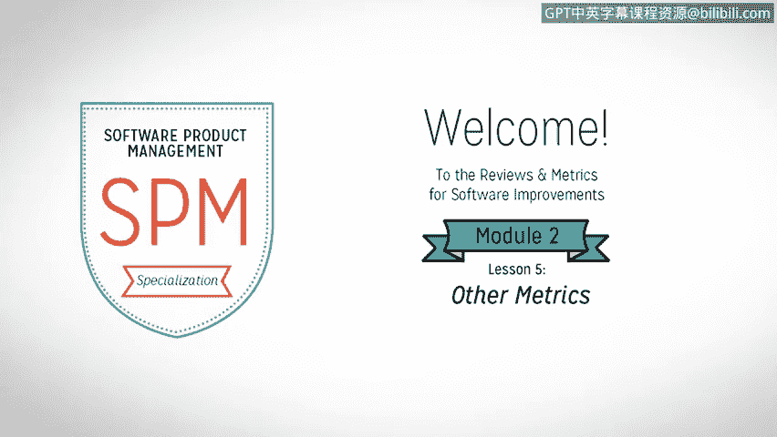
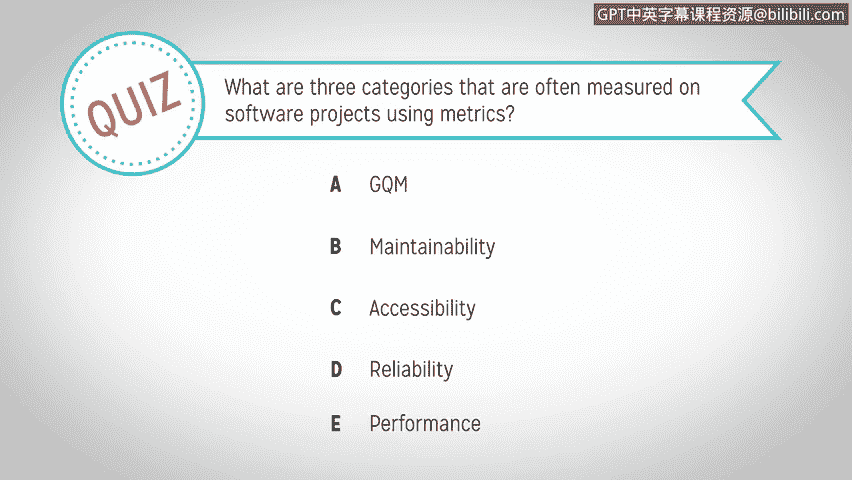

# 041：其他度量指标

## 概述

在本节课中，我们将学习如何运用度量指标来评估软件产品及其项目，特别是针对非功能性需求。我们将探讨可维护性、性能、可靠性和产品成功等关键目标的度量方法。

---

在上一节课中，我们介绍了一些理想的度量属性，并区分了度量、测量和指标之间的差异。本节中，我们将重点讨论用于评估产品与项目非功能性需求的度量指标。

在关于GQM的课程中，我们讨论了为度量指标设定目标。现在，让我们看看一些具体的目标。

以下是软件项目中常被度量的几个关键目标类别：

*   **可维护性**：衡量软件代码的复杂程度，高复杂性通常意味着更难维护。
*   **性能**：评估软件执行任务的速度和效率。
*   **可靠性**：衡量软件系统能够持续正常运行、可供用户使用的能力。

### 度量可维护性

要度量软件的可维护性，可以使用**复杂度度量**。

复杂度度量用于衡量产品源代码的复杂程度。这通常通过源代码中**逻辑分支的数量**来体现。简单来说，逻辑分支越多，项目的复杂度就越高。复杂度更高的软件更难以维护。因此，如果你的代码过于复杂，可能需要考虑降低其复杂度，以提升产品的可维护性。

### 度量性能

要评估产品的性能，可以使用诸如**响应时间**这样的度量指标。

响应时间是一个描述任务从开始执行到完成所需时间的指标。例如，如果你的应用程序在服务器执行请求后需要三秒钟来显示数据，那么你的响应时间就是三秒。你可以对多次执行进行平均，以获得平均响应时间。

### 度量可靠性

产品的可靠性同样可以被度量。要衡量产品的可靠性，可以使用诸如**产品正常运行时间**这样的测量方法。

正常运行时间衡量的是产品能够启动并可供用户使用的时长。它通常以百分比表示。例如，数据库的标准正常运行时间通常在99%以上。这意味着数据库在超过99%的时间内都可以接收和发送信息，这是一个相当好的水平。

### 度量产品成功

最后，还有**产品成功度量指标**。这些指标在本课程前面已经讨论过，例如**客户满意度**。

以客户满意度为例，可以通过从用户那里获取五分制评分，然后将所有用户的评分总和除以用户数量来计算平均分。你也可以度量产品的正确性，但这更多属于功能性需求的范畴。度量产品正确性的最佳方法是通过缺陷分析，这将是下一节课的主题。

---

## 总结

本节课中，我们一起学习了如何运用不同的度量指标来评估软件的非功能性需求。我们探讨了通过复杂度度量来评估可维护性，通过响应时间来评估性能，以及通过正常运行时间来评估可靠性。此外，我们还回顾了客户满意度等产品成功度量指标。理解并应用这些度量，有助于你更全面地把握产品质量和项目健康状况。