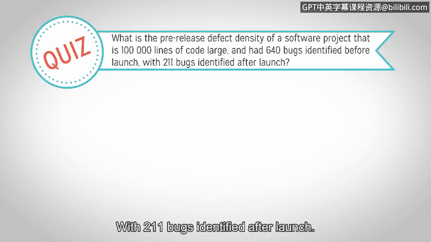

# 042：缺陷分析

## 概述
在本节课中，我们将要学习一个在行业中非常有用且常用的工具：缺陷分析。这是一种评估产品质量的方法。

## 缺陷分析简介
上一节我们介绍了行业中常用的一些度量指标，本节中我们来看看如何通过分析缺陷来评估软件质量。缺陷分析是一种评估产品质量的方法。顾名思义，当你想分析产品中的错误数量时，就会使用缺陷分析。

一个错误是指产品中出现的故障。这通常可以追溯到源代码，但情况并非总是如此。

## 如何进行缺陷分析
进行缺陷分析的一种方法是跟踪代码中的缺陷数量，并将其与已修复的缺陷数量进行比较。

正如我在前几节课中所说，你可以通过统计系统中所有已报告的错误来找到代码中的缺陷数量。理想情况下，这些数据可以来自一组特定的内部软件测试人员，这样你的系统在发布时就不会带有许多错误。然而，这些数字也可能来自产品发布后的最终用户。

存在许多工具可以帮助你跟踪产品的漏洞、问题和错误。使用这些工具时，也容易跟踪这些问题的解决进度，例如它们是否已被修复，以及对其所做的任何更新。你还可以随着时间的推移比较这个数字。

## 缺陷发现率与修复率
以下是缺陷分析中的一个核心概念：缺陷发现率与修复率。

如果你统计每周发现的漏洞数量与每周修复的漏洞数量，并随时间跟踪这个数字，你就可以看到在开发新功能之前，是否应该投入更多精力来修复当前的问题。这被称为缺陷发现率与缺陷修复率。

如果每周发现的漏洞数量远远超过每周修复的漏洞数量，那么投入时间修复这些问题可能是个好主意。

作为一个满足所有理想度量属性的指标，这个指标也允许你跟踪进度。如果你集中精力修复缺陷，那么你最终会看到每周修复的缺陷数量上升。

通过长期跟踪缺陷发现率与缺陷修复率，你可以了解产品内部质量的情况。希望随着项目的推进，你修复的缺陷会多于发现的缺陷，产品中残留的缺陷会越来越少。

然而，如果你修复的缺陷和发现的缺陷一样多，那么你就遇到了所谓的“软件障碍”。正如我之前所说，这可能到了需要做出改变的时候。遇到软件障碍表明你的产品尚未准备好发布，你应该在发布前投入更多时间来修复漏洞。

## 缺陷分析的目的
缺陷分析是一种评估产品的方式。A. 生产力。B. 规模。C. 用户满意度。D. 质量。答案是D，质量。

进行缺陷分析主要是为了了解项目在质量方面的当前状态。

## 子系统缺陷分析
你还可以将已修复的缺陷按产品的不同组成部分（称为子系统）进行划分。本质上，要了解各子系统的缺陷，你只需跟踪与每个已修复缺陷相关联的子系统即可。

然后，你可以统计每个子系统的已修复缺陷数量，以查看产品中需要关注的区域。为了公平比较，这个数字应该除以每个子系统的规模。大的子系统自然会有更多缺陷，这就引出了缺陷密度。

## 缺陷密度
缺陷密度是确定整个产品缺陷数量的标准方法。要计算缺陷密度，只需取代码中发现的缺陷数量与代码规模的比率。规模可以用千行代码来衡量。

对于结构化编程技术，行业平均水平大约是每千行代码15到50个缺陷。你可以使用这个指标来对你的项目发布准备情况做一些有趣的预测。

## 缺陷密度预测示例
想象一下，你正在构建一个软件产品，并和团队一起进行第三次发布。你的第一个版本在发布前发现了900个缺陷，发布后发现了100个缺陷。代码量为10万行。这使得你第一个发布版本的缺陷密度为每千行代码10个缺陷。

在第二个发布版本中，你的团队增加了额外的5万行代码，发布前发现了400个缺陷，发布后发现了45个缺陷。这使得第二个版本的增量缺陷密度为每千行代码8.9个缺陷。

现在你计划发布第三个版本。你的团队已经构建了额外的10万行代码，到目前为止在这部分代码中发现了600个缺陷。这使得你的增量缺陷密度为每千行代码6个缺陷。

考虑到前两个已发布的增量版本缺陷密度在每千行代码8.9到10个缺陷之间，这次你的产品准备好发布了吗？答案是否定的。除非自第二个版本以来你的开发流程有所改进，否则你可以预期在第三个增量版本中，每千行代码会发现8.9到10个缺陷。对于10万行代码，大约是890到1000个缺陷。

在之前的版本中，你在发布前发现并修复了90%的缺陷。这意味着你可以预期在这个版本中，每千行代码会发现大约801到900个缺陷。因此，如果只发现了600个，你可以预期在发布前还会在产品中发现201到300个缺陷。在产品发布前发现缺陷总是更好的，因此你的产品可能还不适合发布。

## 缺陷密度计算练习
对于一个规模为10万行代码、发布前识别出640个漏洞、发布后识别出211个漏洞的软件项目，其发布前缺陷密度是多少？A. 每千行代码2.1个缺陷。B. 每千行代码6.4个缺陷。C. 每千行代码7.51个缺陷。D. 每行代码0.00751个缺陷。答案是B，每千行代码6.4个缺陷。请记住，这里我们只计算发布前的缺陷。

## 缺陷分析实战案例：航天飞机软件
让我们看一个缺陷分析的实际案例。航天飞机飞行软件以其几乎无错误而享有最佳声誉之一。它必须如此，否则可能导致人员伤亡和数十亿美元的损失。

那么，编写该软件的机载航天飞机小组是如何实现这种完美水平的呢？对他们来说，仅仅找到一个缺陷、修复它，然后收工是不够的。当发现一个缺陷时，存在强制性的协议来分析该缺陷，识别该缺陷可能出现的其他类似区域，并调整流程以避免将来出现此类缺陷。

例如，航天飞机有一个著名的加拿大组件，称为Canadarm，这是一个在恶劣太空环境中协助完成复杂任务的机械臂。如果在Canadarm手腕旋转的方式中发现一个漏洞，那么也可以检查其他涉及硬件旋转的代码是否存在类似错误。

因此，通过进行缺陷分析，可以在一个完全独立的、用于旋转通信天线的子系统上发现类似的漏洞，从而避免潜在的灾难。事实上，这是航天飞机软件发生的一个真实场景，帮助节省了大量工作、时间和金钱。

通过实施这种严格的测试和修订程序，机载航天飞机小组能够在其运行软件方面达到完美的状态。如果你想了解更多关于他们流程的信息，请查看课程笔记中的资源。

## 总结
本节课中我们一起学习了缺陷分析。这是一种简单的技术，可以帮助你确保了解项目的质量，并在测试和发布方面做出正确的决策。

这也是本模块的结尾。我们在这个模块中涵盖了很多内容，让我们回顾一下。首先，我讨论了一些软件产品的评审技术，如代码走查和需求技术评审。然后，我讨论了监控软件项目时的一些常见问题，并指出了一些常用但价值不高的度量指标。之后，我讨论了目标-问题-度量（GQM）框架，以及实施它如何帮助你确保在项目中使用适当的度量指标。接着，我们探讨了度量指标的理想属性，涵盖了什么是好的度量指标。然后，我讨论了当今行业中一些流行的度量指标。最后，我们深入学习了缺陷分析。这些活动有助于确保产品通过经过评审和度量的工作正确完成。

在下一个模块中，Morgan将与你讨论如何通过介绍每日站会、回顾速率以及向你展示燃尽图来确保项目得到正确管理。请继续学习。