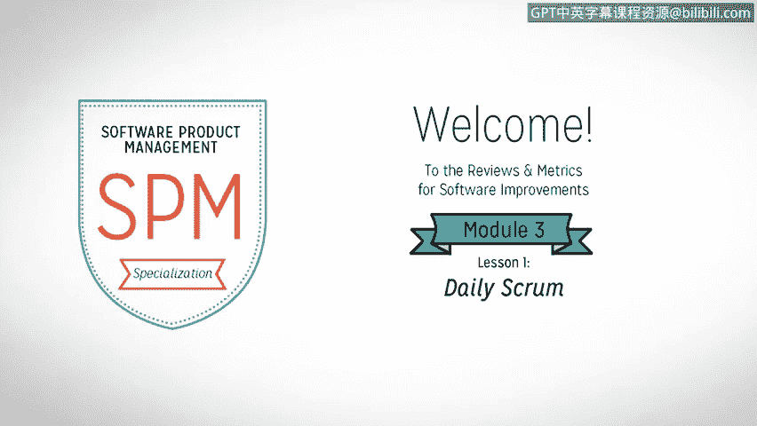
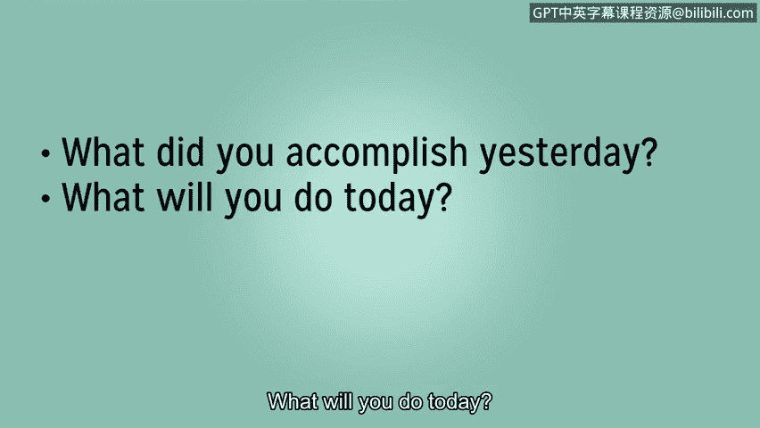
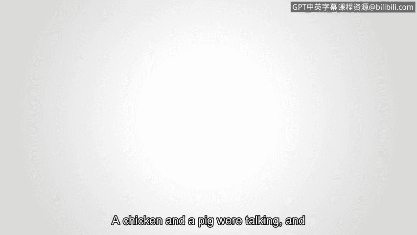
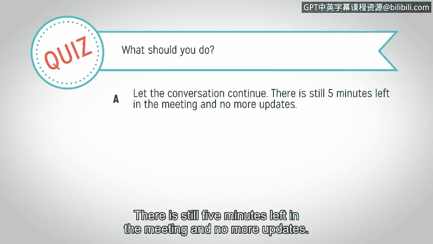

# 043：每日站会 🎯

在本节中，我们将学习如何通过每日站会来确保产品开发过程得到有效管理。我们将了解站会的核心目的、标准流程以及如何高效地运行它，以保持项目按计划推进。

## 概述

每日站会是敏捷开发中一个简短的同步会议，旨在帮助团队快速同步进度、规划当日工作并识别障碍。它并非状态汇报会，而是团队内部的协调会议。

## 每日站会的目的与结构

上一节我们介绍了项目管理的整体框架，本节中我们来看看其中一个核心实践——每日站会。它的主要目标是让开发团队快速启动新一天的工作，并确保所有人目标一致。

每日站会是一个时间盒严格限定为**15分钟**的会议。在会议中，所有核心参与者围成一圈，依次回答三个问题。

以下是每位参与者需要回答的三个核心问题：
1.  我昨天完成了什么？
2.  我今天计划做什么？
3.  我遇到了什么障碍？

## “猪”与“鸡”的角色区分

你可能会想，如何在15分钟内听完所有人的更新？这引出了一个经典的角色比喻来区分参与者。

在每日站会中，建议只有“猪”（即对项目有实质性承诺的人）才需要发言。“鸡”（即项目的相关方或观察者）可以旁听，但通常不参与发言。

*   **“猪”**：通常指开发团队成员，以及有重要更新需要同步的产品负责人。他们对项目成果有直接承诺。
*   **“鸡”**：可能包括来自其他团队的开发者、希望了解状态的高层管理者，或没有重要更新的产品负责人。他们关心项目但并非直接执行者。

## 站会内容演练

假设你正在参加每日站会，下一个轮到你发言。哪些内容应该包含在你的更新中？

以下是几个选项示例：
A. 昨天，你完成了数据库结构的设计。
B. 昨天，你下班后看了一部非常棒的电影。
C. 今天，你计划开始设计用户界面。
D. 物料间没有纸了，导致你无法绘制用户界面的线框图。
E. 你对产品有一个功能改进的建议。

**分析**：在每日站会中，你只需要回答那三个核心问题。更新昨天完成的工作、今天承诺的工作以及遇到的障碍是合适的。因此，选项A、C和D是正确的。分享下班后的活动（B）不应在站会提及。提出未来的改进建议（E）也不是站会的场合。

## 站会的本质与最佳实践

每日站会并不仅限于Scrum框架，它在许多敏捷方法中都很常见，在极限编程中被称为“每日站立会议”，也常被称作“每日短会”或“晨会”。

每日站会不应是产品经理或负责人获取进度报告的状态会议。状态更新应通过看板或燃尽图等进度跟踪工具来完成。站会应是**开发团队为开发团队**召开的同步会议。

在站会中，团队成员是在相互做出承诺。如果一个开发者承诺在站会当天完成某个功能，那么团队就有权期待他在次日的站会上报告该功能已完成，或者说明遇到了阻碍完成的障碍。

一次成功的站会应该是快速且充满活力的，不应是开发者们觉得是负担、 dreaded 的会议。它应该让团队成员感到兴奋并准备好开始一天的工作。

## 处理站会中的特殊情况

假设在一次站会中，开发者丹尼昨天承诺完成登录功能的源代码。但在今天的站会上，他说昨天已经着手开发，并计划在今天完成，且表示没有遇到任何障碍。作为Scrum主管，你应该怎么做？

以下是几个选项：
A. 对他生气，因为他昨天承诺要完成。
B. 礼貌地询问丹尼为何没能完成，并询问团队是否能提供帮助。
C. 什么都不做，他说了今天会完成。
D. 指派其他人去完成这个功能。

**分析**：每日站会应该是一个开放的沟通渠道，而不是相互指责的地方。虽然他未能完成且声称没有障碍的情况有些奇怪，但最好的做法是询问团队是否能提供帮助，例如建议有人可以和他进行结对编程。因此，选项B是正确的。

## 站会的详细流程与Scrum主管的职责

让我们更详细地走一遍每日站会的流程。

会议开始时，所有人站成一个无障碍的圆圈，圈内不应有笔记本电脑或手机。每位“猪”依次回答三个问题。一个典型的开发者更新可能听起来像这样：“大家好。昨天我效率很高，完成了用户个人资料页的所有单元测试。今天，我将开始编写该功能的源代码。我目前唯一的障碍是，我对这个编程语言不太熟悉，今天有谁愿意和我结对编程这个功能吗？”

会议通常在看板或任务板前进行，以便团队在需要时可以移动他们的任务卡片。会议应每天在**同一时间、同一地点**举行。

如果对话开始偏离那三个核心问题，**Scrum主管**有责任打断对话，并将该话题添加到“停车场”列表中，以便在会后与相关人员进行讨论。这有助于将会议控制在15分钟的时间盒内。这个会后讨论列表通常被称为“停车场”、“侧边栏”，或者说“我们线下讨论这个问题”。

Scrum主管还需要记录任何未在会议上直接解决的障碍，并负责确保这些障碍被解决或指派人员去处理。

会议结束时，应有某种行动来示意会议结束，例如团队喊一句口号或Scrum主管说一句熟悉的话，这样可以避免人们尴尬地站着，不确定会议是否已经结束。

## Scrum主管的情景决策

假设你是每日站会的Scrum主管。会议进行得非常顺利，最后一位开发者正在做更新，会议只进行了10分钟。但她的更新引发了开发者们一次离题的讨论。你应该怎么做？

以下是几个选项：
A. 让讨论继续，会议还剩5分钟，而且没有其他更新了。
B. 让讨论继续，这反正是我们需要讨论的事情，超过15分钟时间盒也没关系。
C. 打断讨论，结束会议，让所有人回去工作。
D. 打断讨论，将其添加到讨论事项列表中，并建议任何想继续讨论的人可以在会后进行。

**分析**：无论会议还剩多少时间，离题的讨论都应被打断。你不应鼓励离题讨论的习惯，因为并非每次都有额外时间。你也不希望任何人在会议中停留超过必要的时间，特别是当讨论与他们无关时，这会占用他们的工作时间。然而，你也不想打击沟通。打断讨论后就不再提及该话题，这不是开放沟通的范例。最佳实践是打断讨论，并邀请感兴趣的人在每日站会后继续讨论。因此，选项D是正确的。

## 总结

本节课中我们一起学习了每日站会的核心概念与实践。我们明确了站会的三个核心问题、参与者“猪”与“鸡”的角色区分，以及Scrum主管在维护会议纪律和效率中的关键职责。记住，每日站会的目标是促进团队同步和快速识别障碍，而非进行详细的问题解决或状态汇报，这些活动应安排在会后进行。