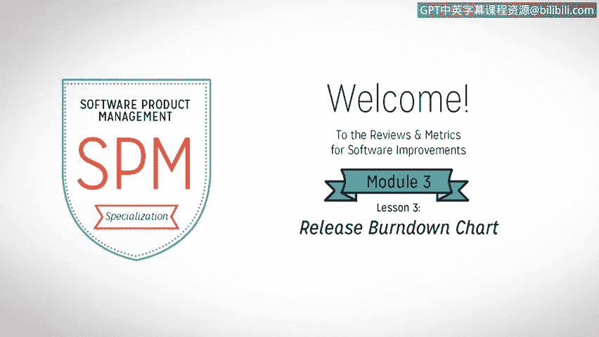
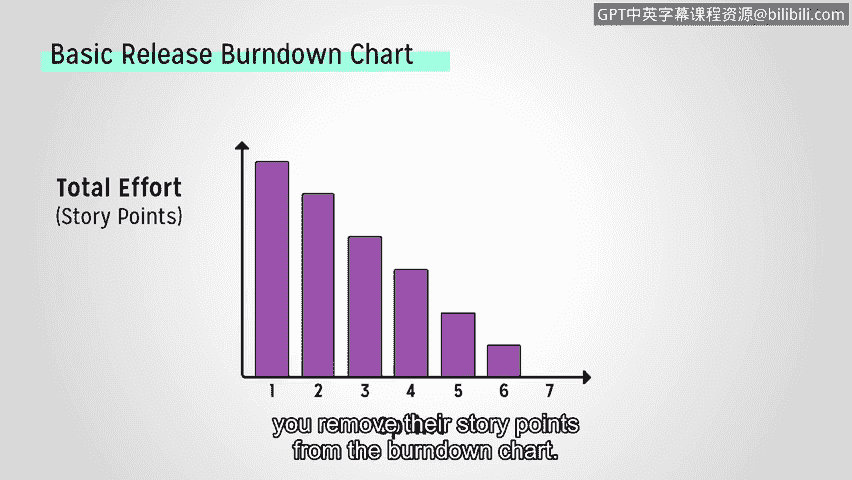
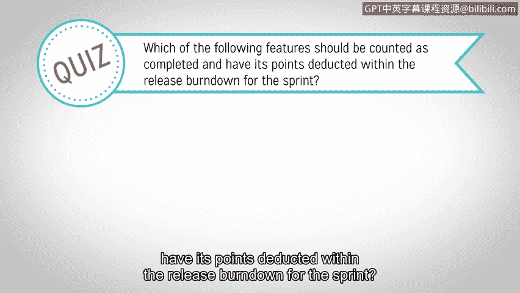

# 046：发布燃尽图 📉

## 概述
在本节课程中，我们将学习一种在Scrum方法中非常常见的可视化监控工具——发布燃尽图。我们将了解它的构成、如何解读它，以及如何利用它来跟踪项目进度和预测完成时间。

---

## 发布燃尽图简介
发布燃尽图是一种可视化监控工具，在Scrum方法中非常常见。

发布燃尽图会向你展示开发团队已经完成了多少工作、还剩下多少工作、团队在每个冲刺中的速度，以及你预计何时能完成产品。可以想象，它是确保项目得到正确管理的绝佳工具。

既然发布燃尽图能展示所有这些信息，你可能会想象它是一张非常复杂的图表。但发布燃尽图的妙处在于，它的概念很简单。让我们来看一个基本的发布燃尽图。

如图所示，我们在水平轴上列出了冲刺。这个示例项目有六个冲刺。在垂直轴上，是总工作量。这可以用你的团队选择的任何度量单位来描述需求规模。

在我们的示例中，我们将使用故事点。图表中与每个冲刺对应的每个条形，代表了在该冲刺开始时仍然剩余的故事点总数。

自然地，在冲刺1开始时，我们拥有所有剩余的故事点，因为我们尚未开始完成它们。这代表了你的总工作量。**总工作量**是你计划在项目中完成的所有用户故事的故事点总和。

当你完成需求时，你将从燃尽图中移除它们的故事点。

---

## 解读燃尽图数据
你的开发团队即将开始第六个也是最后一个冲刺。这是该项目的发布燃尽图。你的团队完成了多少故事点？还剩下多少？

选项：
A. 100个故事点完成，15个故事点剩余。
B. 100个故事点完成，0个故事点剩余。
C. 85个故事点完成，15个故事点剩余。
D. 85个故事点完成，0个故事点剩余。

在这个项目中，总共有100个故事点。我们知道这一点，因为在冲刺1开始时是100个故事点。在冲刺6（项目的最后一个冲刺）开始时，剩余15个故事点。由于我们以100个故事点开始，剩余15个，这意味着团队已经完成了85个故事点；因此，C是正确答案。

---

## 预测线与进度跟踪
假设我们的总工作量是90个故事点。我们在第一个冲刺中完成了15个故事点。从发布燃尽图中，我们可以看到该冲刺的速度是15点。我们还可以看到剩余工作是75点。我们也知道我们以75个剩余故事点开始冲刺2。

如果我们想预测完成这个产品需要多少个冲刺，我们可以画一条穿过条形图的线来预测。我们称这条线为**预测线**。

由于我们是基于一个冲刺的速度来预测，我们将以该值作为预测依据。根据我们的预测线，它表明应该需要六个冲刺。你可能认为这条线指向了七个冲刺，但请记住，发布燃尽图是基于每个冲刺开始时剩余的故事点数量。这意味着在冲刺7开始时将没有故事点需要完成，也就是说你不需要那个冲刺。

你也可以使用预测线来查看开发是否按计划进行。

假设我们刚刚完成冲刺4，我们的发布燃尽图看起来是这样的。在第一个冲刺中，我们完成了15个故事点。我们想保持这个速度，所以那是预测线。然而，在冲刺2中，我们只完成了5个故事点。如图所示，我们冲刺3的条形现在位于预测线之上。在冲刺3中，我们完成了15个故事点。我们将速度恢复到了初始值，但由于冲刺2，我们仍然落后于计划。在冲刺4开始时，我们应该总共完成45个故事点，并且开发进行到一半。但如图所示，我们冲刺4的条形位于预测线之上。我们比预期进度落后了10个故事点。

---

## 调整与进度变化
现在假设在冲刺4开始时，因为我们看到项目落后于计划，我们雇佣了两名开发人员。在冲刺4中，我们完成了25个故事点。这使我们的项目回到了正轨。在冲刺5中，我们又完成了25个故事点。这现在使我们的项目进度超前了。如图所示，我们冲刺6开始时的条形现在位于预测线之下。这意味着你的团队可能能够为产品完成更多需求。

在现实中，你的发布燃尽图看起来像这样的可能性极小。更常见的情况是，你的发布燃尽图看起来像这样。

考虑这个发布燃尽图。你已经完成了第一个冲刺。如果你保持从这个冲刺开始的初始速度，你预计需要多少个冲刺来完成工作？

选项：
A. 5个冲刺
B. 6个冲刺
C. 7个冲刺
D. 8个冲刺
E. 你需要更多信息

如果你保持这个速度，你的预测线表明在冲刺6开始时你将没有故事点需要完成。这意味着你将在五个冲刺内完成项目。因此，A是正确答案。

---

## “完成”定义的重要性
由于发布燃尽图衡量的是已完成的故事点，你可以想象你团队对“完成”的定义非常重要。在敏捷开发中，我们通过可工作的软件来衡量进度，因此，为了将故事点标记为完成，该需求必须满足你团队的“完成”定义。

我曾在一个不专注于可工作软件的团队工作过。我们正在开发一个需要数据库连接的产品。我们团队的一半人致力于开发数据库，另一半人致力于开发产品用户界面。尽管许多功能已经为界面编程，数据库也在开发中，但我们不能将任何需求标记为完成，因为我们正在等待数据库开发完成并连接到应用程序。

我们的燃尽图最终看起来像这样。从我们的燃尽图中可以看出，看起来好像我们在前三个冲刺中什么都没做，然后在冲刺4中非常努力地工作。我们知道情况并非如此，但燃尽图会显示你的团队是否在完全完成功能后才转向新的功能。否则，燃尽图就不能很好地代表产品的进度。

---

## 应用实例与测验
你正在一个开发移动应用程序的团队工作。你刚刚完成了第三个冲刺。你团队的“完成”定义包括仅那些已编程、已文档化、已测试并准备上市的功能。以下哪个功能应被计为已完成，并在该冲刺的发布燃尽图中扣除其点数？

选项：
A. 一个在上个冲刺已开发并文档化但测试失败的功能，在当前冲刺中已收到小修复并通过了测试。
B. 一个你没有时间测试，但你确信它能工作的功能。
C. 一个已编程、文档化并测试的界面功能，但尚未连接到数据库。
D. 一个运行完美、在冲刺中通过了所有测试并已妥善文档化的功能。

只有满足团队“完成”定义的功能才能为发布燃尽图标记为完成。答案B和C都是未满足“完成”定义的功能，因此不能为发布燃尽图标记为完成。答案A展示了一个在上个冲刺未满足“完成”定义但现在满足的功能，因此可以在本冲刺中为发布燃尽图标记为完成。答案D也满足团队的“完成”定义，因此可以为发布燃尽图标记为完成。A和D是正确答案。

---

## 总结
在本节课中，我们一起学习了发布燃尽图。我们了解了它如何作为Scrum中的可视化工具，来展示已完成工作量、剩余工作量、团队速度并预测项目完成时间。我们探讨了如何绘制和解读预测线以跟踪进度，并强调了团队拥有清晰“完成”定义的重要性，因为这是燃尽图准确反映进度的基础。通过实例分析，我们巩固了如何根据“完成”定义来判断哪些工作成果可以计入燃尽图。掌握发布燃尽图将帮助你更有效地监控和管理软件项目的开发进程。