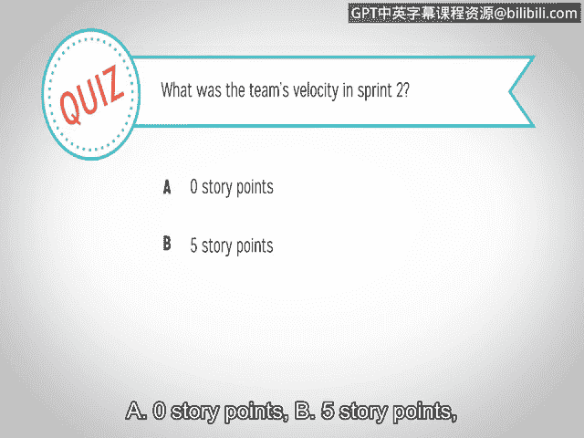
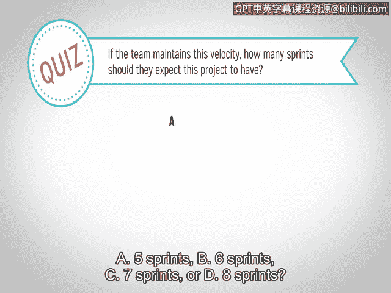

**软件产品管理课程5：3.3a：发布燃尽图与需求变更** 🔄

在本节课程中，我们将探讨一个关键问题：当项目需求发生变更时，如何通过发布燃尽图来准确反映这些变化及其对项目进度的影响。

---

### **概述**

发布燃尽图是跟踪项目整体进度的有效工具。然而，基础版本的燃尽图无法清晰展示需求变更（如新增或移除用户故事）带来的影响。本节课我们将学习两种改进的燃尽图形式，它们能同时展示团队的工作速率和需求范围的变化。

---

### **基础燃尽图的局限性**

上一节我们介绍了基础的发布燃尽图。这种图表的一个不明显之处在于，它无法有效体现需求变更带来的影响。

众所周知，需求是不断变化的。可能某个需求的**故事点**估算发生了变更。我们需要一种方法在燃尽图中表示这种变化。

假设我们处于项目的**Sprint 4**开始时，燃尽图如下所示。

假设在Sprint 4中，团队完成了**15个故事点**的工作。但在Sprint 5开始前，新增了两个用户故事，每个价值**5个故事点**。

此时，我们的燃尽图会变成类似这样。看起来开发团队在Sprint 4只完成了**5个故事点**，但这并非事实。

---

### **展示需求变更的两种方法**

为了准确反映情况，有两种常见的方法可以在发布燃尽图中展示需求变更。

#### **方法一：总工作量完成图**

第一种方法是在表示“剩余工作”的柱状图上方，展示每个冲刺完成的**总工作量**。

图表会变成这样。在此燃尽图中，底部是**剩余总工作量**，顶部是**已完成总工作量**。

你可以看到，在Sprint 2开始时，故事点没有增减。因为Sprint 2开始时的“剩余工作”和“已完成工作”柱体总高度，与Sprint 1开始时的总工作量高度相同。

在Sprint 3开始时，新增了**10个故事点**。我们可以看出这一点，因为此时“剩余工作”和“已完成工作”的总量比上一个冲刺更大了。

故事点总数在Sprint 5开始前保持不变。在Sprint 5开始时，总故事点数减少了，因为“剩余工作”和“已完成工作”的总和现在小于前一个冲刺。

这种燃尽图现在既能展示团队的工作速率（**Velocity**），也能展示故事点的变化。

**思考一下这个总工作量完成燃尽图：团队在Sprint 2的速率是多少？**
A. 0个故事点
B. 5个故事点
C. 10个故事点
D. 15个故事点

为了确定Sprint 2的速率，我们需要观察Sprint 3开始时的柱状图。请记住，柱状图的**下半部分代表剩余故事点**，而**柱体的总高度代表所有故事点**。

Sprint 2开始时剩余75个故事点，Sprint 3开始时剩余65个故事点。表面上看，Sprint 2似乎完成了10个故事点。

然而，Sprint 2的柱体总高度是90个故事点，而Sprint 3的柱体总高度是85个故事点。这意味着有价值**5个故事点**的工作被移除了。

因此，从表面完成的10个故事点中，减去被移除的5个故事点，可以得出Sprint 2的速率是**5个故事点**。所以正确答案是**B**。

#### **方法二：可调基线图**

第二种展示故事点变化的方法是使用**可调基线**。

在这类发布燃尽图中，故事点的变化体现在图表的底部基线调整上。这种燃尽图看起来是这样。

这与我们在小测验前使用的例子是同一个燃尽图。

在Sprint 2开始时，故事点没有变化。你可以看到，因为Sprint 2的柱体仍然紧贴X轴。

在Sprint 3开始时，我们新增了故事点。我们可以看出这一点，因为现在有故事点出现在X轴下方。

Sprint 4的故事点数量保持不变。然后在Sprint 5，我们看到故事点再次发生变化——这次是移除了故事点。我们可以看到这一点，因为Sprint 5的柱体现在比前一个冲刺的柱体更高了。

你还需要调整**预测线**，使其与可调基线对齐。如果我们在Sprint 5开始时从未移除故事点，预测线会是这样的。

**基于这个发布燃尽图以及根据前两个冲刺计算的预测线，如果团队保持这个速率，他们预计这个项目会有多少个冲刺？**
A. 5个冲刺
B. 6个冲刺
C. 7个冲刺
D. 8个冲刺

如果这是一个基础发布燃尽图，你可以预期项目有**6个冲刺**，因为预测线表明第七个冲刺将没有工作。

但由于这是一个可调基线发布燃尽图，我们必须考虑故事点的变化。在Sprint 3开始时，有许多故事点被添加到项目中。如果你要保持相同的速率，这意味着项目需要更长时间才能完成。

如果你延长基线和预测线直到它们相交，你会发现直到第八个冲刺才没有剩余故事需要完成。因此，团队可以预期项目将需要**7个冲刺**。正确答案是**C**。

---

### **如何选择燃尽图类型**

那么，何时适合使用基础发布燃尽图，何时应该使用总工作量完成图或可调基线图呢？

基础形式是展示**剩余总工作量**的绝佳方式。如果你不关心跟踪团队的速率，那么选择简单版本即可。

如果你打算使用发布燃尽图来提供更多信息，那么你应该使用**总工作量完成发布燃尽图**或**可调基线发布燃尽图**。这两种燃尽图展示的信息相同，因此使用哪一种没有区别，只是个人偏好问题。

另一个需要注意的重要点是，有时发布燃尽图被绘制成**折线图**，而不是本演示中使用的柱状图。

在这种情况下，你的基础发布燃尽图会从这样：

变成这样。

总工作量完成燃尽图会从这样，变成这样。

最后，可调基线发布燃尽图会从这样，变成这样。

---

### **总结**

本节课中，我们一起学习了如何通过改进的燃尽图来应对需求变更。

*   **发布燃尽图**是可视化整个开发进度的优秀工具。
*   一张简单的图表可以展示项目的**总工作量**、**已完成的工作**、**剩余的工作**、**预期完成时间**以及**故事点的变化**和团队的**速率**。
*   燃尽图还可以在你项目偏离计划时提供早期预警。
*   燃尽图不仅可用于发布级别，也可用于**迭代或冲刺级别**。这将是我们下一节课要讨论的内容。