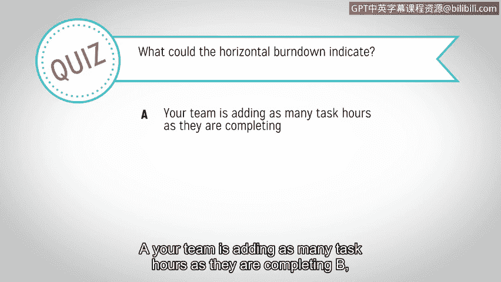
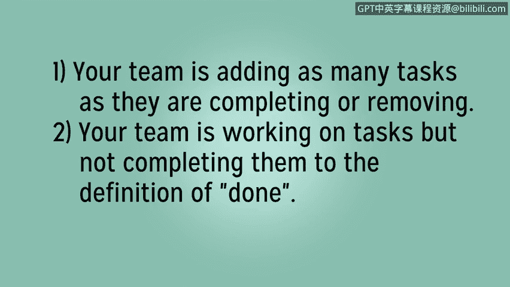

# 048：迭代燃尽图 📉

## 概述
在本节课中，我们将学习几种用于在冲刺或迭代期间跟踪开发进度的技术。我们将重点介绍迭代燃尽图，并将其与发布燃尽图进行比较，同时探讨如何将其与Scrum任务板结合使用。

---

## 迭代燃尽图简介
上一节我们介绍了发布燃尽图。本节中，我们来看看如何将燃尽图进行调整，以用于跟踪冲刺期间的进度。

迭代燃尽图的工作原理与发布燃尽图非常相似。下图展示了一个典型的迭代燃尽图。

与我们在发布燃尽图课程中看到的类似，迭代燃尽图也有一条预测线。这条预测线展示了可持续完成任务进度的理想情况。

迭代燃尽图可以绘制为折线图或条形图，这与发布燃尽图相同。下图展示了作为条形图的燃尽图样式。

这主要取决于个人偏好。我喜欢对发布燃尽图使用条形图，对迭代燃尽图使用折线图，以便快速区分。在本课中，我将使用折线图，以便您熟悉两种风格。

**问题**：根据此迭代燃尽图，团队计划在冲刺的每一天完成多少工时？
A. 220小时
B. 20小时
C. 22小时
D. 需要更多信息

**答案**：预测线显示团队在冲刺中共有220小时的待完成工作，冲刺长度为10天。请记住，第11天开始时没有工作要做，因此冲刺只有10天。这意味着团队计划在冲刺的每一天完成22小时的总工作量。因此，C是正确答案。

---

## 迭代与发布燃尽图的区别
现在，让我们看看迭代燃尽图和发布燃尽图有何不同。

在迭代燃尽图中，横轴是**天数**，而不是发布燃尽图中的**冲刺数**。

在迭代燃尽图的纵轴上，总工作量以**小时**为单位衡量。而在发布燃尽图中，总工作量以**故事点**衡量。

这种变化是因为在迭代燃尽图中，我们跟踪的是**任务**的完成情况，而在发布燃尽图中，我们跟踪的是**用户故事**及其对应故事点的完成情况。

迭代燃尽图应该每天更新，这通常在每日站会中进行，会上会标绘前一天的工作量。

与发布燃尽图在每个冲刺开始时测量待办工作类似，迭代燃尽图中每天的总工作量代表**每天开始时**剩余的工作量。

迭代燃尽图上只应包含工作日，不应包括周末或节假日，除非计划在这些日子工作。此迭代燃尽图代表一个包含10个工作日的两周冲刺。您会注意到周末已被考虑在内，日期从2月26日跳到了2月29日。

**问题**：您正在为一个开发团队创建迭代燃尽图。该团队进行为期两周的冲刺，冲刺中间有一个两天的周末，开发人员周末不工作。团队在冲刺期间还将参加一天的会议，当天无法进行产品开发。您的迭代计划应包含多少天？
A. 14天
B. 10天
C. 9天

**答案**：在迭代燃尽图中，只应包含团队将在产品上工作的天数。由于开发人员在两天的周末和会议日不工作，他们在两周的冲刺中损失了三天，因此迭代燃尽图上只应出现9天。所以，C是正确答案。

---

## Scrum任务板
更新迭代燃尽图通常与Scrum任务板相关联。在深入探讨如何更新迭代燃尽图之前，让我们先花点时间看看什么是Scrum任务板以及如何使用它。

Scrum任务板与看板非常相似。有时，Scrum任务板被称为白板任务板或简称为任务板。

以下是Scrum任务板的使用方法：
*   在第一列中，放置计划在冲刺中完成的所有用户故事。
*   然后将每个用户故事分解为开发人员任务，并为这些任务创建估算。
*   通过为每个用户故事创建任务，可以确保没有任务被遗漏。
*   当任务处于进行中、等待验证或已完成状态时，它们会在任务板上移动，类似于看板。
*   开发人员可以在领取任务时将自己的名字写在任务上，这有助于跟踪特定问题的负责人。
*   一旦任务移动到“完成”区域，即可视为完成。然后在更新燃尽图时，将该任务的工作量“燃尽”，这意味着可以从剩余工作中扣除该任务关联的工时。
*   一旦一个用户故事的所有任务都进入“完成”区域，那么该用户故事就应该满足团队的“完成定义”。

与发布燃尽图只包含满足团队“完成定义”的用户故事类似，在迭代燃尽中，我们也只希望包含完全完成的任务。这就是为什么将迭代燃尽图与任务板结合使用是一个好主意，您可以清楚地看到哪些任务已完成并经过验证。

---

## 结合使用任务板与迭代燃尽图
让我们看一个如何结合使用任务板和迭代燃尽图的例子。

假设我们添加一个任务：“为产品登录页面编写测试”，该任务对应任务板上的第三个用户故事。我们估计此任务需要10小时。开发人员Ellie将此任务分配给自己。

1.  Ellie将任务移动到“进行中”列，并开始编写测试。
2.  当她完成测试编写后，将任务移动到“待验证”列，供另一位开发人员验证。
3.  另一位开发人员Alfred检查Ellie的测试并确认其完成。在审查时，他将任务移动到“验证中”列。完成后，他将任务移动到“完成”列。
4.  在接下来的每日站会上，Scrum主管Benjamin在迭代燃尽图上将此任务标记为完成。假设Ellie的任务是当天唯一完成的任务。更新后的迭代燃尽图如下所示。

**问题**：这些任务在您团队任务板的“完成”列中于第6天被移动。您在第7天早上第一时间更新迭代燃尽图。在第7天开始时，剩余多少任务工时？
A. 50小时
B. 40小时
C. 25小时
D. 15小时

**答案**：第6天完成了价值25小时的任务。这意味着您在第7天开始时，剩余工作量比第6天开始时少了25小时。在第6天开始时，您有40小时剩余。减去当天完成的25小时，您在第7天开始时剩余15小时工作。因此，D是正确答案。

---

## 迭代燃尽图是否需要可调整下限？
这取决于您的团队。在大多数情况下，我认为不需要。但是，如果您的团队希望使用它，这绝对是可以轻松实现的功能。

迭代燃尽图的主要目的是快速可视化团队在冲刺内的进度。您不像使用发布燃尽图那样，用迭代燃尽图来计算速度。因此，添加或删除任务对迭代燃尽图所传达的信息影响不大。

但是，如果您的燃尽图开始“燃烧上升”怎么办？当您添加的任务多于完成或移除的任务时，就会发生这种情况。这表明您的团队在将用户故事分解为任务时，没有进行仔细的迭代规划，可能有些任务被忽视或遗忘了。显然，这不是一个好情况，尤其是在冲刺后期发生。

您通常可以通过花费足够的时间将用户故事分解为任务来避免这种情况。如果确实发现团队在迭代期间添加了大量任务，那么可以考虑移除或优先处理某些任务。这有助于确保在冲刺结束时，您的所有任务不会都处于半完成状态。

**问题**：这是您团队的迭代燃尽图。水平的燃尽线可能表明什么？
A. 您的团队添加的任务工时与他们完成的工时一样多。
B. 您的团队正在开始任务，但没有完成它们。
C. 您的团队没有做任何工作。
D. 您的团队正在以恒定的速度完成任务。

**答案**：水平的燃尽线，也称为“燃烧横线”，可能很常见且危险。答案A、B和C都代表了燃烧横线可能表明的情况。因此，答案A、B和C都是正确的。燃烧横线表明您的团队没有完成任务，因此D不正确。

正如测验所提示的，燃烧横线可能表明三件事：
1.  您的团队添加的任务与完成或移除的任务一样多。
2.  您的团队正在处理任务，但没有按照“完成定义”来完成它们。
3.  您的团队在休假。

最可能是第二种情况。当燃尽图开始出现横线时，通常意味着任务已开始但未完成。如果遇到这种情况，最好的解决方案是与团队讨论，优先完成进行中的任务，而不是开始新任务。这可能意味着当团队成员有空闲时间时，他们可以帮助他人完成工作，而不是开始一个独立的新任务。如果燃烧横线持续存在，您将面临在迭代结束时用户故事处于半完成状态的风险。

我喜欢将这样的项目比作管理不善的自制家居装修项目：您想翻新房子，打算升级多个房间，并同时开始一堆任务。您拆掉了客厅的地板，拆除了浴室的台面，打磨了所有室内门，并移除了厨房水槽。结果多个房间都处于半完成状态，房子会显得混乱且无法使用。这在燃尽图上看起来就像一条燃烧横线。这并不是说您没有做任何工作，而是没有房间被完成。

---

## 总结
如您所见，迭代燃尽图能在一两天内突出显示问题开始出现的迹象。燃尽图在冲刺中期就发现任务未完成，远比在冲刺结束时才发现要好得多。迭代燃尽图是一种出色且简单的工具，可以快速识别进度何时开始偏离预期。它们有助于确保您的产品在日常基础上得到妥善管理。

本节课中，我们一起学习了迭代燃尽图的原理、其与发布燃尽图的区别、如何与Scrum任务板结合使用，以及如何解读图表中出现的异常情况（如燃烧横线）。这些工具和技术共同帮助团队在冲刺期间有效跟踪和管理进度。