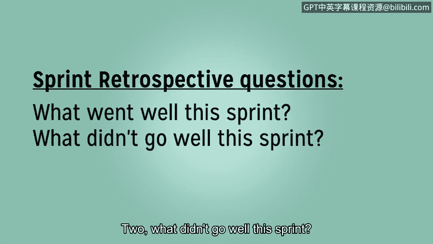

**软件产品管理课程5：5.4.3：Sprint回顾会议** 🧐

在本节中，我们将学习敏捷开发中的一个关键会议——Sprint回顾会议。我们将了解其目的、流程以及如何有效地进行，以确保团队能够持续改进其工作方式。

---

回顾会议既发生在迭代层面，也发生在项目层面。本节我们将重点审视Sprint回顾会议。

Sprint回顾会议应是一个Sprint中最后进行的活动。它通常在Sprint评审会议之后举行。Sprint评审会议用于向客户或产品负责人演示产品成果，而Sprint回顾会议则用于评估开发过程本身。

敏捷要求团队不仅要评审和调整产品，也要评审和调整流程。回顾会议提供了一个机会，来审视产品构建的效果如何，哪些做法有效，哪些地方可以改进。确保回顾会议的氛围安全、允许开放对话至关重要。参与者需要能够自由表达他们对本次Sprint的真实感受。如果团队不能诚实地指出问题所在，就无法产生有效的解决方案。

Sprint回顾会议的时间盒通常设定为一小时。然而，它不像其他Scrum事件那样严格。目标是保持会议简短高效，但如果出现重大问题，不应为了遵守预定时间而掩盖问题。

---

在引导团队进行Sprint回顾会议时，区分讨论焦点很重要。以下是回顾会议中可能出现的对话，我们来判断哪些是合适的：

A. 一名开发人员表示对产品的用户界面不满意。
B. 一名开发人员指出团队在上个Sprint中低估了任务量。
C. 你（引导者）强调了团队在上个Sprint中完成的出色工作。
D. 一名开发人员建议在下个Sprint中实施迭代燃尽图。
E. 产品负责人建议在下一个Sprint中实现某个功能。

回顾会议的重点应放在**过程**上，而非产品本身。因此，讨论产品功能（A和E）是不合适的。Sprint回顾会议是讨论开发过程中哪些做得好、哪些做得不好以及可以如何改进的绝佳场合。因此，讨论过程问题（B）、认可团队努力（C）和提出过程改进建议（D）都是正确的。

---

在Sprint回顾会议中，通常会提出三个核心问题：
1.  本次Sprint中，**哪些方面进行得很顺利？**
2.  本次Sprint中，**哪些方面进行得不顺利？**
3.  为了下一个Sprint，**我们可以改进什么？**

建议按照这个顺序提出问题。Scrum Master应以积极的基调开始会议，对团队已完成的工作表示赞赏和认可。这有助于营造开放的氛围。通常，批评不易被接受，因此Scrum Master应引导会议，确保与会者不感到被攻击。对话应开放、诚实且相互尊重。

会议应以建设性的方式结束。这能让会议圆满收尾，避免人们带着负面情绪离开。以讨论改进方面来结束会议，能给团队带来期待，并为下一个Sprint开个好头。如果某个Sprint未能按计划进行，这一点尤为重要，因为你不希望下一个Sprint受到前一个Sprint失败情绪的影响。

有时，我们需要回顾过去才能更好地前进。在下一课中，我们将通过审视项目层面的回顾会议来扩展对回顾会议的理解。

---

**本节总结**
本节课我们一起学习了Sprint回顾会议。我们明确了它是用于评估和改进**开发过程**的会议，应在Sprint结束时举行。会议的核心是围绕“哪些做得好”、“哪些需改进”和“下一步行动计划”三个问题展开开放、安全的讨论。记住，会议焦点是**过程**而非**产品**，目标是促进团队的持续学习和改进。