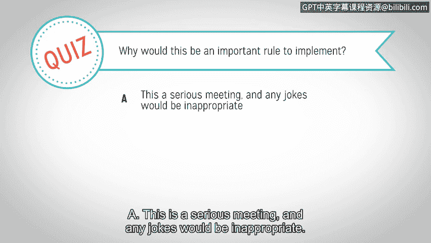

# 053：项目回顾会准备练习 🧩

在本节课中，我们将学习如何为项目回顾会做准备。我们将介绍一系列练习，旨在帮助团队建立信任、明确目标并创造一个安全的分享环境，从而确保回顾会富有成效。

---

## 准备阶段练习简介

首先，我们从准备阶段的练习开始。需要认识到，并非每个项目回顾会都需要执行所有练习。正如我们讨论的大多数事情一样，你需要考虑你的团队，并让会议适应你的团队。

以下是准备阶段的核心练习。

### 练习一：介绍练习

此练习发生在回顾会开始时，应持续约30分钟。这是确保每个人都已相互认识的好时机。如果你怀疑或知道团队成员之间或与你并不完全熟悉，现在就是进行一轮介绍的好机会。

你还应确立会议的大致时间表和议程。请记住，议程可能会根据会议的进展而改变。

一个开启介绍环节的好方法是让人们定义“智慧”一词。什么是明智？一个人如何变得明智？为什么一个75岁的老人会比一个16岁的男孩被认为更明智？这通过认识到智慧是从经验中学习获得的来开启对话，而这正是本次会议旨在达成的目标。

接下来，你应该确立并强调这不是一场指责游戏。这是介绍“凯斯首要准则”的好机会。**“无论我们发现什么，我们都必须理解并真正相信，每个人在当时已知信息、其技能和能力、可用资源以及当时情况下，都已经尽了最大努力。”**

**为什么完成准备阶段的练习很重要？**
A. 在团队中建立信任。
B. 让团队相信这次会议将产生积极成果。
C. 制定创造安全环境的基本规则。
D. 消磨时间以使会议持续整整三天。

准备阶段的练习旨在建立信任、为项目设定积极目标，并制定准则以维护团队的安全环境。它不是浪费时间的方式，因此正确答案是A、B和C。

---

## 练习二：定义成功练习

上一节我们介绍了如何开启会议，本节中我们来看看如何定义成功。此练习旨在定义团队认为的成功是什么，确定团队是否认为他们的项目是成功的，并找出他们本可以做些什么来使项目被视为成功。

在项目回顾会上，你的团队可能只记得项目后期为完成它而进行的挣扎和冲刺。他们会专注于出错的地方。退一步认识到团队的成功和成就是有益的。即使项目失败了，团队也有很多值得骄傲的地方。

回顾会的这一部分应持续30分钟到1小时。

通过询问团队“这个项目成功吗？”来开启小组讨论。记录回答。然后，你想向团队展示他们完成的一切。向他们展示他们在项目中付出的努力。最后，用以下成功定义来结束此练习：**一个成功的项目是每个人都说“我希望我们能以完全相同的方式再做一次”的项目。**

询问团队这个项目是否符合这个成功定义。如果不符合，团队本可以做些什么来使其符合？这个定义将突出项目中许多不成功的领域，并提出许多改进建议。

安全是在回顾会中需要确立的重要事项。如果团队觉得会有不良后果，他们将无法有效地分享所有需要分享的内容。

**有哪些方法可以在回顾会中建立安全感？**
A. 设定基本规则。
B. 团队如何认识会议目标。
C. 使练习成为可选项。
D. 逐步引入困难话题。

这些都是你可以在回顾会中建立安全感的方法，我们将在后续内容中介绍如何在你的会议中实施这些方法，为你的团队创造一个安全的环境。

---

## 练习三：建立安全感练习

现在，让我们继续讨论建立安全感的练习。此练习旨在确保团队中的每个人都感到足够安全，可以分享他们对项目的感受。如果团队彼此之间已经相当熟悉，或者对参与回顾会的实践已经很适应，那么你可以考虑跳过此练习。

你应该确立的第一点是，回顾会中的每个练习都是可选的。如果人们感到被迫参与，他们更可能说他们认为应该说的话，而不是他们真实的想法。

然后，你应该进行一次无记名投票，以确定团队感到的安全程度。让他们写一个1到5之间的数字，代表他们感到的安全程度。1表示他们感到不安全，不会分享真实感受。5表示他们感到足够安全，可以分享任何事情。如果每个团队成员都表示3或以上，那么你就可以安全地继续会议。

接着，你应该为回顾会制定一些基本规则。让团队创建能鼓励他们感到更安全的规则。如果团队没有自己提出，你应该添加这些规则：**1. 参与回顾会是可选的。2. 我们不会拿房间里的任何人开玩笑。3. 基本规则可以在任何休息后修改。**

你应该添加到团队创建的规则列表中的一条规则是“我们不会拿房间里的任何人开玩笑”。**为什么这是一条需要实施的重要规则？**
A. 这是一个严肃的会议，任何玩笑都是不合适的。
B. 有时很难分辨一个玩笑是出于好玩还是伤人。
C. 如果人们认为可能会成为被取笑的对象，这会阻碍他们分享。
D. 你想专注于取笑那些不在房间里的人。

有时很难识别一个玩笑的意图，或者它可能被误解。一个本意为好玩的玩笑可能被接收者理解为伤害。最安全的做法就是完全避免它们。这条规则也很重要，因为如果人们认为可能会成为被取笑的对象，他们可能会不愿意分享。因此，正确答案是B和C。

---

## 练习四：项目成果展示竞赛练习

本课我们将讨论的最后一个准备练习是项目成果展示竞赛练习。我在本课前面提到过项目成果。鼓励参与者带来他们能找到的与项目相关的任何及所有成果。

此练习应持续一到两小时。这将取决于团队人数和他们带来的成果数量。

首先让人们解释他们的成果。它为什么对他们或项目很重要？询问关于成果的问题，并鼓励其他人也这样做。

在所有成果都展示完毕后，是时候对成果进行投票了。首先确定最大的成果集合，然后让人们提名并投票选出最具创意或最不寻常的成果，以及最重要的成果。你应该为这些类别的获胜者准备小奖品。

成果帮助每个人看到他们在项目期间完成的一切。它帮助他们记住美好的时光和出色的工作。它也鼓励团队思考整个项目，而不仅仅是最后的冲刺阶段。

---

## 总结

本节课中我们一起学习了为项目回顾会做准备的四个关键练习：介绍练习、定义成功练习、建立安全感练习和项目成果展示竞赛练习。这些练习共同为富有成效的回顾会奠定了基础，帮助团队建立信任、聚焦成功、创造安全的分享环境，并全面回顾项目历程。