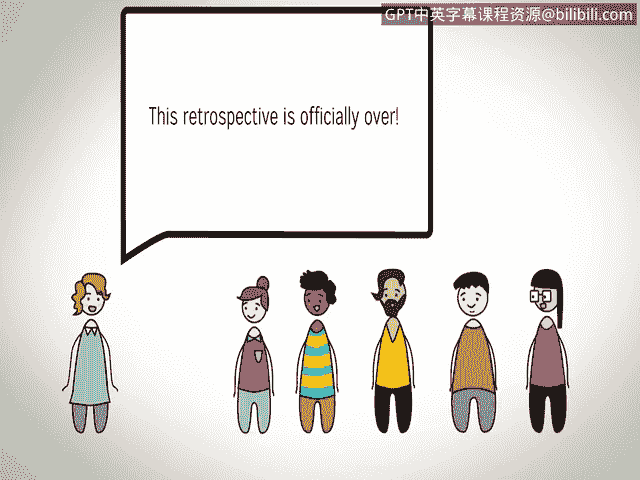

# 055：项目回顾练习——展望未来 🚀

在本节课程中，我们将学习项目回顾会议中“展望未来”环节的核心练习。我们将重点介绍两个关键活动：“创造奇迹”练习和“结束回顾”练习，它们旨在帮助团队坦诚讨论敏感话题，并以积极、富有建设性的方式结束会议。

上一节我们介绍了回顾会议中分析过去的练习，本节中我们来看看如何引导团队面向未来，识别改进机会并规划行动。

---

## 创造奇迹练习 🪄

此练习旨在引导团队讨论那些被回避的敏感话题。在回顾会议的这个后期阶段，团队通常已更愿意分享感受，并对项目有了更深入的集体理解。团队也开始意识到回顾即将结束，如果此时不提出敏感话题，可能就再也没有机会讨论了。作为引导者，你需要邀请大家进行这场艰难的对话，然后退后一步，让对话自然发生。奇迹往往就在这里发生，人们通常会开始分享他们一直回避的事情。

以下是启动此对话的几种方式：

*   **直接邀请**：你可以这样说：“这次回顾即将结束。现在是提出任何你希望讨论但尚未提及的事情的好时机。”
*   **暗示引导**：你可以提及在整个回顾中你察觉到的一些线索。
*   **开门见山**：如果以上方法无效，可以直接提出：“我们已经花了好几天时间讨论所有事情，除了一个非常重要的问题。”

让团队讨论这个问题或这些问题，并尝试提出解决方案。你只需观察其展开，并引导其走向正确的方向。

### 情景模拟与引导技巧

假设团队正在进行“创造奇迹”练习，讨论一个敏感话题。一位开发人员感到工作过度且被利用。讨论开始变得具有攻击性和伤害性。

你应该如何将讨论带回相互尊重的轨道？

A. 完全停止讨论。
B. 回顾之前共同制定的会议准则。
C. 让其继续，他们会自己解决。
D. 开始提问，询问某些行为如何让他们感受，或他们为何以某种方式行事。

**正确答案是 B 和 D**。让讨论继续下去很重要，但必须以尊重的方式进行。如果有人明显违反了既定准则，应提醒他们规则及其制定的原因。如果这不起作用，你可以通过提问来引导讨论，例如询问某些行为如何影响他人感受，或行为背后的原因。在大多数情况下，人们并非心怀恶意，而是存在一些误解。引导讨论去揭示这些误解是关键。

---

## 结束回顾练习 🎯

这个活动用于收尾回顾会议，并处理所有未竟事宜。它帮助团队以积极、充满希望的方式结束会议。

以下是进行此练习的步骤：

1.  给团队每位成员分发纸和笔。
2.  请他们写下希望在回顾会议结束后能看到实现的一个“希望”或“愿望”。
3.  告诉他们写下一些可以匿名与团队分享的内容。
4.  收集所有卡片并打乱顺序。
5.  给每人发一张卡片，让他们阅读。
6.  在小组内传递卡片，直到每个人都阅读了所有卡片。
7.  在每个人都阅读完所有卡片后，用一句积极的话语结束会议，例如：“我认为我们在过去几天取得了很大进展。我相信很多这些希望和愿望都会实现。现在，就看你们的了，去让它发生吧！”
8.  最后，正式宣布：“本次回顾会议到此结束。”

---

本节课中我们一起学习了项目回顾会议中“展望未来”阶段的两个核心练习。“创造奇迹”练习鼓励团队勇敢讨论敏感议题，而“结束回顾”练习则以收集匿名希望与愿望的方式，赋予团队行动的责任感与积极的结束氛围。这些练习能有效促进团队沟通，并为后续改进奠定基础。

如果你想了解更多关于回顾练习的细节，可以参考 Norman L. Kerth 的著作《Project Retrospectives: A Handbook for Team Reviews》。

至此，本课程（顶点项目前的最后一课）内容全部结束。期待在顶点项目中与你相见！😊