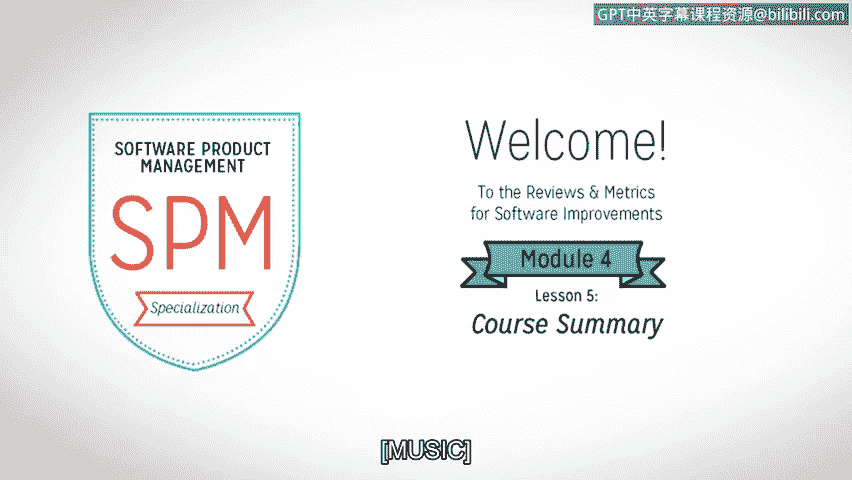

# 056：《软件改进的评审与度量》课程总结

在本节课中，我们将回顾整个课程的核心内容，总结如何通过评审与度量来改进软件产品、流程和项目管理。

---

## 模块一：确保构建正确的产品

在第一个模块中，Morgan探讨了如何确保你正在构建正确的产品。她描述了迭代评审会议、用户研究、产品成功标准，以及行业中用于创建成功且设计精良产品的流程示例。

## 模块二：确保以正确的方式构建产品

接下来，Bradley描述了如何确保开发人员以正确的方式完成流程，以实现高质量的产品。这涉及同行评审技术，例如：
*   **走查**
*   **技术评审**
*   **审查**

他还介绍了度量的目的、一个用于指导其使用的目标导向框架，以及一些良好和不良度量的例子。

## 模块三：确保项目得到正确管理

在第三个模块中，Bo详细说明了如何确保项目得到正确管理。她讨论了：
*   **每日站会**
*   **优先级排序**
*   **发布迭代**
*   用于监控进行中和已完成工作状态的**燃尽图**和**任务板**。

## 模块四：通过回顾进行改进

在这个最终模块中，Brad解释了两种回顾会议：
*   **迭代回顾**
*   **项目回顾**

两者都旨在承认问题、认可贡献，并总结经验教训以改进未来的工作。

---

## 课程核心总结

在本课程中，我们涵盖了许多方法来发现改进产品、流程和项目的途径，以实现 **“正确的产品”**、**“正确地完成”** 和 **“正确地管理”** 的目标。

由于这是专项课程的第五门课，下一门课是顶点课程。如果将整个专项课程的结构比作一个人体，那么顶点课程就相当于至关重要的头部，它建立在代表前面课程的双腿、躯干和手臂之上。顶点课程将汇集你目前所学的大部分知识。在那里，你将在一个模拟环境中应用敏捷方法论，与用户和利益相关者互动，定义产品的用户故事，对产品待办列表进行优先级排序，规划发布，获取反馈，处理变更，跟踪进度，应对风险等等。

期待在那里与你相见。