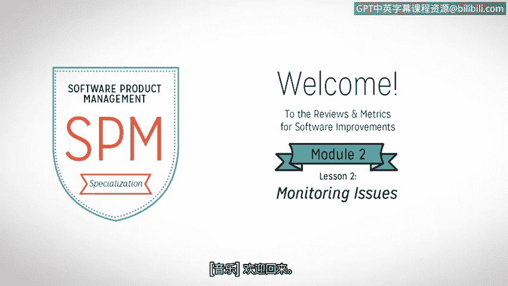
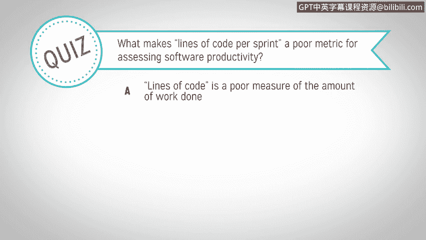

# 艾伯塔大学软件产品管理课程5：《软件改进的评审与度量》｜reviews-and-metrics-for-software-improvements｜ - P10：9_第5.2.2节 监控问题.zh - GPT中英字幕课程资源 - BV1j8411y7q1

Welcome back in the last lesson I showed you some different types of peer review techniques used in software development。

Let's take a step back and talk about some of the issues around monitoring projects。

Like why you should avoid some metrics and what makes some metrics bad for software projects？

You just saw that your monitoring could be manifested in peer reviews， like a code walkthrough。

 for example。Like the title of this course says， that's not the only way in which monitoring can be done。

There are a lot of metrics that can be used in software to track your progress。

 productivity and quality。Velocity is one of these metrics。

I' talked a little about how to estimate your velocity in the last course。

 and Morgan will dive more into calculating and tracking it in the next module。

There are actually a lot of metrics， and they all assess different parts of your project。However。

 on many software projects， these metrics aren't used at all。 Why is this？Well， most of the time。

 the issue is finding the time to properly compile these metrics。

Like I said in the lesson on anti patternstterns and the Agile Planning for softwareft projects course。

 the amount of time your developers have to actually code is limited。

This means that any time the developers spend doing non coding tasks， such as compiling metrics。

 takes away from the entire time that they have to work on the coding。

To maximize the amount of progress that the development team makes in creating the product。

 often the first things to skip are metrics。The team builds a solid product。

 delivers it to the client early and iteratively， and everyone's happy。 Everyone that is。

 except for those who want to take a step back and analyze the project quantitatively so that issues can be caught and fixed properly。

😊，Why wouldn't they want to do so？And for comparisons across projects。

 would it not make sense for more industry standard than measurement practices？

This issue isn't one that's easily solved， especially in an agile framework that focuses on fast and efficientsion development。

 it's easy to see why metrics will be put aside。In a paradigm where the success of a project depends on how much can get done right now。

 it can be hard to see the value of calculating metrics。

Perhaps one of the biggest issues with the metrics is that there is a significant lack of developer and manager knowledge on the matter。

There's quite a few examples out there and it can be hard to see what's really worth the time you decide to put towards them。

This， combined with the lack of industry standards， can really make the decision tough。

Some people say to track this， others say to track that。

Studies in this area tend to be inconclusive or not generalizable。

They might only work in certain settings or for certain organizations。Ultimately。

 each organization has to determine what works for their situation。

Can you see why there's so few industry standards？What is one of the main reasons I mentioned that metrics don't get used properly on software projects。

A， not enough money。B， too many metric to choose from。C， lack of developer or manager knowledge or D。

 lack of developer or manager interest。The answer is C， a lack of developer and manager knowledge。

Frequently， those assigned the task of managing software projects do not have substantial training in measuring quality；

 therefore， it's common that project metrics are either misused or not used at all。

A relatively common metric used in the industry is the metric of lines of code。

 also referred to as LOC。Basically， lines of code tracks the number of lines of code written for a piece of software and uses that number to generate some data。

This data could include the price per line of code。

 which is calculated by taking the cost of the entire project and dividing that over the number of lines of code written。

Another could be the number of lines of code written over some unit of time。

 a sort of technical velocity measurement。While it may seem to make sense to track lines of code as a gauge of productivity。

 this is not the case。For one， this metric is unreliable。

 the lines of code metric that you get on one part of your project may vary drastically from the metric you get on another part of the project。

 even within the same team。There are a few reasons for this。First of all。

 the number of lines of code a developer writes largely depends on the programming language they use。

For those of you that are familiar with various languages。

 you'll know that C is a very low levell language and requires significantly more explicitly written content to achieve the same high level functionality as a higher level programming language like Python。

So， using rough numbers， a Python program might be five times fewer lines of code than a C program used to achieve the same functionality。

There's no real comparison between measures of lines of code for different programs of different languages。

In fact， lines of code will barely show you the productivity within a product using the same language。

This is because different functions might have different complexities。If you don't account for this。

 you'll find yourself making comparisons where you really shouldn't。

This example shows the importance of knowing why you're measuring to begin with。

The measure of lines of code is an issue in its own right。

 but there's an interesting side effect that often comes with this measurement。

 Your developer's behavior changes。Whenever someone is given a score by which they can measure themselves。

 their natural inclination will be to maximize that score。Given this。

 can you think of another issue with the lines of code metric？

If developers are measured on the lines of code that they write。

 their natural tendency is likely going to be writing more lines of code more than if that metric wasn't compiled。

This unintended consequence may not be a bad thing at first。

 but if your developers are spending more time writing these lines of code。

 productivity could easily decrease。Knowing what you're measuring is important。

 it's not about collecting all the data you can and analyzing it。

 You have to be able to assess the tradeoff you're making between the value of the metrics that you're giving。

And the amount of time that it takes to tabulate them。

 along with other associated costs of these metrics。As sociologist， William Bruce Cameron puts it。

  not everything that can be counted counts and not everything that counts can be counted。

What makes lines of code per sprint a poor metric for assessing software productivity？

A lines of code is a poor measure of the amount of work done。

B， sprints are a poor measure for project length。C， code size cannot be measured in lines of code。

D lines of code per sprint is a good metric for assessing software productivity。

 or E lines of code are the same across functions for all languages。

The answer is a lines of code is a poor measure of project size。 As I said earlier。

 lines of code could change drastically between projects and doesn't truly reflect developer' effort。

There are issues with reviews and metrics that doesn't make them any less valuable。 In fact。

 there is a real need for more of them in the industry。

The fact that issues exist means that there's a great deal of room for more study。

To improve software products and processes， it's important to be smart and informed in any decision to implement them。

In the next lesson， I'm going to talk about a model that helps you to make those smart and informed decisions。

 the goal question metric model， see you there。