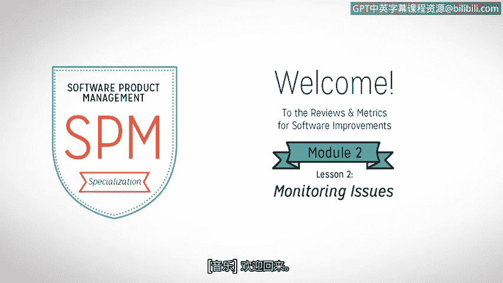
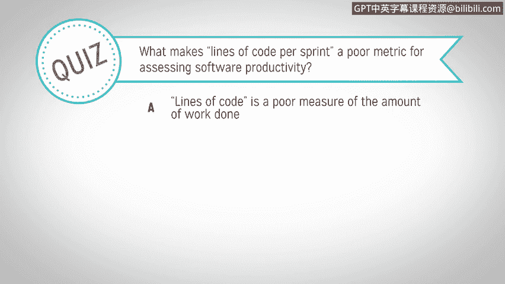

# 软件产品管理：5.2.2：监控问题 🔍

## 概述
在本节中，我们将探讨软件项目中监控环节的常见问题。我们将分析为何某些度量指标可能不适用于软件开发，以及如何避免使用不良指标。理解这些问题有助于我们更明智地选择和应用度量方法，从而有效提升软件产品的质量与开发效率。

---

上一节我们介绍了软件开发中使用的几种同行评审技术。现在，让我们退一步，讨论监控项目时可能遇到的一些问题。

例如，为何应避免使用某些度量指标？以及哪些指标对软件项目是有害的？

你刚刚看到，监控可以通过同行评审（如代码走查）来实现。但正如本课程标题所示，这并非监控的唯一方式。

软件中有许多度量指标可用于跟踪进度、生产力和质量。**速度（Velocity）** 就是其中之一。

我在上一门课程中简要介绍了如何估算速度，Morgan 将在下一个模块中深入讲解如何计算和跟踪它。

实际上存在很多度量指标，它们各自评估项目的不同方面。然而，在许多软件项目中，这些指标根本未被使用。这是为什么呢？

大多数时候，问题在于难以找到合适的时间来正确编制这些指标。

正如我在关于反模式以及软件项目敏捷规划的课程中所说，开发人员实际用于编码的时间是有限的。

这意味着开发人员花在任何非编码任务（例如编制指标）上的时间，都会占用他们用于编码的总时间。

为了最大化开发团队在产品创建上的进展，通常首先被省略的就是度量指标。团队构建了一个可靠的产品，早期并迭代地交付给客户，每个人都很满意。

然而，除了那些希望退一步定量分析项目、以便及时发现和妥善解决问题的人。

那么，他们为何不愿意这样做呢？为了进行跨项目比较，采用更行业标准的测量实践难道不合理吗？

这个问题并不容易解决，尤其是在一个专注于快速高效开发的敏捷框架中，很容易理解为何度量指标会被搁置一旁。在一个项目成功取决于当下能完成多少工作的范式中，很难看到计算指标的价值。

或许度量指标最大的问题之一是，开发人员和管理者在这方面知识显著缺乏。

外界有很多例子，很难判断哪些指标值得你投入时间去计算。

这一点，加上缺乏行业标准，确实让决策变得困难。有些人说要跟踪这个，另一些人说要跟踪那个。该领域的研究往往没有定论或无法推广。它们可能只适用于特定环境或特定组织。最终，每个组织都必须确定什么适合他们的情况。

你能明白为何行业标准如此之少吗？

以下是我提到的软件项目中度量指标未被正确使用的主要原因之一：
A. 资金不足。
B. 可选择的指标太多。
C. 缺乏开发人员或管理者的知识。
D. 缺乏开发人员或管理者的兴趣。

答案是 **C**，缺乏开发人员和管理者的知识。

通常，被指派管理软件项目的人员在衡量质量方面没有接受过实质性培训；因此，项目指标要么被误用，要么根本不被使用，这很常见。

行业中一个相对常见的指标是**代码行数（Lines of Code，简称 LOC）**。基本上，代码行数跟踪为一段软件编写的代码行数，并使用该数字生成一些数据。

这些数据可能包括：
*   **每行代码的成本**：通过将整个项目的成本除以编写的代码行数来计算。
*   **单位时间内编写的代码行数**：一种技术速度的测量。

虽然将代码行数作为生产力的衡量标准似乎有道理，但事实并非如此。

首先，这个指标不可靠。你在项目某一部分获得的代码行数指标，可能与另一部分获得的指标大相径庭，即使在同一团队内也是如此。

这有几个原因：
1.  开发人员编写的代码行数很大程度上取决于他们使用的编程语言。如果你熟悉各种语言，你会知道 C 是一种非常低级的语言，需要编写多得多的显式内容才能实现与 Python 这样的高级编程语言相同的高级功能。因此，粗略来说，实现相同功能，Python 程序的代码行数可能比 C 程序少五倍。对于不同语言的不同程序，代码行数的度量之间没有真正的可比性。
2.  事实上，即使使用同一种语言，代码行数也很难显示产品内部的生产力。这是因为不同的功能可能具有不同的复杂性。如果不考虑这一点，你可能会在不该比较的地方进行比较。

这个例子显示了了解为何要进行测量的重要性。

代码行数的度量本身就是一个问题，但伴随这种测量往往会产生一个有趣的副作用：**开发人员的行为会改变**。每当有人获得一个可以衡量自己的分数时，他们的自然倾向就是最大化这个分数。考虑到这一点，你能想到代码行数指标的另一个问题吗？

如果开发人员根据他们编写的代码行数来衡量，他们的自然倾向很可能会比不编制该指标时编写更多的代码行数。这种非预期的后果起初可能不是坏事，但如果你的开发人员花更多时间编写这些代码行，生产力很容易下降。

了解你在测量什么很重要。这不是关于收集所有你能收集的数据并进行分析。你必须能够评估你在所提供指标的价值与编制它们所需时间（以及这些指标的其他相关成本）之间所做的权衡。正如社会学家威廉·布鲁斯·卡梅伦所说：“**并非所有可计数的东西都重要，也并非所有重要的东西都可计数。**”

以下哪项使得“每个冲刺的代码行数”成为评估软件生产力的不良指标？
A. 代码行数是衡量已完成工作量的不良指标。
B. 冲刺是衡量项目长度的不良指标。
C. 代码大小无法用代码行数衡量。
D. 每个冲刺的代码行数是评估软件生产力的良好指标。
E. 所有语言中，不同功能的代码行数是相同的。

答案是 **A**，代码行数是衡量项目规模的不良指标。正如我之前所说，代码行数在不同项目之间可能差异巨大，并不能真正反映开发人员的努力。

评审和度量指标存在问题，但这并不会降低它们的价值。事实上，行业中确实需要更多的评审和度量。问题的存在意味着有很大的研究空间。为了改进软件产品和流程，在决定实施任何度量时，保持明智和知情非常重要。

---

## 总结
本节课我们一起学习了软件项目监控中度量指标的应用挑战。我们了解到，由于时间限制、知识缺乏以及指标本身的缺陷（如代码行数指标的不准确性和行为误导性），许多指标未被有效使用。关键在于理解测量目的，并明智地权衡指标价值与收集成本。在下一课中，我将介绍一个帮助你做出明智决策的模型——目标-问题-指标模型。